# Mapa completo do Intercert ERP — Relatório 2 (consolidação da auditoria)

**Data:** 13/10/2026 · **Base:** consolidação dos seis relatórios de área desta auditoria (`plataforma`, `cadastros-estoque`, `vendas-pdv`, `compras`, `financeiro`, `fiscal-relatorios-contabil`, versões `.json` e `.md`) · **Inventário estruturado:** `inventario.json` (mesma pasta) · **Repositório:** `/home/user/Intercerterp` (somente leitura).

**Regra de consolidação:** o que não está nas áreas não entra. Itens iguais (mesmo recurso/rota) em mais de uma área foram unidos; quando as classificações divergiram, prevaleceu a mais conservadora e a divergência está anotada (seção 2.3). As únicas verificações adicionais feitas na consolidação foram: contagem de tabelas em `schema.ts` (94), contagem de arquivos/testes (40 arquivos, 403 `it(`), inexistência de `playwright.config`/`*.spec.ts`, e existência atual das páginas `/administracao/certificacao` e `/contabil/certificados*`.

**Legenda de situação:** IF = Implementado e funcional · IP = Implementado parcialmente · DI = Dependente de integração externa · NI = Não implementado · ET = Estrutura técnica existente · AI = Apenas interface. **[fato]** = verificado em arquivo:linha, teste, captura ou varredura; **[inferência]** = conclusão derivada, marcada como tal nas áreas.

## 1. Visão de arquitetura (uma página)

**Produto.** ERP web multiempresa para comércio/varejo com um segundo tipo de empresa, o escritório contábil (`companies.kind = retail | accounting`), que recebe menu, perfis e parametrização próprios. Áreas funcionais: acesso e administração (empresas, filiais, usuários, perfis, terminais, parâmetros, histórico/auditoria, backups, integrações, notificações, ajuda/chamados), cadastros e estoque (produtos/SKUs, preços, importação, depósitos, movimentos, transferências, inventários, fornecedores), vendas (PDV em tela cheia, pagamento, vendas, devoluções/trocas, caixa, clientes), compras (pedidos, cotações, aprovações com alçadas, recebimento com XML, reposição), financeiro (contas a receber/pagar, fluxo de caixa, contas, conciliação bancária por arquivos, cartões, cadastros), fiscal (NF-e, NFC-e, NFS-e, configurações, relatórios fiscais, obrigações, pacote contábil), análise (painel, gerenciais, curva ABC, metas) e gestão contábil fase 0 + certificados digitais (carteira, vínculo por consentimento, entregas, equipe, solicitações de certificado).

**Stack [fato, plataforma].** Next.js 15.5 (App Router, Server Actions, `after()`), React 19, TypeScript strict, Tailwind 4, lucide-react, recharts; `node-appwrite` 20. Hospedagem Vercel (`vercel.json` com cron `47 8 * * *`) e Appwrite Cloud (TablesDB, Auth, Storage; região fra). Em desenvolvimento/testes, backend em memória com a mesma interface.

**Camada de dados (`src/lib/db`).** Interface `Store` (get/list/create/update/delete/increment com limites/transaction) com `AppwriteStore` e `MemoryStore` (modo `deferred` reproduz a semântica transacional do Appwrite: ≤ 100 operações por transação, índices únicos, incrementos com limite). Esquema único em `schema.ts` com **94 tabelas** (a área plataforma cita 92; as duas a mais são `certificate_requests` e `accounting_certificates`, da Tela 67). Provisionamento idempotente (`provision.ts`, só adiciona colunas/índices; sem migrações versionadas). `ReadCachedStore` (memória por requisição + 15 s para cadastros quase fixos), `ScopedStore` (isolamento por empresa em toda requisição e tarefa), `ReadOnlyStore` (leitura cruzada do escritório contábil) e `ctxForCompany` (administração explícita de outra empresa). Ids determinísticos (`detId`), chaves idempotentes (`_idem` nos formulários, `idemKey`/`dedupeKey` únicos), sequências por agregado (`balanceId+seq`, `accountId+seq`, `installmentId+seq`) e travas otimistas em `operations` sustentam idempotência e concorrência em todos os domínios.

**Sessão e permissões.** Cookies `ic_session` (httpOnly, sameSite=lax, secure em produção) e `ic_unit` (`empresa:filial|all`); `requireSession(módulo, op)` página a página e `requireApiSession` nas rotas `/api` (409 sem contexto completo); não há middleware. Permissões em `src/lib/permissions.ts`: 15 módulos × ver/criar/editar/excluir + 28 operações especiais, aplicadas no servidor (`runAction`, `requirePerm`, `requireAction`, `requireBranch`), negativas auditadas; perfil por empresa (`roleByCompany`), 6 perfis padrão de varejo e 4 de escritório, sincronização automática de operações novas dos modelos; administrador global ignora a matriz; contexto consolidado (todas as filiais) é somente consulta.

**Domínio (`src/domain`).** Um módulo por agregado (`users`, `companies`, `roles`, `products`, `pricing`, `stock`, `transfers`, `inventory`, `suppliers`, `carts`, `sales`, `cash`, `customers`, `purchases`, `quotations`, `approvals`, `receipts`, `replenishment`, `abc`, `reports`, `goals`, `finance`, `cashflow`, `reconciliation`, `bank/*`, `fiscal/*`, `payments/*`, `integrations`, `backup`, `support`, `notifications`, `accounting/*`), cálculos puros compartilhados entre navegador e servidor (`cart-calc`, `pricing-calc`, `purchase-calc`, `fiscal/calc`), auditoria transversal (`audit()` com before/after saneados, motivo, perfil no momento, `related[]`) e notificações por ocorrência (`notify`, dedupe, lida ≠ resolvida).

**Tarefas e rotinas.** Outbox durável em `jobs` (reivindicação única por tentativa em `operations`, recuo exponencial 15 s·2^n até 1 h, trava de 10 min, 8 tentativas, limite de 200 reagendamentos, tarefa morta → aviso) executada por `GET /api/jobs` (cron diário, `CRON_SECRET`) e pelo executor oportunista `after()` após cada ação (só tarefas). Onze rotinas diárias registradas (`admin.backup`, `admin.roles`, `finance.due`, `fiscal.obligations`, `fiscal.certificate`, `fiscal.accountingExport`, `fiscal.stuck`, `purchases.followup`, `stock.transfers_overdue`, `stock.inventories_stale`, `accounting.certificates`) rodam uma vez por empresa/dia apenas pelo cron.

**Integrações.** Credenciais só por nome de variável de ambiente (nunca o valor), estados medidos por teste real, provedor de simulação rotulado (fiscal e Pix), URL base fixa no código. Provedores: Focus NFe (NF-e/NFC-e/NFS-e), Mercado Pago (Pix), Resend/Appwrite Messaging (e-mail), BrasilAPI (CNPJ), conector local de periféricos/TEF (externo), arquivos bancários OFX/CSV/CNAB (leitores próprios), vínculo interno com escritório contábil. Nenhum provedor externo foi executado com credencial real.

**Interface (`src/app/(app)`, `src/components`).** 140 `page.tsx` (115 chamam `requireSession` diretamente; as demais ficam sob o layout autenticado), 12 `route.ts` em `src/app/api`, 13 áreas de exportação CSV em `src/exports`. Componentes de tela padronizados (PageHeader, Stat, FilterBar, StatusTabs, DataTable, LinkTabs, DefinitionList, Timeline, ActionForm, Dialog/Drawer), PWA instalável (manifesto, service worker só de estáticos, página offline), tema claro único.

**Verificação.** Suíte vitest com 403 testes em 40 arquivos (também executada no modo transacional do Appwrite); varredura de navegação com login real em 3 perfis (442 páginas, 0 erros, 06/10/2026, 1440×900); 62 capturas de evidência; `tsc --noEmit` sem erros. Não há suíte E2E persistida.

## 2. Resumo quantitativo

### 2.1 Por área (classificação original de cada relatório)

| Área | IF | IP | DI | NI | ET | AI | Total |
|---|---|---|---|---|---|---|---|
| Plataforma | 62 | 11 | 4 | 4 | 2 | 0 | 83 |
| Cadastros e estoque | 34 | 6 | 2 | 1 | 1 | 0 | 44 |
| Vendas, PDV, caixa e clientes | 34 | 6 | 5 | 4 | 0 | 0 | 49 |
| Compras | 39 | 4 | 2 | 6 | 0 | 0 | 51 |
| Financeiro | 48 | 2 | 2 | 6 | 0 | 0 | 58 |
| Fiscal, integrações, relatórios, gestão contábil e certificados | 41 | 6 | 8 | 6 | 2 | 0 | 63 |
| **Soma das áreas (antes da união)** | 258 | 35 | 23 | 27 | 5 | 0 | 348 |
| **Consolidado (após 16 uniões)** | **246** | **34** | **22** | **26** | **4** | **0** | **332** |

Nenhuma área encontrou tela "casca" (Apenas interface = 0): todas as telas chamam domínio com persistência. Os 4 itens "Estrutura técnica existente" são: fila da certificação (`/administracao/certificacao`, ver 2.3), depósitos adicionais (esquema sem tela), leitura/validação de XML de NF-e (parser sem tela fiscal) e `webhook_events` + API para terceiros (tabela sem rota).

### 2.2 Uniões realizadas

| Recurso mantido | Rota | Áreas | Nota |
|---|---|---|---|
| Central de integrações (estados medidos, pendências de tarefas, executar agora) | `/administracao/integracoes` | plataforma, fiscal-relatorios-contabil | Mesma rota /administracao/integracoes; classificações iguais (Implementado e funcional); itens unidos. |
| Detalhe da integração (configuração, credencial vinculada por nome de variável, teste de conexão, pendências,… | `/administracao/integracoes/[kind]` | plataforma, fiscal-relatorios-contabil | Conflito de classificação: plataforma = 'Dependente de integração externa' (sem credencial no servidor a integração nunca fica operacional); fiscal-relatorios-contabil = 'Implementado e funcional' (tela, domínio e testes). Mantida a mais conservadora (Depende… |
| Vínculo com o escritório contábil pelo lado da empresa (código de consentimento) e autorizações de certificado | `/administracao/integracoes/accounting` | plataforma, fiscal-relatorios-contabil | Mesma rota /administracao/integracoes/accounting; classificações iguais; itens unidos. |
| Fila da equipe de certificação digital (Tela 67 — lado da plataforma) | `/administracao/certificacao, /administracao/certificacao/[id]` | plataforma, fiscal-relatorios-contabil | Conflito de classificação: plataforma = 'Estrutura técnica existente' (na leitura de 13/10 não havia page.tsx em src/app/(app)/administracao/certificacao); fiscal-relatorios-contabil = 'Implementado parcialmente' (páginas criadas em 13/10, tsc ok, 11 testes d… |
| Download controlado de arquivos (XML, anexos, imagens, backups, certificado, pacote contábil, entregas ao esc… | `GET /api/files/[id]?inline=1` | plataforma, compras | Mesma rota /api/files/[id]; o item de compras é um uso específico (XML do recebimento); classificações iguais; unidos. |
| APIs do PDV (busca de produtos, clientes, vale-crédito, consulta de intenção Pix) | `GET /api/pdv/products, /api/pdv/customers, /api/pdv/vouchers, /api/pd…` | plataforma, vendas-pdv | Mesmas rotas /api/pdv/*; classificações iguais; itens unidos. |
| API pública/REST para terceiros (tokens de API) e recepção de webhooks de provedores | `(inexistente)` | plataforma, fiscal-relatorios-contabil | Mesmo fato (webhook_events sem rota/consumidor); classificações iguais (Estrutura técnica existente); itens unidos. |
| Detalhe do fornecedor em 8 abas (cadastro, produtos fornecidos, custos e prazos recentes, propostas, pedidos,… | `/fornecedores/[id]?tab=…` | cadastros-estoque, compras | Mesmas rotas /fornecedores e /fornecedores/[id]; o item de compras cobria só a integração (assertSupplierUsable, snapshot, vínculo produto × fornecedor); classificações iguais; unidos. |
| Desempenho do fornecedor medido (0–5): 60% pontualidade + 40% conformidade sobre recebimentos confirmados; cu… | `/fornecedores e /fornecedores/[id]?tab=custos` | cadastros-estoque, compras | Conflito de classificação: cadastros-estoque = 'Implementado e funcional' (fórmula implementada e exibida; sem teste dedicado); compras = 'Implementado parcialmente' (sem teste automatizado, sem nota manual nem histórico de avaliação). Mantida a mais conserva… |
| Planejamento de compras e reposição (Tela 46): parâmetros (filial, cobertura, histórico, fornecedor, categori… | `/compras/reposicao` | cadastros-estoque, compras | Mesma rota /compras/reposicao; classificações iguais; itens unidos. |
| Detalhamento da sugestão (visão 12): 9 indicadores, horizonte/lote/múltiplo, alertas de ruptura e entrega for… | `/compras/reposicao/[skuId]` | cadastros-estoque, compras | Mesma rota /compras/reposicao/[skuId]; classificações iguais; itens unidos. |
| Parâmetros de reposição e ABC por empresa/filial (cobertura, histórico, limites A/B) | `/administracao/parametros (área Administração)` | cadastros-estoque, compras | Mesma rota /administracao/parametros (parâmetros de reposição/compras/ABC); classificações iguais; itens unidos. O item genérico da tela de parâmetros (plataforma) permanece separado. |
| Produtos e curva ABC (Tela 45): período/filial/categoria, critério (receita líquida, quantidade, lucro bruto)… | `/relatorios/curva-abc` | cadastros-estoque, fiscal-relatorios-contabil | Mesma rota /relatorios/curva-abc; classificações iguais; itens unidos. |
| Composição do produto na curva: posição/participação/acumulado, vendas e devoluções do recorte (data do movim… | `/relatorios/curva-abc/produto/[skuId]` | cadastros-estoque, fiscal-relatorios-contabil | Mesma rota /relatorios/curva-abc/produto/[skuId]; classificações iguais; itens unidos. |
| TEF integrado (transação enviada ao pinpad pelo conector local POST /tef/transactions) | `/pdv/pagamento` | vendas-pdv, financeiro | Conflito de classificação: vendas-pdv = 'Não implementado' (nenhum código em src/app ou src/domain chama /tef/transactions; CardForm cai no registro manual); financeiro = 'Dependente de integração externa' (conector externo não incluído). Mantida a mais conse… |
| Sincronização bancária automática ('Sincronizar banco' / API bancária / Open Finance) | `/financeiro/conciliacao (botão do PDF; não existe na tela) · /adminis…` | financeiro, fiscal-relatorios-contabil | Mesmo recurso (API bancária/Open Finance) visto pela conciliação e pela Central de integrações; classificações iguais (Não implementado); itens unidos. |

### 2.3 Conflitos de classificação (mantida a mais conservadora)

- **Fila da equipe de certificação digital (Tela 67 — lado da plataforma)** (`/administracao/certificacao, /administracao/certificacao/[id]`) — plataforma: **Estrutura técnica existente** × fiscal-relatorios-contabil: **Implementado parcialmente** → mantida **Estrutura técnica existente**. Conflito de classificação: plataforma = 'Estrutura técnica existente' (na leitura de 13/10 não havia page.tsx em src/app/(app)/administracao/certificacao); fiscal-relatorios-contabil = 'Implementado parcialmente' (páginas criadas em 13/10, tsc ok, 11 testes de domínio, sem varredura/evidência). Mantida a classificação mais conservadora. Verificação na consolidação (13/10/2026): src/app/(app)/administracao/certificacao/page.tsx e [id]/page.tsx existem agora; a divergência entre as áreas é temporal (repositório alterado em paralelo). Permanece o fato de que as telas da Tela 67 não passaram por varredura, evidência visual nem publicação.
- **Detalhe da integração (configuração, credencial vinculada por nome de variável, teste de conexão, pendências, atividade)** (`/administracao/integracoes/[kind]`) — plataforma: **Dependente de integração externa** × fiscal-relatorios-contabil: **Implementado e funcional** → mantida **Dependente de integração externa**. Conflito de classificação: plataforma = 'Dependente de integração externa' (sem credencial no servidor a integração nunca fica operacional); fiscal-relatorios-contabil = 'Implementado e funcional' (tela, domínio e testes). Mantida a mais conservadora (Dependente de integração externa). A tela em si está implementada e testada; a dependência refere-se à operação real de cada provedor.
- **TEF integrado (transação enviada ao pinpad pelo conector local POST /tef/transactions)** (`/pdv/pagamento`) — vendas-pdv: **Não implementado** × financeiro: **Dependente de integração externa** → mantida **Não implementado**. Conflito de classificação: vendas-pdv = 'Não implementado' (nenhum código em src/app ou src/domain chama /tef/transactions; CardForm cai no registro manual); financeiro = 'Dependente de integração externa' (conector externo não incluído). Mantida a mais conservadora (Não implementado): mesmo com o conector instalado, o PDV não tem consumidor para a transação integrada.
- **Desempenho do fornecedor medido (0–5): 60% pontualidade + 40% conformidade sobre recebimentos confirmados; custos/prazo…** (`/fornecedores e /fornecedores/[id]?tab=custos`) — cadastros-estoque: **Implementado e funcional** × compras: **Implementado parcialmente** → mantida **Implementado parcialmente**. Conflito de classificação: cadastros-estoque = 'Implementado e funcional' (fórmula implementada e exibida; sem teste dedicado); compras = 'Implementado parcialmente' (sem teste automatizado, sem nota manual nem histórico de avaliação). Mantida a mais conservadora (Implementado parcialmente).

## 3. Tabela por módulo (recurso, rota, situação, evidência, o que falta)

Cada linha é um item de `inventario.json` (id INV-nnn). Evidência e "o que falta" estão resumidos; o texto integral, o domínio (arquivo:função), as tabelas e os testes de cada item estão no JSON.

### 3.1 Plataforma — 83 itens (IF 62, IP 11, DI 4, NI 4, ET 2)

#### Acesso e sessão

| Id | Recurso | Rota | Sit. | Evidência | O que falta |
|---|---|---|---|---|---|
| INV-001 | Login (usuário ou e-mail + senha, mostrar senha, manter conectado) | `/login` | IF | docs/evidencias/01-login.jpg; docs/matriz-cobertura.md linha 94; crawl-admin.json (login real); session.ts:37-47 (bloqueio 15 min após 5 falhas calculado sobre audit_logs); cookie ic_session httpOnly/sameSite=lax/secure… | Não há teste automatizado persistido para o bloqueio por 5 tentativas (a matriz cita verificação manual com Playwright). Não há 2FA nem política de senha além de 8 caracteres. |
| INV-002 | Bloqueio temporário após tentativas inválidas e registro de tentativas | `/login (regra)` | IP | session.ts:41-47 (chave por usuário ou texto normalizado; janela de 15 min; reinicia após sucesso). | Teste automatizado do bloqueio; tentativas de login com usuário inexistente são gravadas com companyId nulo e não aparecem em nenhuma tela de histórico (historico/queries.ts:42 filtra pela empresa ativa). |
| INV-003 | Seleção de empresa e filial (duas etapas, busca, consolidado, seleção automática) | `/selecionar-unidade (+ /api/unit)` | IF | docs/evidencias/02-selecionar-unidade.jpg (empresa DEMO, Matriz — Centro, Filial — Shopping Norte, Consolidado); crawl-admin.json /selecionar-unidade 200; crawl-contador.json redireciona para /contabil. | — |
| INV-004 | Troca de empresa/filial pelo cabeçalho (UnitSwitcher) e lembrança da última unidade | `cabeçalho de todas as telas` | IF | src/app/(app)/layout.tsx:30-35; docs/evidencias/03-dashboard.jpg (seletor 'Loja Demonstração Intercert · M…'). | — |
| INV-005 | Recuperação e redefinição de senha | `/recuperar-senha, /redefinir-senha` | DI | docs/pendencias-externas.md item 5; docs/integracoes.md linha 'Recuperação de senha'. | Envio real depende do SMTP do Appwrite (createRecovery) ou do canal de e-mail (Resend/Appwrite Messaging) no backend local. Sem canal, a tela orienta a pedir ao administrador; em desenvolvimento exibe o link. |
| INV-006 | Primeiro acesso por convite (token com hash e validade) | `/convite/[token]` | IF | docs/evidencias/36-usuarios.jpg (Paula Prado — Convite pendente); parâmetro users.inviteExpiryDays (parametros/catalog.ts:46). | O envio do e-mail depende do canal configurado (sem canal, o link é exibido ao administrador — comportamento intencional e auditado). |
| INV-007 | Chamado público de suporte sem sessão (tela de login) | `/suporte` | IF | public.ts:8-18; chamados públicos aparecem como 'P-<nº>' na lista de atendimento (ajuda/chamados/page.tsx:30-31). | Sem limite de requisições/captcha (qualquer visitante pode criar chamados ilimitados) [inferência de risco]. |
| INV-008 | Instalação inicial (provisionamento retomável do Appwrite, empresa + administrador ou demonstração) | `/primeiro-acesso (+ GET /api/setup/run?step=provision\|demo\|demo-update\|statu…` | IF | docs/matriz-cobertura.md 'Complementos além do PDF'; docs/pendencias-externas.md item 1 (83 tabelas provisionadas em 06/10/2026); README 'Instalação automatizada'. | — |
| INV-009 | Sessão do servidor (cookies, verificação, contexto por requisição) e logout | `transversal (src/lib/server/session.ts)` | IF | session.ts:29-77; cookie ic_unit (empresa:filial\|all) com maxAge 1 ano; status do usuário conferido a cada requisição (session.ts:38). | Não existe middleware; a proteção é feita página a página (requireSession) e por rota de API (requireApiSession). 115 de 140 page.tsx chamam requireSession diretamente; as demais ficam sob o layout (app)/layout.tsx:15 que também exige sessão. |
| INV-010 | Alteração da própria senha / perfil do usuário logado | `(inexistente)` | NI | grep por 'minha senha\|alterar senha\|changePassword\|meu perfil' em src/app/(app) e src/components/shell sem resultados. | Não há tela de perfil nem de troca da própria senha (menu do usuário só tem 'Trocar empresa/filial', 'Preferências de notificação' e 'Sair' — src/components/shell/user-menu.tsx:21-31). A senha só muda por recuperação por e-mail ou por redefinição do administrador (users.ts:adminSetPassword). |
| INV-011 | Autenticação em dois fatores e gestão de sessões ativas (encerrar outros dispositivos) | `(inexistente)` | NI | docs/referencia/telas/acesso.md Tela 01 'Não há indicação de … segundo fator'. | 2FA, listagem/encerramento de sessões, política de senha (complexidade/expiração), registro de user-agent nas sessões (campo existe em sessions mas não é preenchido — provider.ts:63). |
| INV-012 | Segurança de transporte e cabeçalhos (CSP, HSTS, X-Frame-Options), limites de requisição | `transversal (next.config.ts, rotas /api)` | IP | grep por rate-limit\|captcha\|csrf\|Content-Security-Policy em src: só files/[id]/route.ts. | Sem CSP/HSTS/X-Frame-Options globais; sem rate limit em /suporte, /recuperar-senha, /login (o bloqueio por tentativas é por usuário, não por IP); CSRF das server actions fica a cargo do framework [inferência]. Cookies httpOnly/sameSite=lax/secure estão corretos; downloads usam nosniff + CSP sandbox. |

#### Permissões e perfis

| Id | Recurso | Rota | Sit. | Evidência | O que falta |
|---|---|---|---|---|---|
| INV-013 | Matriz de permissões por módulo (ver/criar/editar/excluir) + 28 operações especiais aplicadas no servidor | `transversal (src/lib/permissions.ts, src/lib/core/ctx.ts, src/lib/server/action…` | IF | 15 módulos e 28 ações em permissions.ts:3-58; 6 perfis padrão de varejo e 4 de escritório; menu filtrado por can/canDo em (app)/layout.tsx:16. | — |
| INV-014 | Lista de usuários (indicadores, filtros, colunas configuráveis, exportação) | `/administracao/usuarios` | IF | docs/evidencias/36-usuarios.jpg (8 usuários, 5 indicadores, filtros Situação/Perfil/Filial/Acesso); crawl-admin.json 200; docs/matriz-cobertura.md linha 129. | Paginação em memória após carregar todos os usuários (queries.ts:12-16) — adequado a instalações pequenas [inferência de escala]. |
| INV-015 | Novo usuário (acesso direto por senha ou convite; empresas, filiais, perfil, limite de desconto) | `/administracao/usuarios/novo` | IF | users.ts:261-279 (rollback do registro se a credencial falhar); idempotência por idemKey. | — |
| INV-016 | Detalhe do usuário (resumo, permissões, atividades, histórico; suspender/inativar/reativar, reenviar/cancelar convite, redefinir senha) | `/administracao/usuarios/[id]` | IF | [id]/page.tsx abas resumo\|permissoes\|atividades\|historico (linhas 100-190); aviso 'Gestão parcial deste usuário'. | — |
| INV-017 | Edição do usuário (perfil por empresa, vínculos preservados fora do alcance do gestor, restrição de filiais) | `/administracao/usuarios/[id]/editar` | IF | docs/regras-assumidas.md §18 'Administração e acesso' e §19 'Administração… (rodada 3)'. | Restrição de filiais é uma lista única para todas as empresas do usuário (limitação documentada em docs/regras-assumidas.md §19). |
| INV-018 | Perfis e permissões (lista com cobertura e contagem de usuários) | `/administracao/usuarios/perfis` | IF | docs/evidencias/v09-perfil-permissoes.jpg; docs/matriz-cobertura.md visão 9. | — |
| INV-019 | Detalhe/edição do perfil (matriz, operações sensíveis, limite de desconto, motivo auditado; duplicar; excluir) | `/administracao/usuarios/perfis/[id]` | IF | docs/evidencias/v09-perfil-permissoes.jpg (matriz 13 módulos × 4 operações, 9 grupos de operações sensíveis, campo 'Motivo / contexto da alteração'). | — |
| INV-020 | Novo perfil | `/administracao/usuarios/perfis/novo` | IF | crawl-admin.json /administracao/usuarios/perfis/novo 200. | — |
| INV-021 | Perfil por empresa (roleByCompany) e sincronização de operações novas dos modelos padrão | `transversal` | IF | docs/evidencias/37-historico.jpg mostra eventos 'Perfil de sistema … recebeu operação(ões) nova(s) do modelo padrão' por 'Sistema'. | — |
| INV-022 | Autorização de supervisor no terminal (login + senha do aprovador para desconto acima do limite / sangria acima da política) | `transversal (PDV e caixa)` | IF | supervisor.ts:17-40; docs/matriz-cobertura.md linha 100 ('supervisor para desconto acima do limite'). | — |
| INV-023 | Página 'Acesso não permitido' | `/sem-permissao` | IF | crawl-analista.json. | — |

#### Multiempresa e filiais

| Id | Recurso | Rota | Sit. | Evidência | O que falta |
|---|---|---|---|---|---|
| INV-024 | Empresas e filiais (lista de unidades da empresa em uso + lista de empresas acessíveis) | `/administracao/empresas` | IF | docs/evidencias/38-empresas.jpg; docs/matriz-cobertura.md linha 131. | — |
| INV-025 | Nova empresa (tipo operacional ou escritório contábil, parametrização inicial) | `/administracao/empresas/nova` | IF | crawl-admin.json /administracao/empresas/nova 200. | O tipo (retail/accounting) não pode ser alterado depois (companies.ts:197-198) — decisão. |
| INV-026 | Detalhe da empresa (cadastro, filiais, usuários vinculados, histórico; inativar/reativar) | `/administracao/empresas/[id]` | IF | [id]/page.tsx abas cadastro\|filiais\|usuarios\|historico; não inativa a empresa em uso nem com caixas abertos (companies.ts:218-222). | — |
| INV-027 | Editar empresa | `/administracao/empresas/[id]/editar` | IF | crawl-admin.json 200; auditoria 'documentos já emitidos mantêm os dados da época'. | — |
| INV-028 | Nova filial (depósitos principal/avarias, conta caixa, tabela padrão) | `/administracao/empresas/[id]/filiais/nova` | IF | docs/matriz-cobertura.md linha 131 ('Playwright (nova filial com depósitos)' — verificação manual). | — |
| INV-029 | Detalhe/edição da filial (dados, operação, fiscal, editar, usuários, histórico; inativar/reativar) | `/administracao/empresas/filiais/[id]` | IF | filiais/[id]/page.tsx abas dados\|operacao\|fiscal\|editar\|usuarios\|historico; empresa precisa manter ao menos uma filial ativa (companies.ts:342-343). | Fuso da filial é somente leitura (único da instalação). |
| INV-030 | Isolamento de dados por empresa (ScopedStore), leitura somente-consulta de outra empresa (ReadOnlyStore) e contexto explícito multiempresa (ctxForCompany) | `transversal` | IF | docs/regras-assumidas.md §11; docs/validacao.md §4 (correção de isolamento após revisão adversarial). | — |
| INV-031 | Contexto consolidado (todas as filiais, somente consulta) e restrição por filial | `transversal` | IP | docs/regras-assumidas.md §11 e §19. | A restrição de filiais (branchIds) é uma lista única para todas as empresas do usuário — não há restrição por empresa (regras-assumidas §19). Consolidado só para quem acessa todas as filiais. |

#### Navegação e shell

| Id | Recurso | Rota | Sit. | Evidência | O que falta |
|---|---|---|---|---|---|
| INV-032 | Menu por tipo de empresa (varejo × escritório contábil) filtrado por permissão e ação especial | `transversal (src/components/shell/nav.ts)` | IP | find src/app -path '*certificacao*' sem resultados; docs/matriz-gestao-contabil.md C11 declara a tela como implementada (divergência documentação × código); docs/progresso.md 13/10 marca as telas da Tela 67 como pendent… | Item 'Certificação digital (equipe)' (nav.ts:89 e 141) aponta para /administracao/certificacao, rota sem page.tsx (nenhum arquivo em src/app/(app)/administracao/certificacao) — administradores globais e usuários com certification.operate veem um link que cai em 'Página ou registro não encontrado'. Links em contabil/ce… |
| INV-060 | Shell da aplicação (sidebar fixa 256 px com menu móvel, cabeçalho com seletor de unidade, busca global, sino, instalar app, menu do usuário, faixa de demonstração) | `src/app/(app)/layout.tsx` | IF | docs/evidencias/03-dashboard.jpg e 36-43 (shell idêntico em todas as telas). | — |
| INV-061 | Pesquisa global (Ctrl+K) por produtos, clientes, fornecedores, vendas, pedidos, títulos e documentos fiscais | `GET /api/search?q=` | IF | route.ts:8-87 (requireApiSession, 6 resultados por grupo, máx. 30). | Não pesquisa usuários, chamados, notificações nem artigos de ajuda; sem teste automatizado. |
| INV-064 | Retorno visual de navegação (barra de progresso global, tela 'Carregando…', pré-carga sob intenção, página não encontrado em português) | `transversal` | IF | docs/regras-assumidas.md §20. | — |
| INV-065 | Página 'configuração pendente' (publicação sem variáveis do Appwrite) | `/ (layout raiz)` | IF | deploy-config.ts:8-11; regras-assumidas §18 'Publicação'. | — |

#### Terminais do PDV

| Id | Recurso | Rota | Sit. | Evidência | O que falta |
|---|---|---|---|---|---|
| INV-033 | Lista de terminais (indicadores, filtros, caixa atual, último teste) | `/administracao/terminais` | IF | docs/evidencias/39-terminais.jpg (CX01/CX02, caixa nº 46 aberto, Navegador 80 mm). | — |
| INV-034 | Novo terminal / edição (filial, código, série NFC-e, impressora, papel, leitor, TEF, depósito, gaveta) | `/administracao/terminais/novo, /administracao/terminais/[id]?tab=editar` | IF | terminals.ts:132-135 (filial/série/depósito só mudam com caixa fechado). | — |
| INV-035 | Detalhe do terminal (identificação, pagamentos, periféricos e testes, sessões, histórico) | `/administracao/terminais/[id]` | IF | [id]/page.tsx abas identificacao\|pagamentos\|editar\|perifericos\|sessoes (linhas 96-227). | — |
| INV-036 | Página de teste de impressão (cupom 58/80 mm, régua, código de barras) | `/administracao/terminais/[id]/teste-impressao` | IF | docs/evidencias/37-historico.jpg mostra eventos 'Página de teste de impressão aberta… (impressão física não verificável)'. | Não há confirmação de impressão física (limitação do navegador, declarada na tela). |
| INV-037 | Conector local de periféricos (impressora/leitor HID/TEF) e impressão por comando | `(componente externo; contrato em docs/integracoes.md)` | DI | docs/integracoes.md 'Conector de periféricos — Situação nesta versão'; docs/pendencias-externas.md item 6. | O conector não faz parte do repositório; POST /print, /drawer/open, /tef/transactions descritos no contrato não têm consumidor no ERP (só GET /status é usado — connector-check.tsx:34). Sem conector: impressão pelo navegador, leitor como teclado, NSU manual. |

#### Auditoria e histórico

| Id | Recurso | Rota | Sit. | Evidência | O que falta |
|---|---|---|---|---|---|
| INV-038 | Histórico de atividades e auditoria (período, usuário, módulo, ação, objeto, filial, ações sensíveis, abas Todos/Concluídos/Bloqueados, exportação CSV) | `/administracao/historico` | IF | docs/evidencias/37-historico.jpg (704 eventos, 50 por página, selo 'Somente consulta', códigos AUD-…); docs/matriz-cobertura.md linha 130. | Carrega até 50.000 eventos do período em memória antes de filtrar/paginar (queries.ts:48) [inferência: risco de desempenho com volume]. Eventos com companyId nulo (login de usuário inexistente, sincronizações globais) não aparecem. |
| INV-039 | Detalhe do evento (antes/depois campo a campo, motivo, relacionados, mesma operação, abrir origem) | `/administracao/historico/[id]` | IF | historico/[id]/page.tsx:95-120 (tabela antes → depois com destaque vermelho/verde); valores sensíveis mascarados (audit.ts:4-17). | — |
| INV-040 | Registro de auditoria transversal (audit(), related, Timeline nos detalhes) | `transversal` | IP | docs/referencia/telas/administracao-suporte.md Tela 37 'preservar sua integridade'. | A auditoria nunca bloqueia a operação principal: falha ao gravar é apenas registrada no log do servidor (audit.ts:57-60) — não há garantia de trilha completa. Não há imutabilidade técnica (a tabela é gravável pelo Store; a interface não oferece edição/exclusão). Não há retenção/arquivamento do histórico. |

#### Central de integrações

| Id | Recurso | Rota | Sit. | Evidência | O que falta |
|---|---|---|---|---|---|
| INV-041 | Central de integrações (estados medidos, pendências de tarefas, executar agora) | `/administracao/integracoes` | IF | docs/evidencias/40-integracoes.jpg (7 cartões, 'Configurada sem teste', 'Simulação', 'Não configurada'); docs/matriz-cobertura.md linha 133. \| [fiscal-relatorios-contabil] matriz-cobertura.md linha 52 (Tela 40); docs/e… | Operação real de cada provedor depende de credencial (ver itens de outras áreas). |
| INV-042 | Detalhe da integração (configuração, credencial vinculada por nome de variável, teste de conexão, pendências, atividade) | `/administracao/integracoes/[kind]` | DI | docs/evidencias/v10-integracao-fiscal.jpg (visão 10). \| [fiscal-relatorios-contabil] matriz-cobertura.md continuação p. 57; crawl-admin.json /administracao/integracoes/{pix,card_tef,fiscal_nfe,fiscal_nfse,bank,accounti… | Sem credencial no servidor a integração nunca fica 'operacional'; provedor de simulação aparece como 'Simulação'. [conflito de classificação — ver 2.3] |
| INV-043 | Vínculo com o escritório contábil pelo lado da empresa (código de consentimento) e autorizações de certificado | `/administracao/integracoes/accounting` | IF | docs/matriz-gestao-contabil.md C08 e C12. \| [fiscal-relatorios-contabil] matriz-gestao-contabil.md C08; crawl-admin.json /administracao/integracoes/accounting (200) | — |

#### Backup e restauração

| Id | Recurso | Rota | Sit. | Evidência | O que falta |
|---|---|---|---|---|---|
| INV-044 | Lista de cópias (resumo, indicadores, histórico, programação e retenção) | `/administracao/backups` | IF | docs/evidencias/41-backups.jpg (BKP-0001, 4.156 registros, 411,4 KB, 'Verificada (restaurável)'); docs/validacao.md cenário 18 (1.264 registros/28 arquivos restaurados em nova base no Appwrite local). | — |
| INV-045 | Detalhe da cópia (resumo, conteúdo por tabela, verificação de integridade, restauração) | `/administracao/backups/[id]` | IF | backups/[id]/page.tsx abas resumo\|conteudo\|verificacao\|restauracao. | — |
| INV-046 | Download do artefato (partes concatenadas, checksum no cabeçalho) | `GET /administracao/backups/[id]/download` | IF | route.ts:11-14 (tentativa sem permissão auditada como backup.download.denied). | — |
| INV-047 | Cópia automática agendada (frequência, horário, retenção) e rotina diária | `/administracao/backups?tab=programacao (+ rotina admin.backup)` | IP | backup.ts:634-646; src/app/api/jobs/route.ts:18-19 (runScheduled seguido de runDueJobs); docs/pendencias-externas.md item 2. | O horário configurado (padrão 02:00) não é honrado no plano Vercel Hobby: a rotina só roda quando /api/jobs é acionado pelo cron diário (vercel.json: '47 8 * * *' = 05:47 em Brasília); ela enfileira a tarefa com runAt=02:00 do mesmo dia (já passado) e o executor a roda no mesmo instante — a cópia efetivamente ocorre n… |
| INV-048 | Restauração em nova base Appwrite (databaseId separado) | `/administracao/backups/[id]?tab=restauracao (target=appwrite_new)` | DI | docs/pendencias-externas.md itens 1 e 9. | No Appwrite Cloud gratuito só existe 1 banco → restauração em base paralela indisponível (docs/pendencias-externas.md itens 1 e 9). Restaurar sobre a base em uso não é oferecido (decisão: 'nunca sobrescreve a base em uso' — backup.ts:23); a troca de base é operação manual de infraestrutura (APPWRITE_DATABASE_ID) [infe… |

#### Parâmetros

| Id | Recurso | Rota | Sit. | Evidência | O que falta |
|---|---|---|---|---|---|
| INV-049 | Parâmetros por empresa e filial (14 parâmetros em 8 grupos, origem do valor, histórico de alterações) | `/administracao/parametros` | IF | crawl-admin.json /administracao/parametros 200; catalog.ts:26-52. | Parâmetros de 'Caixa' no catálogo cobrem só cash.withdrawalApprovalAbove; cash.requireJustificationAbove e cash.blindClose existem em DEFAULT_SETTINGS (settings.ts:34-36) mas não no catálogo editável [fato]; fuso horário único por instalação (somente leitura). |
| INV-083 | Fuso horário por empresa/filial | `/administracao/parametros (parâmetro 'Fuso horário' somente leitura)` | NI | docs/regras-assumidas.md §18 'Fuso horário único por instalação'. | Decisão registrada: fuso único por instalação (APP_TIMEZONE). Empresas em fusos diferentes na mesma instalação não são suportadas. |

#### Administração

| Id | Recurso | Rota | Sit. | Evidência | O que falta |
|---|---|---|---|---|---|
| INV-050 | Fila da equipe de certificação digital (Tela 67 — lado da plataforma) | `/administracao/certificacao, /administracao/certificacao/[id]` | ET | find src/app -path '*certificacao*' vazio em 13/10/2026; docs/progresso.md 'Tela 67 — [ ] Telas' pendente; docs/matriz-gestao-contabil.md C11 diverge (declara implementada). \| [fiscal-relatorios-contabil] matriz-gestao… | Não existe page.tsx para a rota; o item de menu (nav.ts:89/141), o botão em /contabil/certificados/[id] (page.tsx:147) e as notificações (certificates.ts:331) apontam para 404. Domínio, tabelas e 11 testes existem. \| [fiscal-relatorios-contabil] Telas criadas em 13/10/2026 e ainda sem varredura de navegação, evidênci… |

#### Notificações

| Id | Recurso | Rota | Sit. | Evidência | O que falta |
|---|---|---|---|---|---|
| INV-051 | Central de notificações (caixa de entrada por usuário, filtros, seleção em lote, detalhe com próxima ação, arquivadas) | `/notificacoes` | IF | docs/evidencias/42-notificacoes.jpg (44 não lidas, 41 pendências, 15 alta; painel de detalhe com 'Próxima ação' e aviso 'Ler o aviso não resolve a pendência'); docs/matriz-cobertura.md linha 135. | Lista carregada inteira (até 5.000) e filtrada em memória (notifications.ts:99-103); exportação CSV do recorte existe (link na tela). |
| INV-052 | Preferências por tipo (silenciar; crítica sempre entregue) | `/notificacoes?tab=preferencias` | IF | prefs-form.tsx; user-menu.tsx link 'Preferências de notificação'. | — |
| INV-053 | Indicador de não lidas no cabeçalho (sino) e geração de avisos pelas rotinas/eventos | `cabeçalho (todas as telas)` | IP | layout.tsx:19 (consulta com limit 1 e total); scheduler.ts:20-37; api/jobs/route.ts:18. | O contador só atualiza ao navegar (sem polling/tempo real); as rotinas diárias que geram avisos (vencidos, contas do dia, prazos) só rodam no cron diário (05:47 BRT) ou por `npm run jobs` — não rodam no executor em segundo plano após ações (background-jobs.ts chama só runDueJobs). |
| INV-054 | Canais externos de notificação (e-mail, push, WhatsApp/SMS) e tempo real | `(inexistente)` | NI | public/sw.js (sem listener push); grep 'push' inexistente no sw. | Notificações são apenas internas (tabela notifications). E-mails existem só para convites, recuperação, chamados, documentos e cobranças (src/lib/core/email.ts). Push do PWA não é usado pelo service worker (sw.js não trata 'push'). |

#### Ajuda e suporte

| Id | Recurso | Rota | Sit. | Evidência | O que falta |
|---|---|---|---|---|---|
| INV-055 | Ajuda (base de conhecimento com 22 artigos, busca, assunto, ajuda contextual por rota, meus chamados) | `/ajuda` | IF | docs/evidencias/43-ajuda.jpg (22 orientações em cartões por área; abas 'Base de ajuda' e 'Meus chamados (0)'); crawl-admin.json 22 rotas /ajuda/artigos/* 200. | Artigos definidos em código (companyId nulo), sem edição pela interface nem artigos por empresa (a tabela tem companyId mas não há tela). |
| INV-056 | Artigo de ajuda (Markdown simples, telas relacionadas, 'Não resolveu? Abrir chamado' com contexto) | `/ajuda/artigos/[slug]` | IF | crawl-admin.json (22 artigos); artigos/[slug]/page.tsx:34-35. | — |
| INV-057 | Chamados (lista: meus chamados ou atendimento com públicos, filtros, indicadores) | `/ajuda/chamados` | IF | chamados/page.tsx (colunas Nº, Assunto, Solicitante, Categoria, Prioridade, Responsável, Última movimentação, Situação). | Sem SLA/prazos, sem fila por categoria, sem métricas de atendimento. |
| INV-058 | Novo chamado (categoria, prioridade, assunto, mensagem, até 5 anexos ≤ 8 MB, contexto da tela/filial/navegador) | `/ajuda/chamados/novo` | IF | support.ts:46-47 (tipos e tamanho de anexo); idempotência por idemKey. | — |
| INV-059 | Detalhe do chamado (conversa, resposta, nota interna, situação/responsável/prioridade, e-mail ao solicitante) | `/ajuda/chamados/[id]` | IF | docs/evidencias/37-historico.jpg mostra 'Resposta do suporte no chamado nº 1 … e-mail não enviado (Canal de e-mail não configurado)'; docs/matriz-cobertura.md linha 136. | O e-mail ao solicitante depende do canal configurado (resultado real gravado em tickets.externalStatus). |

#### PWA

| Id | Recurso | Rota | Sit. | Evidência | O que falta |
|---|---|---|---|---|---|
| INV-062 | Aplicativo instalável (manifesto, ícones maskable/Apple, service worker, página offline, botão 'Instalar app', atalhos) | `/manifest.webmanifest, /sw.js, /offline.html` | IF | manifest.ts (display standalone, 4 atalhos, ícones 192/512 + maskable + SVG); sw.js (cache só de /_next/static e /icons; navegação → rede; offline → /offline.html; /api nunca interceptado). | Sem operação offline (decisão: páginas sempre pela rede; dados nunca em cache); sem push; o service worker só é registrado em produção (register-sw.tsx:9). |

#### Responsividade e acessibilidade

| Id | Recurso | Rota | Sit. | Evidência | O que falta |
|---|---|---|---|---|---|
| INV-063 | Layout responsivo (menu lateral vira gaveta < lg, busca global abaixo do cabeçalho < md, tabelas com rolagem horizontal, filtros em wrap, grades por breakpoint) | `transversal` | IP | classes lg:pl-64, lg:hidden, md:hidden, overflow-x-auto no código; viewport com viewportFit=cover (layout.tsx:20). | Sem evidências de telas administrativas em celular no repositório (só o PDV é citado em tablet); telas densas (matriz de permissões, histórico com 9 colunas, notificações mestre-detalhe) não têm variante móvel dedicada — dependem de rolagem horizontal [inferência a partir do código]. Acessibilidade: aria-labels, roles… |

#### Rotinas e tarefas

| Id | Recurso | Rota | Sit. | Evidência | O que falta |
|---|---|---|---|---|---|
| INV-066 | Executor de tarefas duráveis e rotinas pelo cron (GET /api/jobs com CRON_SECRET) | `/api/jobs` | IF | docs/integracoes.md 'Tarefas duráveis e rotinas'; docs/pendencias-externas.md item 2. | Frequência limitada a 1×/dia pelo plano Vercel Hobby (vercel.json '47 8 * * *'); maxDuration 300 s e lote de 50 tarefas por execução (route.ts:19) — instalações com muitas empresas/tarefas podem não esgotar a fila diária [inferência]. |
| INV-067 | Executor oportunista em segundo plano após cada ação de usuário (after(), 30 s mínimo por instância, 10 tarefas/20 s) | `transversal (src/lib/server/background-jobs.ts)` | IF | background-jobs.ts:19-26; desligável com BACKGROUND_JOBS=off. | Só processa tarefas (runDueJobs); não executa rotinas diárias (runScheduled) — avisos de vencidos/prazos e a agenda de backup dependem exclusivamente do cron. |
| INV-068 | Rotinas diárias registradas (admin.backup, admin.roles, finance.due, fiscal.obligations, fiscal.certificate, fiscal.accountingExport, fiscal.stuck, purchases.followup, s… | `src/domain/routines/*.ts` | IP | scheduler.ts:20-37; routines/index.ts. | Não há tela com a última execução/resultado de cada rotina por empresa (o marcador fica em settings sem interface); execução única por empresa/dia sem retentativa no mesmo dia se falhar (scheduler.ts:28-35 grava o marcador só em sucesso, mas a próxima tentativa é no cron seguinte). |
| INV-069 | Outbox de tarefas (enqueue por chave, reivindicação única por tentativa, recuo exponencial, trava de 10 min, tarefa morta → notificação, requeue manual, 'Executar tarefa… | `transversal + /administracao/integracoes?view=pendencias` | IF | jobs.ts:64-69 (backoff 15 s·2^n até 1 h; RETRY_AT_CAP 200); docs/validacao.md §4 'limite geral de reagendamento'. | — |

#### APIs

| Id | Recurso | Rota | Sit. | Evidência | O que falta |
|---|---|---|---|---|---|
| INV-070 | Instalação automatizada por etapas (provision, demo, demo-update, status, check-login, owner, finish) | `GET /api/setup/run` | IF | route.ts:16-24 (timingSafeEqual do SETUP_TOKEN); após finish responde 410 exceto provision e demo-update. | Senha do administrador geral devolvida em texto na resposta (step=owner, route.ts:105 e 128) — aceitável como uso único, mas fica em logs de acesso se chamada por URL com ?token= [inferência de risco]. check-login aceita a senha por query string. |
| INV-071 | Download controlado de arquivos (XML, anexos, imagens, backups, certificado, pacote contábil, entregas ao escritório) | `GET /api/files/[id]?inline=1` | IF | route.ts:41-48 (Content-Disposition attachment por padrão, inline só para imagem/PDF, nosniff, CSP sandbox, no-store). \| [compras] 29-recebimento.jpg (botão 'XML' no cabeçalho) | — |
| INV-072 | Exportação CSV do recorte filtrado (mesma consulta da tela, auditada, exige data.export) | `GET /api/export/[key]` | IF | route.ts:15 (can + canDo data.export); docs/regras-assumidas.md §11 (neutralização de fórmulas). | Só CSV (sem XLSX/PDF); exportação sem paginação (todo o recorte). |
| INV-073 | APIs do PDV (busca de produtos, clientes, vale-crédito, consulta de intenção Pix) | `GET /api/pdv/products, /api/pdv/customers, /api/pdv/vouchers, /api/pdv/intents/…` | IF | Todas exigem requireApiSession + can('pdv'); products exige filial (route.ts:19-20). \| [vendas-pdv] Uso comprovado pelas capturas 05 (busca) e 06 (cliente); 'Rotas /api exigem contexto completo (409)' em docs/regras-as… | [vendas-pdv] Sem testes automatizados das rotas; /api/pdv/customers faz uma consulta de 'última compra' por cliente retornado (até 12 consultas sequenciais por busca) |
| INV-074 | Download do certificado digital emitido (POST com confirmação de senha) | `POST /api/certificados/[id]` | IF | access.ts:37 bloqueia o download do .pfx pela rota genérica de arquivos. | — |
| INV-075 | API pública/REST para terceiros (tokens de API) e recepção de webhooks de provedores | `(inexistente)` | ET | src/app/api contém só as rotas internas listadas (12 route.ts). \| [fiscal-relatorios-contabil] src/lib/db/schema.ts:743 (única referência no código) | Não há rota de webhook (ex.: confirmação de Pix do Mercado Pago chega só por consulta/polling — /api/pdv/intents/[id]) nem API autenticada por token para integradores. grep 'webhook_events' em src/app: nenhum uso. \| [fiscal-relatorios-contabil] Nenhum serviço, rota /api/webhook ou tela grava/lê a tabela (grep em src/… |

#### Arquitetura e dados

| Id | Recurso | Rota | Sit. | Evidência | O que falta |
|---|---|---|---|---|---|
| INV-076 | Camada de dados (Store Appwrite/Memory com a mesma interface, esquema único de 92 tabelas, provisionamento idempotente, cache de leitura, serialização de tipos) | `src/lib/db/*` | IF | docs/arquitetura.md 'Camada de dados'; docs/validacao.md §1-2. | Appwrite Cloud testado só pela publicação (docs/validacao.md: Appwrite Cloud 'não executado' no ambiente de validação; docs/pendencias-externas.md item 1 confirma instalação em 06/10). Sem migrações versionadas (provisionamento só adiciona colunas/índices; não renomeia nem remove). |
| INV-077 | Idempotência e concorrência (ids determinísticos, _idem nos formulários, reivindicação por operação, retryOnConflict, sequência por agregado, transações) | `transversal` | IF | docs/arquitetura.md 'Consistência e concorrência'; docs/regras-assumidas.md §9. | — |
| INV-078 | Ambiente de demonstração (seed idempotente/retomável, empresa DEMO, usuários por setor, acesso rápido no login) | `npm run seed; /primeiro-acesso (modo demo); /api/setup/run?step=demo\|demo-upda…` | IF | login/page.tsx:51-53, 73; seed/base.ts:120-126 (7 usuários de varejo). | Risco operacional: SHOW_DEMO_LOGIN=1 mostra a senha de demonstração na página pública de login; docs/progresso.md indica acesso rápido ativo na publicação [inferência: variável ligada em produção] — README orienta removê-la em operação real. |

#### Testes

| Id | Recurso | Rota | Sit. | Evidência | O que falta |
|---|---|---|---|---|---|
| INV-079 | Suíte automatizada vitest (403 testes em 40 arquivos; modos imediato e deferred) | `tests/*.test.ts` | IF | contagem por grep '^\s*(it\|test)\(' em tests/*.test.ts em 13/10/2026 (403); docs/validacao.md registra 374 em 06/10 e docs/progresso.md 392 após a fase 0. | Sem teste do bloqueio por tentativas, da recuperação de senha, de /api/search, de /api/setup/run, do PWA e da responsividade; sem testes de componentes React; sem medição de cobertura de código (nenhum script de coverage em package.json). |
| INV-080 | Testes de navegador (Playwright): varredura de navegação e captura de evidências | `scripts/dev/crawl.mjs, scripts/dev/evidence.mjs, scripts/dev/shot.mjs` | IP | ls playwright.config.* → inexistente; package.json scripts.e2e. | Não há suíte E2E persistida: `npm run e2e` aponta para `playwright test`, mas não existe playwright.config nem pasta de specs; as validações 'Playwright' citadas na matriz (login, troca de filial, nova filial, PDV tablet) foram execuções manuais/scripts não versionados. A varredura só confere renderização (status, err… |

#### Desempenho

| Id | Recurso | Rota | Sit. | Evidência | O que falta |
|---|---|---|---|---|---|
| INV-081 | Otimizações de leitura e navegação (memória por requisição, cache de 15 s para cadastros quase fixos, prefetch sob intenção, gráficos sob demanda, STORE_TRACE) | `transversal` | IF | docs/regras-assumidas.md §20 (36-98 ms por consulta; 314 → ~190 consultas em 12 telas; painel 227 KB → 110 KB JS); crawl-admin.json: média 715 ms/página, mediana 700 ms, máximo 1.144 ms (/dashboard) com build de produçã… | Alterações de perfil/parâmetro/filial podem levar até 15 s para valer em outra instância (documentado em §20). Latência estrutural: banco e servidor na Europa (~200 ms de ida e volta do Brasil). |
| INV-082 | Estratégia de listagem (listAll + filtro/ordenação/paginação em memória) | `transversal (src/lib/list.ts:paginate)` | IP | list.ts:36-54; historico/queries.ts:39-68. | A paginação é feita no servidor após carregar o conjunto inteiro do recorte (até 50 páginas de 1.000 no histórico); com volume de auditoria de meses, o custo por requisição cresce linearmente [inferência]. Sem índices compostos para os filtros secundários (ação, usuário+período) — audit_logs tem só i_company_date e i_… |

### 3.2 Cadastros e estoque — 44 itens (IF 33, IP 7, DI 2, NI 1, ET 1)

#### Produtos e serviços

| Id | Recurso | Rota | Sit. | Evidência | O que falta |
|---|---|---|---|---|---|
| INV-084 | Lista de produtos (Tela 15): busca, 8 filtros, KPIs, saldo disponível por filial permitida, preço/custo, situação fiscal, exportação | `/produtos` | IF | docs/matriz-cobertura.md linha 27 (Tela 15, Implementada); docs/evidencias/15-produtos.jpg (17 registros, 5 KPIs, 2 colunas de disponível por filial, totais); crawl-admin: /produtos, /produtos?status=active → 200 sem er… | — |
| INV-085 | Cadastro de produto/serviço (Tela 16) em 5 abas salvas de uma vez: dados gerais com imagem, variações por eixos, custos e preço padrão/atacado, parâmetros e saldo inicia… | `/produtos/novo` | IF | docs/matriz-cobertura.md linha 28; crawl-admin: /produtos/novo → 200; product-form.tsx (ProductCreateForm) com barra de progresso por seção obrigatória (nome, preço, NCM) | — |
| INV-086 | Detalhe/edição do produto — aba Dados gerais (edição por seção com auditoria), status (ativar rascunho, inativar, reativar), exclusão só sem uso | `/produtos/[id]?tab=geral` | IF | docs/matriz-cobertura.md linha 28; docs/evidencias/16-produto.jpg (cabeçalho com selos Ativo/Serviço/No PDV/Fiscal: Configurado, 3 cartões, 4 abas); crawl-admin: 2 ids de /produtos/[id] → 200 | — |
| INV-087 | Imagem principal do produto (upload PNG/JPG/WEBP/GIF até 5 MB, remoção, exibição na lista e no detalhe) | `/produtos/[id]?tab=geral (painel Imagem) e /api/files/[id]?inline=1` | IF | src/app/(app)/produtos/[id]/panels.tsx:ImagePanel; lista usa ; nenhuma evidência JPG mostra produto com imagem (demo sem imagens) | Teste automatizado do upload/remoção; galeria com várias imagens (só uma principal) |
| INV-088 | Variações (SKUs) por eixos: geração de combinações, SKU/GTIN/códigos adicionais por variação, herança de custo e preços, simples→variado, remover (exclui sem uso / inati… | `/produtos/[id]?tab=variacoes` | IF | docs/matriz-cobertura.md linha 28 (variações por eixos); variants-editor.tsx (VariantsEditor/VariantsForm); evidência 15-produtos.jpg mostra “+4 • 5 variações” para Camiseta e “+3 • 4 variações” para Tênis | — |
| INV-089 | Custos e preços (visão complementar 2): custo de aquisição + custos adicionais nomeados, preços por tabela × SKU × filial × vigência, atacado por quantidade mínima, desc… | `/produtos/[id]?tab=precos` | IF | docs/matriz-cobertura.md linhas 28 e 67 (V2); docs/evidencias/v02-produto-precos.jpg (tabelas Custos por variação, Preços por tabela com Varejo padrão R$ 25,00 e Atacado R$ 21,25, histórico vazio) | — |
| INV-090 | Estoque do produto: saldos por filial/depósito (físico, reservado, disponível, trânsito, custo médio, valor), parâmetros (mínimo, máximo/alvo, segurança, múltiplo, local… | `/produtos/[id]?tab=estoque` | IF | docs/regras-assumidas.md §12 (saldo inicial é movimento `initial`); src/app/(app)/produtos/[id]/page.tsx (aba estoque, 14 colunas); crawl-admin: /produtos/[id] → 200 | — |
| INV-091 | Dados fiscais do produto (visão complementar 1): NCM, CEST, origem, grupo tributário, CFOP/CST-CSOSN próprios conforme regime; serviço com item LC 116, código municipal,… | `/produtos/[id]?tab=fiscal` | IF | docs/matriz-cobertura.md linha 66 (V1); docs/evidencias/v01-produto-fiscal.jpg (serviço: aviso ISS, 4 campos, cartão Serviço (NFS-e)); evidência 15 mostra “Revisar — CEST pendente” e “Incompleto — NCM pendente” | — |
| INV-092 | Histórico do produto (linha do tempo de auditoria do produto e dos SKUs) | `/produtos/[id]?tab=historico` | IF | src/app/(app)/produtos/[id]/page.tsx (tab historico, refs product:id e sku:id); docs/arquitetura.md (Timeline com eventos reais de audit_logs) | — |
| INV-093 | Unidades de medida e conversões por produto (ex.: 1 CX = 12 UN) | `/produtos/[id]?tab=geral (painel Unidades e conversões) e /produtos/cadastros?t…` | IF | src/domain/seed/modules/products.ts (conversão CX→UN da caneta na demonstração) | Conversões não são usadas automaticamente no PDV/compras (fator produto × fornecedor é campo próprio em supplier_products) — inferência pela ausência de chamadas a convertQty fora dos testes |
| INV-094 | Cadastros auxiliares: categorias hierárquicas, marcas, unidades, tabelas de preço (uma padrão ativa), grupos tributários (CFOP por operação, CST/CSOSN, ICMS/FCP/PIS/COFI… | `/produtos/cadastros?tab=categorias\|marcas\|unidades\|tabelas\|grupos` | IF | docs/matriz-cobertura.md linha 129 (tela adicional); crawl-admin: /produtos/cadastros e ?tab=categorias → 200; sem evidência JPG (não é tela do PDF) | — |
| INV-095 | Importação de produtos por CSV: análise de cabeçalhos, mapeamento sugerido, política (só criar / só atualizar / criar e atualizar) por SKU ou código, prévia linha a linh… | `/produtos/importar e /produtos/importar/[id]` | IF | docs/matriz-cobertura.md linhas 27 e 129; import-wizard.tsx (3 etapas + modelo CSV para download); crawl-admin: /produtos/importar → 200 | Limitações: só CSV (sem XLSX), até 1.000 linhas, sem variações por eixos (1 SKU por linha), sem imagens, sem parâmetros de estoque (mínimo etc.), preço só na tabela padrão/geral; saldo inicial só para itens novos |
| INV-096 | Exportação CSV de produtos (mesma consulta da tela, só filiais permitidas; exige operação “Exportar dados”) | `/api/export/products (botão Exportar em /produtos)` | IF | src/app/(app)/produtos/page.tsx (canDo(data.export)); evidência 15-produtos.jpg botão “Exportar” no cabeçalho e na tabela | — |
| INV-097 | “Disponível para loja virtual” (availableEcommerce) | `/produtos (filtro/coluna oculta) e /produtos/[id] (selo “Loja virtual”)` | IP | product-form.tsx: checkbox “Disponível para loja virtual (atributo de integração)”; queries.ts filtro ecommerce=1 | Nenhuma integração com loja virtual/marketplace: o atributo é gravado, filtrado e exibido, mas não há conector, API de catálogo nem sincronização de preço/estoque (rótulo do formulário já diz “atributo de integração”) |
| INV-098 | Limites/alçada para alteração de preço (comentário do PDF p. 22: “vigência e limites para alterações de preço”) | `—` | NI | docs/referencia/telas/produtos-estoque.md (Tela 16 p. 22, ponto de atenção: “Definir cálculo de margem, vigência e limites para alterações de preço”) — vigência e margem implementadas; limites não | Regra de limite percentual de reajuste, aprovação de alteração de preço ou bloqueio por faixa; reajuste em massa por percentual/tabela |
| INV-099 | Busca global e busca do PDV reutilizam o catálogo (searchText por nome, código, GTIN, SKU, códigos adicionais, marca, categoria) | `/api/pdv/products (área Vendas) e cabeçalho Ctrl+K` | IF | docs/matriz-cobertura.md linha 17 (Tela 05, /api/pdv/products); evidência 15: placeholder “Produto, código, SKU, GTIN ou NCM” | — |

#### Estoque

| Id | Recurso | Rota | Sit. | Evidência | O que falta |
|---|---|---|---|---|---|
| INV-100 | Saldos de estoque por SKU × depósito (físico, reservado, disponível, trânsito, mínimo/alvo/segurança, custo médio, valor, último movimento) com filtros por filial permit… | `/estoque` | IF | crawl-admin: /estoque e /estoque?filial=…&situacao=below_min → 200; nav.ts item “Saldos de estoque” (tela adicional ao PDF); evidência 17-movimentos.jpg mostra botão “Saldos” | — |
| INV-101 | Movimentação de estoque (Tela 17): entrada/saída/ajuste/perda avulsos com motivo obrigatório e permissão `stock.adjust`, custo unitário em entradas (recalcula custo médi… | `/estoque/movimentos` | IF | docs/matriz-cobertura.md linha 29; docs/evidencias/17-movimentos.jpg (formulário de 2 colunas com 5 botões de tipo, resumo de saldo, 4 KPIs, 86 registros em 2 páginas com selos coloridos por tipo e quantidade +/−); craw… | — |
| INV-102 | Rastreabilidade por lote e validade nos movimentos | `/estoque/movimentos (campos Lote e Validade em entradas)` | IP | src/domain/stock.ts (interface MovementInput); movement-form.tsx mostra Lote e Validade apenas para entradas | Saldo por lote, FEFO/FIFO por lote, consulta de saldo por lote, alerta de vencimento, lote nas vendas/transferências/inventário — só a entrada manual grava o lote como texto |
| INV-103 | Transferências entre filiais — lista com KPIs (em trânsito, a receber nesta filial, aguardando envio, com divergência), filtros e exportação | `/estoque/transferencias` | IF | docs/matriz-cobertura.md linha 30; crawl-admin: /estoque/transferencias e ?status=in_transit,partial&filial=all → 200 | — |
| INV-104 | Nova transferência / editar rascunho (Tela 18): origem = filial atual, destino e depósitos, itens via pesquisa com disponível e saldo após, responsável, previsão, docume… | `/estoque/transferencias/novo e /estoque/transferencias/[id]/editar` | IF | docs/matriz-cobertura.md linha 30; crawl-admin: /estoque/transferencias/novo → 200; transfer-form.tsx reproduz a faixa origem → destino, tabela de itens e resumo lateral do protótipo | — |
| INV-105 | Detalhe da transferência: separar (reserva), expedir (saída + trânsito), expedição incompleta, receber parcial/total com avaria, falta → retorno à origem ou perda, cance… | `/estoque/transferencias/[id]` | IF | docs/matriz-cobertura.md linha 30; docs/evidencias/18-transferencia.jpg (TR-00001 Em trânsito: 4 etapas, 4 KPIs, itens com Qtd/Expedido/Recebido/Avariado/Devolvido/Perdido, formulário de pendente, cartões laterais); cra… | — |
| INV-106 | NF-e de transferência (CFOP 5152/6152) emitida a partir da transferência e listagem dos documentos fiscais vinculados | `/estoque/transferencias/[id] → /fiscal/nfe/nova?origem=transfer:[id]` | DI | docs/matriz-cobertura.md linha 30 (“operação real depende de credencial externa”); evidência 18: cartão “Documento fiscal de transferência” com botão “Emitir NF-e de transferência” e campo de referência | Autorização real exige token Focus NFe e certificado A1 (docs/pendencias-externas.md item 3); sem credencial, documento fica pendente de configuração ou em simulação rotulada na demo |
| INV-107 | Impressão de romaneio da transferência | `/estoque/transferencias/[id]?print=1` | IP | transferencias/page.tsx ação “Imprimir romaneio” (ícone impressora) → ?print=1 dispara window.print() | Modelo de impressão próprio (romaneio/etiqueta de volume, assinatura de conferência); hoje imprime a própria página com classes no-print |
| INV-108 | Alerta de transferência atrasada (previsão vencida ou expedida há mais de 3 dias) — rotina diária com notificação deduplicada e resolução no recebimento/cancelamento | `/notificacoes (origem) → /estoque/transferencias/[id]` | IF | src/domain/routines/stock.ts | — |
| INV-109 | Inventários — lista com KPIs, filtros e abertura (depósito da filial, responsável, escopo: todos / categoria com subcategorias / localização por prefixo; aviso de depósi… | `/estoque/inventarios` | IF | docs/matriz-cobertura.md linha 31; crawl-admin: /estoque/inventarios e ?status=preparing,open,counting → 200; evidência 19 (botão “Inventários anteriores”) | — |
| INV-110 | Inventário e contagem (Tela 19): base temporal por sequência de movimentos, contagem/recontagem, observação por item, incluir item fora do escopo, filtros (situação, set… | `/estoque/inventarios/[id]` | IF | docs/matriz-cobertura.md linha 31; docs/evidencias/19-inventario.jpg (INV-2026-001 Em contagem, 4 KPIs, tabela com Saldo base/Saldo sistema/Contagem/Divergência/Impacto/Status, legenda, cartão “Método da contagem”); cra… | — |
| INV-111 | Alerta de inventário aberto há mais de 7 dias — rotina diária | `/notificacoes → /estoque/inventarios/[id]` | IF | src/domain/routines/stock.ts | — |
| INV-112 | Reservas de estoque (reduzem o disponível, não o físico; serializadas com os movimentos) | `/estoque (coluna Reservado) e /estoque/transferencias/[id] (Separar)` | IP | grep “reserve(” em src/domain → só transfers.ts; src/app/(app)/estoque/page.tsx hint “Transferências separadas e pré-vendas” | Reserva por venda/pré-venda, orçamento ou pedido de venda: `reserve()` tem um único chamador (transfers.ts:224); o texto “pré-vendas” no cartão Reservado de /estoque não corresponde a nenhuma reserva de PDV |
| INV-113 | Depósitos (múltiplos por filial, tipos disponível/avarias, localização por saldo) | `/administracao/empresas/filiais/[id] (lista e depósito padrão — área Administra…` | ET | grep create("warehouses") → apenas companies.ts e stock.ts:damageWarehouse (+ seed); administracao/empresas/filiais/[id]/page.tsx lista depósitos sem ação de criar | Tela para criar/editar/inativar depósitos adicionais (CD, loja, consignação): o esquema e as consultas suportam N depósitos por filial, mas só os dois automáticos existem; a filial apenas escolhe o padrão entre os existentes |
| INV-114 | Notificação de estoque mínimo após venda (disponível ≤ mínimo por SKU/filial) com link para a reposição; “Estoque crítico” no painel com o mesmo critério | `/notificacoes → /compras/reposicao?sku=…; /dashboard` | IF | src/domain/sales.ts linhas ~674–697; evidência 46 traz aviso “Aberto a partir de um alerta de estoque mínimo” quando ?sku= é informado | Teste automatizado dedicado; o critério documentado (< mínimo) difere do código (≤ mínimo) — inferência de divergência textual |

#### Fornecedores

| Id | Recurso | Rota | Sit. | Evidência | O que falta |
|---|---|---|---|---|---|
| INV-115 | Lista de fornecedores (Tela 26): KPIs (recorte, compras no mês, prazo médio negociado × mês anterior, saldo a pagar), busca por razão social/CNPJ/produto/contato, filtro… | `/fornecedores` | IF | docs/matriz-cobertura.md linha 38; docs/evidencias/26-fornecedores.jpg (4 KPIs, 5 filtros, 5 linhas com avatar de iniciais, desempenho ★5,0/“sem dados”, totais, nota de rodapé da fórmula); crawl-admin: /fornecedores e ?… | — |
| INV-116 | Cadastro/edição de fornecedor: PF/PJ com CPF/CNPJ válido e único por empresa, código automático, IE/IM, categoria, condições comerciais (condição de pagamento, prazo, pe… | `/fornecedores/novo e /fornecedores/[id]/editar` | IF | docs/matriz-cobertura.md linha 38; crawl-admin: /fornecedores/novo e 2× /fornecedores/[id]/editar → 200; supplier-form.tsx (4 seções + rodapé fixo com “Salvar rascunho”/“Salvar fornecedor”) | — |
| INV-117 | Consulta de CNPJ (preenche razão social, fantasia, e-mail, telefone, endereço e situação cadastral) | `/fornecedores/novo (botão lupa ao lado do CNPJ)` | DI | docs/matriz-cobertura.md linha 38 (BrasilAPI (CNPJ)); docs/integracoes.md linha 19 | Verificação em ambiente com acesso à internet; serviço público sem credencial (BrasilAPI) — funciona quando há rede |
| INV-118 | Detalhe do fornecedor em 8 abas (cadastro, produtos fornecidos, custos e prazos recentes, propostas, pedidos, recebimentos, títulos, histórico), KPIs, bloquear com motiv… | `/fornecedores/[id]?tab=…` | IF | crawl-admin: 2× /fornecedores/[id] → 200; docs/regras-assumidas.md §18 (fornecedor: id independente do CNPJ; reposição e cotação ignoram bloqueados/inativos/rascunho) \| [compras] matriz linha 38 (Tela 26); /fornecedore… | [compras] Detalhes do cadastro (Tela 26) pertencem à auditoria de cadastros; aqui só a integração. |
| INV-119 | Produtos fornecidos (vínculo produto × fornecedor): código do fornecedor (usado no XML), descrição, conversão, último custo/última compra, prazo, lote mínimo, múltiplo,… | `/fornecedores/[id]?tab=produtos` | IF | docs/matriz-cobertura.md linha 38 (“Produtos fornecidos com lote/múltiplo”); supplier-products.tsx (tabela + diálogo com SkuPicker); evidência 26 mostra “N produto(s)” por fornecedor | — |
| INV-120 | Desempenho do fornecedor medido (0–5): 60% pontualidade + 40% conformidade sobre recebimentos confirmados; custos/prazos reais por item | `/fornecedores e /fornecedores/[id]?tab=custos` | IP | docs/evidencias/26-fornecedores.jpg (Têxtil Paulista ★5,0; demais “sem dados”) \| [compras] docs/regras-assumidas.md §14 ('Desempenho do fornecedor = 60% pontualidade + 40% conformidade (medido, sem nota manual)'); orde… | Teste automatizado da fórmula \| [compras] Sem teste automatizado; sem nota manual nem histórico de avaliação. [conflito de classificação — ver 2.3] |
| INV-121 | Situação “Docs. pendentes” e documentação do fornecedor | `/fornecedores (filtro Situação) e /fornecedores/[id]` | IP | docs/referencia/telas/compras.md (Tela 26: “Fornecedor com documentação incompleta recebe status ‘Docs. pendentes’”); badge.tsx supplier.draft = “Docs. pendentes” | “Docs. pendentes” equivale apenas a rascunho sem CPF/CNPJ; não há checklist/anexos de documentos (contrato, certidões, dados bancários) nem vencimento de documentos |
| INV-122 | “Última compra” referenciada por CT-e/NFS-e (fretes e serviços) como no protótipo | `/fornecedores (coluna Última compra)` | IP | docs/referencia/telas/compras.md (Tela 26: CT-e 000849, NFS-e 009184 como última compra); evidência 26: só Têxtil Paulista (NF-e 4711) tem última compra | Só recebimentos de mercadorias (NF-e) alimentam “Última compra”, “Total comprado” e desempenho; compras de serviços/fretes (CT-e, NFS-e de entrada) não existem no sistema, então fornecedores de Logística/Serviços/Tecnologia ficam sem histórico de compra |

#### Reposição / Curva ABC

| Id | Recurso | Rota | Sit. | Evidência | O que falta |
|---|---|---|---|---|---|
| INV-123 | Planejamento de compras e reposição (Tela 46): parâmetros (filial, cobertura, histórico, fornecedor, categoria, exibir, produto), KPIs, tabela com seleção persistente (s… | `/compras/reposicao` | IF | docs/matriz-cobertura.md linha 58; docs/evidencias/46-reposicao.jpg (12 itens a repor de 23, R$ 2.126,30, 11 em risco, 1 completar dados; tabela de 14 linhas com checkbox, selo de situação, input Comprar, select de forn… | — |
| INV-124 | Detalhamento da sugestão (visão 12): 9 indicadores, horizonte/lote/múltiplo, alertas de ruptura e entrega fora do horizonte, pedidos em aberto (considerado / após o hori… | `/compras/reposicao/[skuId]` | IF | docs/matriz-cobertura.md linha 77 (V12); docs/evidencias/v12-reposicao-detalhe.jpg (Calça Jeans Slim 38: grade 3×3, faixa azul do horizonte, alerta de ruptura, cálculo em 7 passos, parâmetros da simulação, “Criar rascun… | — |
| INV-125 | Parâmetros de reposição e ABC por empresa/filial (cobertura, histórico, limites A/B) | `/administracao/parametros (área Administração)` | IF | catalog.ts linhas 31–35 \| [compras] settings.ts padrões; a tela de reposição permite sobrepor cobertura/histórico por consulta (query string) | — |
| INV-126 | Produtos e curva ABC (Tela 45): período/filial/categoria, critério (receita líquida, quantidade, lucro bruto), limites A/B por recorte, classe pelo acumulado anterior, b… | `/relatorios/curva-abc` | IF | docs/matriz-cobertura.md linha 57; docs/evidencias/45-curva-abc.jpg (R$ 776,80; 9 na curva A6/B2/C1; 16 sem classe; gráfico de barras por classe + linha acumulada com referências A 80%/B 95%; tabela de 25 linhas com chi… | — |
| INV-127 | Composição do produto na curva: posição/participação/acumulado, vendas e devoluções do recorte (data do movimento, venda anterior ao período sinalizada), composição rece… | `/relatorios/curva-abc/produto/[skuId]` | IF | docs/matriz-cobertura.md linha 57 (+ /produto/[skuId]); crawl-admin: 2× /relatorios/curva-abc/produto/[id] → 200; sem evidência JPG própria (parte 3 do PDF é a tabela) \| [fiscal-relatorios-contabil] matriz continuação… | — |

### 3.3 Vendas, PDV, caixa e clientes — 48 itens (IF 33, IP 6, DI 5, NI 4)

#### PDV / Frente de caixa

| Id | Recurso | Rota | Sit. | Evidência | O que falta |
|---|---|---|---|---|---|
| INV-128 | Atendimento do PDV (Tela 04): itens, quantidades, tabela de preço, vendedor, autosalvamento, atalhos de teclado | `/pdv (page.tsx, pdv-app.tsx, terminal.ts)` | IF | docs/evidencias/04-pdv.jpg; matriz-cobertura linha 04; crawl-admin /pdv e /pdv?nova=1 (200); carts.ts:360-444 (atendimento gravado no servidor a cada alteração + cópia em localStorage em pdv-app.tsx:96-163) | — |
| INV-129 | Busca de produtos no PDV (Tela 05): descrição, SKU, código de barras/GTIN, categoria, marca, lista/grade, preço da tabela com atacado, disponível da filial, quantidade ×… | `/pdv (product-search.tsx) + GET /api/pdv/products` | IF | docs/evidencias/05-pdv-busca.jpg (1 produto, 5 variações, selos 'Sem estoque' / '9 em estoque', atacado a partir de 10); products/route.ts:22-120 (limite 30, debounce 250 ms no cliente, code exato resolve barcode → sku… | Teste automatizado da rota /api/pdv/products (só verificação visual/crawl) |
| INV-130 | Identificação do cliente (Tela 06): busca incremental (nome, CPF/CNPJ, telefone, e-mail), conferência, cadastro rápido, consumidor final com CPF na nota | `/pdv (customer-picker.tsx) + GET /api/pdv/customers` | IF | docs/evidencias/06-pdv-cliente.jpg; customers/route.ts:11-64 (mostra crédito disponível, tabela de preço própria, última compra, vales ativos); pdv-app.tsx:623-637 (tabela de preço do cliente aplicada ao atendimento) | — |
| INV-131 | Pré-venda (salvar em espera, retomar em qualquer terminal da filial, descartar, validade) | `/pdv (Drawer 'Pré-vendas em espera')` | IP | docs/evidencias/04-pdv.jpg (badge 'Pré-vendas 1'); seed sales.ts cria 'Maria — volta às 15h para provar o tênis'; carts.ts:446-486 | Pré-venda NÃO reserva estoque: carts.ts e sales.ts não gravam stock_reservations (só stock.ts/transfers.ts/products.ts usam a tabela), embora o texto do parâmetro sales.presaleExpiryHours (administracao/parametros/catalog.ts:29) diga que atendimentos expirados 'liberam as reservas'. Pré-venda vencida apenas recebe o s… |
| INV-132 | Descontos (por item em R$/% e geral rateado), acréscimos, preço digitado abaixo da tabela, limite do perfil e da tabela, autorização de supervisor por login/senha | `/pdv (LineDialog, DiscountDialog) e /pdv/pagamento (bloco 'Autorização do super…` | IF | pdv-app.tsx:359-361 e 594 (aviso de desconto acima do limite); pagamento/page.tsx:47-60 (recalcula como aprovado e exige credencial na conclusão); permissões sale.discount_over_limit (permissions.ts:33) e discountLimitB… | — |
| INV-133 | Pagamento da venda (Tela 07): meios combináveis, saldo restante, troco, parcelas/vencimentos, comprovante, conclusão idempotente | `/pdv/pagamento?carrinho=<id> (page.tsx, payment-app.tsx)` | IF | docs/evidencias/07-pagamento.jpg; sales.ts:211-582 (uma transação ≤ 95 escritas, itens excedentes pela tarefa durável; idemKey = cart:<id>); payment-app.tsx:110-118 (rascunho dos pagamentos gravado no atendimento) | Rota não coberta pela varredura automática (capturada só pelo evidence.mjs) |
| INV-134 | Dinheiro: valor recebido, atalhos de cédulas, troco, movimento de caixa e lançamento na conta Caixa da filial | `/pdv/pagamento (CashForm)` | IF | docs/evidencias/07-pagamento.jpg ('Aplicado na venda R$ 279,90 · Troco R$ 0,00'); 08-conclusao mostra 'Troco a entregar' quando > 0; exige conta financeira do tipo Caixa na filial (sales.ts:265) | — |
| INV-135 | Pix integrado (QR Code, copia e cola, consulta periódica, cancelamento no provedor) e Pix manual com identificador do comprovante | `/pdv/pagamento (PixForm) + GET /api/pdv/intents/[id] + actions createPixAction/…` | DI | providers.ts:60-206; intents.ts:68-119 (consulta cobranças anteriores do mesmo atendimento antes de criar outra); payment-app.tsx:431-579; docs/pendencias-externas.md item 4 | Cobrança real nunca executada (docs/validacao.md §1: 'Não executado (sem MERCADOPAGO_ACCESS_TOKEN)'); confirmação apenas por consulta (polling de 3 s no navegador + 'Consultar agora'), não há rota de webhook do provedor (não existe /api/webhooks; a tabela webhook_events não é usada pelo Pix). Sem credencial: Pix manua… |
| INV-136 | Cartão de débito/crédito com registro manual (NSU/autorização/bandeira, parcelas até o máximo do meio) → recebível contra a adquirente com taxa prevista e liquidação em… | `/pdv/pagamento (CardForm); liquidação em /financeiro/cartoes (área Financeiro)` | IF | payment-app.tsx:371-413 (aviso 'Sem TEF integrado: passe o cartão na maquininha e registre o NSU'); docs/integracoes.md linha 'Cartões'; docs/evidencias/14-caixa-fechamento.jpg (linha 'Cartão de débito · 1 transação') | Só o fluxo manual (maquininha avulsa); ver item 'TEF integrado' |
| INV-137 | TEF integrado (transação enviada ao pinpad pelo conector local POST /tef/transactions) | `/pdv/pagamento` | NI | docs/integracoes.md 'Situação nesta versão'; docs/pendencias-externas.md item 6; terminal-form.tsx:77-86 (campos tefProvider/connectorUrl existem) \| [financeiro] integracoes.md 'TEF — Teste feito pelo navegador do caix… | Nenhum código em src/app ou src/domain chama /tef/transactions, /print, /drawer/open ou /scanner/events (grep nesta auditoria: 0 ocorrências fora da tela de terminais). O CardForm mostra 'TEF por conector local configurado, mas a transação integrada não está disponível neste navegador' (payment-app.tsx:386) e cai no r… |
| INV-138 | Crediário próprio e boleto (venda a prazo): condição de pagamento, prévia de parcelas, título do cliente, limite de crédito com trava concorrente | `/pdv/pagamento (DeferredForm)` | IF | payment-app.tsx:581-606 (limite, disponível, tabela de parcelas, bloqueio 'Cliente sem limite de crédito'); docs/evidencias/09-vendas.jpg (venda nº 159 'Crediário próprio · A receber') | Boleto não é registrado no banco (docs/pendencias-externas.md item 7) — o título nasce no contas a receber sem integração bancária; juros da condição não se aplicam a vendas (regras §18 Financeiro). Títulos criados manualmente no Financeiro não disputam a trava de crédito (risco residual documentado). |
| INV-139 | Vale-crédito como meio de pagamento (consulta por código, saldo, validade, titular; consumo com limite atômico) | `/pdv/pagamento (VoucherForm) + GET /api/pdv/vouchers` | IF | sales.ts:532-538 (t.increment balance com min 0 → conflito 'bounds' vira erro de negócio); docs/evidencias/09-vendas.jpg (venda nº 161 'Troca · Vale-crédito, Dinheiro') | — |
| INV-140 | Outros meios (voucher/convênio, 'other') com conta de destino e referência opcional | `/pdv/pagamento (OtherForm)` | IF | docs/evidencias/04-pdv.jpg e 07-pagamento.jpg (meio 'Convênio / voucher' criado por src/domain/seed/modules/sales.ts:24-27) | — |
| INV-141 | Emissão de NFC-e a partir da venda (opcional por atendimento; tarefa durável sale.effects → documento fiscal → transmissão) | `/pdv (checkbox 'Emitir NFC-e') → /vendas/[id]/conclusao (situação) → /fiscal/nf…` | DI | docs/evidencias/08-conclusao.jpg (selo 'Descartado · SIMULAÇÃO', 'NFC-e (sem número) · Série 1'); 09-vendas.jpg (todas as notas com selo SIMULAÇÃO); pdv/page.tsx:103-109 (rótulo 'Ambiente: simulação (sem validade)' / pr… | Autorização SEFAZ real nunca executada (sem FOCUSNFE_TOKEN; docs/validacao.md §3 cenário 13). Em produção sem credencial a venda fica 'Pendente' (fiscal) e a NFC-e aparece 'pendente de configuração'. Estado comercial e fiscal independentes: venda concluída não espera a nota. |
| INV-142 | Periféricos no PDV: leitor de código de barras, impressora térmica e gaveta | `/pdv, /vendas/[id]/recibo, /caixa/abertura (conferência do terminal)` | IP | grep '/print\|drawer/open\|tef/transactions' em src/app e src/domain → 0 chamadas; sale-widgets.tsx:628-654; docs/integracoes.md 'Situação nesta versão' | Leitor funciona apenas como teclado (keyboard_wedge); impressão apenas pelo diálogo do navegador (iframe oculto /recibo?print=1); o conector local (POST /print, /drawer/open, SSE /scanner/events) não é chamado pelo PDV — só GET /status é testado em Administração → Terminais. 'drawerOnCash' é gravado mas nunca lido. |

#### Vendas

| Id | Recurso | Rota | Sit. | Evidência | O que falta |
|---|---|---|---|---|---|
| INV-143 | Venda concluída (Tela 08): resumo, pagamentos, vencimentos a prazo, troco, situação fiscal separada, comprovantes, novo atendimento (Enter/F2) | `/vendas/[id]/conclusao?comprovante=imprimir\|email\|imprimir_email` | IF | docs/evidencias/08-conclusao.jpg (venda nº 162 cancelada: selos 'Cancelada · Estornado', documento 'Descartado · SIMULAÇÃO', botões Recibo/WhatsApp/E-mail); conclusao/page.tsx:401-544 | Rota não coberta pela varredura (capturada pelo evidence.mjs); a automação de comprovante roda uma vez e limpa a query string (recarregar não reimprime) |
| INV-144 | Recibo não fiscal 80 mm (comprovante de venda) com itens, pagamentos, troco, parcelas a prazo com assinatura e chave da NFC-e | `/vendas/[id]/recibo?print=1` | IP | recibo/page.tsx:562-659 (fonte mono 11 px, largura 80 mm, bordas tracejadas); referenciado em conclusao/page.tsx:433 e sale-widgets.tsx:645 (iframe oculto) | Verificação real ausente (não visitada pelo crawl, sem teste); impressão só via diálogo do navegador (window.print), sem envio ao conector/impressora térmica; cabeçalho declara 'COMPROVANTE DE VENDA — NÃO É DOCUMENTO FISCAL' (correto, mas o DANFE NFC-e vem de outra rota) |
| INV-145 | Envio do comprovante por e-mail (HTML + XML autorizado anexo) pelo canal configurado | `/vendas/[id]/conclusao e /vendas/[id] (EmailReceipt) → sendReceiptAction` | DI | docs/evidencias/08-conclusao.jpg (campo 'E-mail (informe o endereço)' + botão Enviar); auditoria registra sucesso/falha real | Sem RESEND_API_KEY ou provedor no Appwrite Messaging, o resultado é 'Canal de e-mail não configurado … Nada foi enviado' (email.ts:14; vendas/actions.ts:463). Envio real nunca executado (docs/validacao.md). |
| INV-146 | Envio do comprovante por WhatsApp | `/vendas/[id]/conclusao e /vendas/[id] (WhatsAppLink)` | IP | docs/evidencias/08-conclusao.jpg ('WhatsApp: cliente sem celular cadastrado.'); sale-widgets.tsx:616-625 | É apenas um link https://wa.me/<celular>?text=… aberto em nova aba: o envio é feito manualmente pelo operador, sem integração (API oficial), sem anexo (DANFE/PDF) e sem registro de auditoria do envio. Exige celular cadastrado (≥ 10 dígitos). |
| INV-147 | Histórico de vendas (Tela 09): indicadores do recorte, comparação com período anterior, filtros, situações independentes (comercial/pagamento/fiscal), devoluções identif… | `/vendas` | IF | docs/evidencias/09-vendas.jpg (46 vendas, R$ 4.292,80 líquido, devolvido R$ 223,50, 1 cancelada, 0 documentos pendentes; linhas com selos Concluída/Cancelada, Pago/A receber/Estornado, Autorizado/Descartado + SIMULAÇÃO,… | — |
| INV-148 | Detalhe da venda (Tela 10): abas Visão geral / Pagamento e financeiro / Fiscal / Estoque / Trocas e devoluções / Histórico; margem estimada; links para títulos, contas,… | `/vendas/[id]?tab=visao\|pagamentos\|fiscal\|estoque\|devolucoes\|historico` | IF | docs/evidencias/10-venda-detalhe.jpg (venda nº 162 cancelada por Gustavo Gerente; 4 Stats; abas com contadores; 'Cliente e operação'); crawl-admin 2 ids (200); [id]/page.tsx:30-379 | — |
| INV-149 | Cancelamento de venda com efeitos inversos (estoque, caixa/conta, títulos sem baixa, vale, fiscal, estorno Pix) e pendências repassadas ao Financeiro | `/vendas/[id] (ActionButton 'Cancelar venda') → cancelSaleAction` | IF | docs/evidencias/10-venda-detalhe.jpg (aviso vermelho com motivo, data e responsável; 'Estoque devolvido no cancelamento'); permissão sale.cancel (gerente/admin); 13-caixa-movimentos.jpg mostra 'Devolução ao cliente − R$… | Estorno de cartão é manual (na maquininha/TEF); estorno de Pix manual é devolução manual pelo operador; estorno de Pix integrado e cancelamento da NFC-e dependem do provedor (ver itens de integração). Venda com devolução registrada não pode ser cancelada integralmente (regra). |
| INV-150 | Troca ou devolução (Tela 11): itens com quantidade devolvível, motivo e condição (revenda/avaria) por item, compensação (vale-crédito, estorno dinheiro/Pix/cartão/conta,… | `/vendas/[id]/devolucoes (page.tsx, return-form.tsx) → processReturnAction` | IF | docs/evidencias/11-devolucao.jpg (estado bloqueado); return-form.tsx:96-315; permissão sale.return; crawl-admin /vendas/<id>/devolucoes (200) | A captura 11-devolucao.jpg mostra apenas o estado bloqueado ('Somente vendas concluídas aceitam devolução (esta venda está cancelada)'): o formulário em si não tem evidência visual, só os testes de domínio. Não há campo 'Taxas ou diferenças' editável (fixo em R$ 0,00). Limite que exige autorização do gerente (citado n… |
| INV-151 | Devolução de venda a prazo: abatimento do saldo em aberto do título antes de qualquer reembolso; só o efetivamente pago volta ao cliente; desconto concedido na baixa não… | `/vendas/[id]/devolucoes` | IF | docs/regras-assumidas.md §18 'Vendas e caixa' e 'rodada 2'; return-form.tsx:136-162 reproduz o cálculo do servidor para prévia | — |
| INV-152 | Troca imediata: vale de troca aplicado automaticamente no novo atendimento do PDV, vínculo único e diferença paga ou mantida em vale | `/vendas/devolucoes/[id] (botão 'Abrir PDV com o vale da troca') → /pdv?troca=<r…` | IF | docs/evidencias/09-vendas.jpg (venda nº 161 origem 'Troca', pagamento 'Vale-crédito, Dinheiro'); pdv/page.tsx:56-77 (faixa 'Troca em andamento' e pendência quando o atendimento atual tem itens); seed cria 'demo-exchange… | — |
| INV-153 | Estorno em cartão na devolução: obrigação a pagar 'em processamento' até a confirmação da adquirente (NSU/protocolo) | `/vendas/devolucoes/[id] (ActionButton 'Confirmar estorno na adquirente')` | IF | devolucoes/[id]/page.tsx:466-468 e 476-477 | Confirmação manual (adquirente não integrada) |
| INV-154 | Documento fiscal de devolução (NF-e de entrada em rascunho referenciando a NFC-e/NF-e original) | `/vendas/devolucoes/[id] (Stat 'Documento fiscal de devolução') → /fiscal/nfe/[i…` | DI | return-form.tsx:279 (impacto fiscal explicado); devolucoes/[id]/page.tsx:499 | Só é gerado quando a venda tem documento autorizado a referenciar; a transmissão é manual no módulo Fiscal e depende do provedor |
| INV-155 | Lista de trocas e devoluções com indicadores (em vale, estornos, trocas aguardando nova venda), filtros e exportação CSV | `/vendas/devolucoes` | IF | crawl-admin /vendas/devolucoes e /vendas/devolucoes?de=…&filial=… (200); devolucoes/page.tsx:333-399 | Sem captura em docs/evidencias (verificação apenas por crawl 200 e código) |
| INV-156 | Detalhe da devolução/troca: itens, condição/destino, vale com movimentos, efeitos (estoque, caixa, conta, título de estorno), histórico | `/vendas/devolucoes/[id]` | IF | crawl-admin /vendas/devolucoes/<2 ids> (200) | Sem captura em docs/evidencias |
| INV-157 | Orçamento / proposta comercial de venda (cotação ao cliente com validade, conversão em venda) | `—` | NI | nav.ts (grupo 'Vendas e caixa' tem apenas PDV, Histórico, Trocas e devoluções, Caixa); schema.ts não tem tabela de orçamento de venda | Não existe rota, tabela, permissão nem item de menu para orçamento de venda; o único substituto é a pré-venda do PDV (sem validade comercial, sem impressão/envio ao cliente, sem aprovação). |
| INV-158 | Comissões de vendedores (regras, apuração, relatório, fechamento) | `—` | NI | pdv-app.tsx:559-561 (select Vendedor); schema sales.sellerId; permissions.ts sem ação relacionada | grep -i 'comiss' em src → 0 ocorrências. O vendedor é gravado na venda (campo 'Vendedor' no PDV, padrão = operador) e os relatórios gerenciais quebram por operador (matriz linha 44), mas não há percentual, base de cálculo, apuração por período nem integração com contas a pagar. |

#### Caixa

| Id | Recurso | Rota | Sit. | Evidência | O que falta |
|---|---|---|---|---|---|
| INV-159 | Sessões de caixa (lista): abertas/fechadas, previsto × contado, divergências preservadas, versões, exportação CSV | `/caixa` | IF | crawl-admin /caixa e /caixa?situacao=open (200); caixa/page.tsx:21-107 | Sem captura em docs/evidencias (o PDF não tem esta tela; a matriz a lista como complemento) |
| INV-160 | Abertura de caixa (Tela 12): terminal, fundo de troco, observações, último fechamento, conferência do terminal (impressora, leitor com teste real, TEF, fiscal/Pix com es… | `/caixa/abertura?terminal=<id> (page.tsx, opening-form.tsx) → openSessionAction` | IF | docs/evidencias/12-caixa-abertura.jpg; opening-form.tsx:755-876; cash.ts:93 (lockKey) + u_lock no schema (cash_sessions índice único) | A captura 12-caixa-abertura.jpg mostra o aviso 'Caixa nº 46 já está aberto' (sessão existente), não o formulário; rota não coberta pela varredura. Os 'interruptores' de equipamento são confirmação do operador (estado medido só para fiscal/Pix/TEF e teste do leitor via /api/pdv/products); 'IP' prometido no rodapé ('Ser… |
| INV-161 | Suprimentos e sangrias (Tela 13): motivo, origem/destino (conta → transferência entre contas), responsável, observações, limite de sangria por política com autorização d… | `/caixa/movimentos?sessao=<id> (page.tsx, movement-form.tsx) → addMovementAction` | IF | docs/evidencias/13-caixa-movimentos.jpg (saldo estimado R$ 574,50 = 300 + 269,40 + 50 − 0 − 44,90; aviso 'Sangrias acima de R$ 500,00 exigem autorização'); permissão cash.withdrawal; crawl-admin /caixa/movimentos e ?ses… | — |
| INV-162 | Comprovante 80 mm de abertura/suprimento/sangria | `/caixa/movimentos/[id]/comprovante?print=1` | IF | crawl-admin /caixa/movimentos/<2 ids>/comprovante (200) | Impressão só pelo navegador |
| INV-163 | Fechamento de caixa (Tela 14): previsto × informado por meio, diferença por meio e geral, justificativa obrigatória com divergência, conferências finais, relatório prévi… | `/caixa/fechamento?sessao=<id> (page.tsx, closing-form.tsx) → closeSessionAction…` | IF | docs/evidencias/14-caixa-fechamento.jpg (5 meios: Dinheiro 574,50 / Débito 144,50 / Crediário 339,80 / Pix 100,00 / Vale 49,90; total esperado 1.208,70; 4 conferências; justificativa obrigatória; botão desabilitado 'Agu… | — |
| INV-164 | Conferência cega (parâmetro cash.blindClose): previsto oculto até registrar a contagem no servidor, recontagem após novos movimentos sem apagar diferença já revelada, oc… | `/caixa/fechamento, /caixa, /caixa/[id], /caixa/movimentos, /vendas?sessao=` | IF | docs/regras-assumidas.md §18 'Vendas e caixa' e §19 'Vendas e caixa (rodada 3)'; closing-form.tsx:1038-1047 (apuração registra contagem e bloqueia edição) | Risco residual documentado: valor de cada venda e de cada suprimento/sangria continua visível ao operador (docs/pendencias-externas.md 'Riscos residuais'). A captura 14 foi feita com o parâmetro desligado (coluna Esperado visível). |
| INV-165 | Sessão de caixa (detalhe): conferência em tempo real ou registrada, movimentos, vendas da sessão, versões de fechamento, histórico; reabertura com nova versão; concluir… | `/caixa/[id]?tab=resumo\|movimentos\|vendas\|versoes\|historico` | IF | crawl-admin /caixa/<2 ids> (200); permissão cash.reopen (gerente/admin); caixa/[id]/page.tsx:403-567 | Sem captura em docs/evidencias |
| INV-166 | Relatório de caixa (A4) imprimível: totais, previsto/conferência, movimentos, vendas, versões, assinaturas | `/caixa/[id]/relatorio?print=1` | IF | crawl-admin /caixa/<2 ids>/relatorio (200) | — |
| INV-167 | Vínculo da venda à sessão de caixa e ao operador | `/pdv, /pdv/pagamento` | IP | docs/evidencias/04-pdv.jpg; sales.ts:224 e 441-442; terminal.ts:16-30 (escolha do terminal por cookie, não pela sessão do usuário) | Qualquer usuário com pdv.create vende na sessão aberta do terminal mesmo que ela pertença a outro operador (fato: a captura 04-pdv.jpg mostra 'Ana Administradora' vendendo na 'sessão nº 46 · Carla Caixa'); a venda grava operatorId = usuário logado e cashSessionId = sessão da Carla. A proteção de gaveta existe apenas p… |

#### Clientes / CRM

| Id | Recurso | Rota | Sit. | Evidência | O que falta |
|---|---|---|---|---|---|
| INV-168 | Gestão de clientes (Tela 20): indicadores (total, compradores 90 dias, ticket 30 dias, aniversariantes), filtros, lista com relacionamento calculado das operações reais,… | `/clientes` | IF | docs/evidencias/20-clientes.jpg (5 clientes, KPIs, colunas CPF/CNPJ, contato, última compra, total líquido, crédito disponível, em aberto); crawl-admin /clientes e /clientes?buyer=90 (200) | Consulta carrega TODAS as vendas e parcelas da empresa em memória para calcular os indicadores (queries.ts:133-147) — risco de desempenho com volume; sem paginação no banco. |
| INV-169 | Cadastro de cliente (Tela 21): PF/PJ condicional, CPF/CNPJ validado e único, código sequencial, consulta de duplicidade, contatos, múltiplos endereços, dados fiscais (IE… | `/clientes/novo e /clientes/[id]/editar (customer-form.tsx) → saveCustomerAction…` | IF | docs/evidencias/21-cliente.jpg (edição de Ana Beatriz Rocha, código C0003, seções 1–5, barra de ações fixa); crawl-admin /clientes/novo e /clientes/<2 ids>/editar (200) | Sem consulta de CEP (grep viacep/api/cep → 0; endereço totalmente manual); o fluxo em 3 etapas 'Cadastro › Revisão › Concluído' do PDF não existe (decisão: seções com navegação lateral + 'Salvar rascunho'); data de nascimento usa <input type=date> nativo (captura mostra '01/20/2001', formato do locale do navegador). |
| INV-170 | Consulta de CNPJ na Receita (BrasilAPI) com sugestão de razão social, fantasia, e-mail, telefone e endereço | `/clientes/novo, /clientes/[id]/editar (botão 'Consultar' em PJ) → checkDocActio…` | DI | customer-form.tsx:345-368 e 407-413 (aviso 'Dados sugeridos por consulta externa' com fonte, situação e data); docs/matriz-cobertura linha 21 | Depende de acesso HTTPS a brasilapi.com.br (serviço público, sem credencial); erro tratado e exibido ('Não foi possível consultar o serviço externo'). Para PF o botão só verifica duplicidade local. |
| INV-171 | Cliente 360°: cadastro, compras, títulos (com vencido), créditos (vales), documentos fiscais pelo CPF/CNPJ da empresa ativa, histórico (auditoria); inativar/reativar/exc… | `/clientes/[id]?tab=resumo\|compras\|financeiro\|creditos\|documentos\|historico` | IF | crawl-admin /clientes/<2 ids> (200); clientes/[id]/page.tsx:591-799 | Sem captura própria em docs/evidencias (a matriz usa 21-cliente para o cadastro). Não há registro de interações/atendimentos, tarefas, campanhas ou segmentação (ver item CRM). |
| INV-172 | Limite de crédito do crediário (concessão manual com permissão específica; disponível = limite − em aberto; usado pelo PDV) | `/clientes/novo, /clientes/[id]/editar (campo somente leitura sem permissão), /c…` | IF | permissions.ts:52 (customer.credit_limit — Gerente e Administrador); customer-form.tsx:508-514; docs/evidencias/20-clientes.jpg (coluna 'Crédito disponível' / 'sem limite') | Sem análise/score de crédito, sem bloqueio automático por inadimplência (cliente com parcela vencida continua com crédito disponível = limite − em aberto), sem histórico de alterações de limite além do audit_log; títulos manuais/renegociações não disputam a trava (risco residual documentado). |
| INV-173 | Gestão de vales-crédito (emissão manual, cancelamento, prorrogação, listagem geral) | `— (vales só aparecem em /clientes/[id]?tab=creditos, /vendas/devolucoes, /venda…` | IP | nav.ts sem item de vales; grep 'credit_vouchers' em src/app → apenas leitura; schema credit_vouchers | Não há tela nem função de domínio para emitir vale manualmente (cortesia/campanha), cancelar/estornar um vale, prorrogar validade ou listar todos os vales da empresa; validade de 12 meses é fixa no código (não parametrizável); vale vencido não é baixado automaticamente (apenas bloqueado no uso). |
| INV-174 | CRM relacional: registro de interações/atendimentos, tarefas e follow-up, campanhas/promoções, segmentação, programa de fidelidade/pontos, SMS/WhatsApp em massa | `—` | NI | schema.ts customers (campos vip/acceptsPromotions/promoChannels); nav.ts grupo 'Clientes' com um único item; docs/referencia/telas/clientes.md (o PDF também não detalha funções de CRM além da lista e do cadastro) | O item de menu chama-se 'Clientes e CRM' no PDF, mas o sistema entrega cadastro + histórico operacional (compras, títulos, vales, documentos, auditoria). Não existem interações, notas de relacionamento, tarefas, campanhas, segmentos, pontos/fidelidade nem envio em massa; 'Aceita receber promoções' e canais são apenas… |

#### Transversal

| Id | Recurso | Rota | Sit. | Evidência | O que falta |
|---|---|---|---|---|---|
| INV-175 | Exportações CSV da área (vendas, devoluções, clientes, sessões e movimentos de caixa) com os mesmos filtros da tela e valores ocultos em conferência cega | `/api/export/sales, /api/export/returns, /api/export/customers, /api/export/cash…` | IF | Botões 'Exportar' nas capturas 09 e 20; 'Exportar (CSV)' na 13 | Exige a ação 'data.export' (Exportar dados) — operadores de caixa não têm (permissions.ts:105) |

### 3.4 Compras — 45 itens (IF 34, IP 3, DI 2, NI 6)

#### Pedidos de compra

| Id | Recurso | Rota | Sit. | Evidência | O que falta |
|---|---|---|---|---|---|
| INV-176 | Lista de pedidos (KPIs, etapas do pipeline como filtro, filtros, ordenação, totais, exportação CSV) | `/compras/pedidos` | IF | docs/evidencias/27-pedidos.jpg (4 KPIs, 6 cartões de etapa, filtros, tabela com 3 pedidos e linha de totais); docs/matriz-cobertura.md linha 39 (Tela 27); src/exports/purchases.ts:10 defineExport("purchase_orders") | — |
| INV-177 | Novo pedido: fornecedor com dados comerciais e desempenho, depósito de entrega, previsão, comprador, finalidade, itens com estoque/custo sugerido, desconto/IPI por linha… | `/compras/pedidos/novo` | IF | docs/evidencias/28-novo-pedido.jpg; matriz linha 40 (Tela 28); os mesmos cálculos puros (purchase-calc.ts) rodam no navegador e no servidor | — |
| INV-178 | Edição direta (rascunho/ajuste) e revisão formal após aprovação (snapshot preservado, motivo obrigatório, fornecedor imutável, retorno à análise conforme política always… | `/compras/pedidos/[id]/editar` | IF | crawl-admin.json /compras/pedidos/[id]/editar 200; aba 'Revisões' no detalhe lista versão preservada, motivo e se exigiu nova análise; docs/regras-assumidas.md §14 ('Fornecedor não muda após aprovação; revisão relevante… | — |
| INV-179 | Detalhe do pedido: KPIs (total, recebido, saldo, previsão, aprovação), abas Itens e condições / Aprovação / Recebimentos / Revisões / Histórico, origem (cotação com prop… | `/compras/pedidos/[id]` | IF | crawl-admin.json /compras/pedidos/c2e5f6… e /4cf902… 200; sem captura jpg dedicada (a matriz cobre pela Tela 27) | — |
| INV-180 | Máquina de estados do pedido (rascunho → em análise → aprovado → enviado → parcialmente recebido → recebido; ajuste; rejeitado; cancelado) com transições validadas | `(domínio, usado por todas as telas de compras)` | IF | src/domain/purchases.ts:20-30 (comentário da máquina); matriz linha 107 ('Estados saltados: aprovar ≠ enviar ≠ receber ≠ obrigação ≠ pagar') | — |
| INV-181 | Envio para análise (solicitação agrupando pedidos) e autoaprovação abaixo do limite da política | `/compras/pedidos/[id] (botão) e /compras/pedidos/novo (intent submit)` | IF | src/domain/approvals.ts:291-300 (auto = total < autoApproveBelow e sem proposta vencida bloqueante); reenvio após ajuste reabre a mesma solicitação com nova revisão (approvals.ts:270-277) | — |
| INV-182 | Registro de envio ao fornecedor: manual identificado (canal, contato, data) ou e-mail com resultado real do provedor; revisão não enviada sinalizada | `/compras/pedidos/[id] (diálogo 'Registrar envio')` | DI | matriz linha 39 ('Implementada · operação real depende de credencial externa'); send-order.tsx mostra aviso 'Canal de e-mail não configurado' e permite o envio manual | Canal de e-mail (Resend ou Appwrite Messaging) não configurado neste ambiente: a tentativa é registrada como falha e o pedido continua aprovado (comportamento correto e testado). Não há PDF/impressão do pedido, portal do fornecedor nem confirmação de recebimento do pedido pelo fornecedor; o envio manual é apenas um re… |
| INV-183 | Cancelamento com motivo (bloqueado com recebimento) e encerramento de saldo pendente de pedido parcial | `/compras/pedidos/[id]` | IF | src/domain/purchases.ts:429-456 (recusa com recebimento em conferência/confirmando/confirmado; mensagens orientam 'Encerrar saldo') | closeOrderBalance não tem teste automatizado dedicado (verificado por leitura do código). |
| INV-184 | Orçamento mensal de compras por filial (consumido = aprovados no mês + em análise; saldo após o pedido; barra de progresso) | `/compras/pedidos/novo (cartão lateral) e /compras/aprovacoes/politica (configur…` | IP | docs/evidencias/28-novo-pedido.jpg (cartão 'Orçamento mensal de compras — Orçamento não configurado. Definir na política de compras'); PDF Tela 28 previa limite e saldo restante | Sem teste automatizado; o orçamento é apenas orientativo (policy-form.tsx: 'Não bloqueia: orienta a decisão') — não há alçada/bloqueio por orçamento nem indicador na fila de aprovação. |
| INV-185 | Acompanhamento automático: pedido aprovado há ≥1 dia sem envio e entrega atrasada com saldo → notificações deduplicadas, resolvidas na origem | `(rotina diária 'purchases.followup' via /api/jobs; aparece em /notificacoes)` | IP | src/domain/routines/purchases.ts (ocorrências `po_unsent:<id>` e `po_late:<id>`; audiência módulo compras / ação purchase.receive) | Sem teste automatizado da rotina; depende do agendador (Vercel Cron diário ou execução em segundo plano após ações — docs/integracoes.md linha 38). |
| INV-186 | Rastreio de entrega / estado 'Em trânsito' e ação 'rastrear' (PDF Tela 27) | `—` | NI | docs/referencia/telas/compras.md Tela 27 ('Em trânsito: rastrear entrega'); src/domain/purchase-calc.ts:33 (sem estado in_transit) | Não existe estado 'em trânsito' nem ação de rastreio (grep -i 'rastre\|tracking' em src/app/(app)/compras e src/domain/purchases.ts sem resultado). O pedido vai de 'Enviado' direto para 'Parcialmente recebido/Recebido'; a previsão de entrega e o atraso são calculados por data. |
| INV-187 | Adicionar itens pela sugestão de reposição do fornecedor e gerar cotação a partir do formulário do pedido | `/compras/pedidos/novo` | IF | order-form.tsx (botões 'Adicionar pela sugestão de compra' e 'Gerar cotação', este último desabilitado sem itens — visível em 28-novo-pedido.jpg) | Sem teste das ações de tela (verificadas por leitura do código). |
| INV-188 | Exportação CSV das listagens de compras (pedidos, solicitações, recebimentos, cotações, reposição) com a mesma consulta da tela, permissão 'Exportar dados' e auditoria | `/api/export/purchase_orders \| purchase_requests \| receipts \| quotations \| r…` | IF | Botão 'Exportar' visível em 27-pedidos.jpg, 46-reposicao.jpg e 48-aprovacoes.jpg; rota exige can(module) + canDo('data.export') | — |

#### Cotações

| Id | Recurso | Rota | Sit. | Evidência | O que falta |
|---|---|---|---|---|---|
| INV-189 | Lista de cotações (KPIs: em comparação, propostas vencidas, seleções em aberto, com pedidos gerados; filtros por situação/origem; seleção com frete por linha) | `/compras/cotacoes` | IF | src/exports/purchases.ts:66 defineExport("quotations") | Sem captura jpg dedicada da lista (as evidências 47 e v13 são do detalhe). |
| INV-190 | Nova cotação e alteração de itens/fornecedores (título, respostas até, itens com quantidade e data necessária, fornecedores convidados somente ativos, pré-carga ?skus=id… | `/compras/cotacoes/nova e /compras/cotacoes/[id]?tab=itens` | IF | crawl-admin.json /compras/cotacoes/nova 200; updateQuotation reinicia a seleção (quotations.ts:125 'seleção reiniciada') | — |
| INV-191 | Registro/edição de proposta por fornecedor (preço, desconto %, disponibilidade total/parcial, prazo ou data por item, frete, mínimo, validade, condição) com versão incre… | `/compras/cotacoes/[id]?tab=propostas` | IF | docs/evidencias/47-cotacao.jpg (cabeçalho por fornecedor com frete, pagamento, validade, mínimo e link 'Editar proposta'; 'Proposta vencida' em vermelho) | — |
| INV-192 | Importação de propostas por CSV (separador ; ou ,, cabeçalho tolerante a acentos, modelo pré-preenchido para download, erros por linha) | `/compras/cotacoes/[id]?tab=propostas` | IF | quotations.ts:222-297 (colunas fornecedor/sku/preco/desconto/disponivel/qtd_disponivel/prazo/frete/pedido_minimo/validade/condicao) | — |
| INV-193 | Envio da cotação (RFQ) aos fornecedores por e-mail/portal e recebimento eletrônico das propostas | `—` | NI | src/app/(app)/compras/cotacoes/[id]/page.tsx (texto do cartão sem proposta); PDF Tela 47 não previa envio, mas o fluxo real de RFQ depende dele | quotations.ts não importa sendEmail nem notify (grep sem resultado); a tela orienta 'Registre a proposta recebida (e-mail, telefone, portal) ou importe por CSV'. O campo 'Respostas até' é apenas informativo. |
| INV-194 | Matriz de comparação: preço líquido por UN, desconto, entrega, 'Somente entregas no prazo', selo 'Menor unitário' (entre viáveis), propostas vencidas/indisponíveis/parci… | `/compras/cotacoes/[id]?tab=comparacao` | IF | docs/evidencias/47-cotacao.jpg (3 fornecedores × 3 produtos, 'Proposta vencida', 'Entrega 16/10/2026 — após a data necessária', 'Disponível: 60 de 96', totais R$ 2.607,78); matriz linha 59 (Tela 47) | — |
| INV-195 | Sugestão 'Selecionar menor total com frete' — heurística gulosa + busca local considerando frete, pedido mínimo, validade, disponibilidade e prazo; rotulada como heuríst… | `/compras/cotacoes/[id]?tab=comparacao` | IF | 47-cotacao.jpg: 'Sugestão: Heurística gulosa + busca local (frete e pedido mínimo). Não garante o ótimo global. (gulosa R$ 2.607,78 → R$ 2.607,78)'; docs/regras-assumidas.md §14 Cotação | Não garante o ótimo global (declarado no código e na tela). |
| INV-196 | Revisão por fornecedor e geração de pedidos em rascunho (um por fornecedor, frete uma vez, proposalRef com versão/validade, ids idempotentes, ressincronização de rascunh… | `/compras/cotacoes/[id]?tab=revisao` | IF | docs/evidencias/v13-cotacao-revisao.jpg (3 indicadores, blocos por fornecedor com condições/validade/versão/mínimo, '2 rascunho(s) a criar', botões 'Criar rascunhos' e 'Criar e enviar para aprovação'); matriz linha 78 (… | — |
| INV-197 | Cancelamento da cotação (aberta sem pedidos) e sinalização de seleção feita sobre versão anterior da proposta (stale) | `/compras/cotacoes/[id]` | IF | 47-cotacao.jpg (botão vermelho 'Cancelar cotação'); aviso 'Proposta alterada após a seleção' em page.tsx | cancelQuotation sem teste dedicado (código simples, verificado por leitura). |
| INV-198 | Criação de cotação a partir do planejamento de reposição (itens selecionados + todos os fornecedores ativos vinculados; data necessária = ruptura prevista ou prazo) e a… | `/compras/reposicao (diálogo 'Revisar selecionados' → 'Criar cotação com os sele…` | IF | replenishment-table.tsx (botão no rodapé do diálogo); fornecedores inativos ignorados com aviso na mensagem | Sem teste dedicado da ação de tela. |

#### Aprovações

| Id | Recurso | Rota | Sit. | Evidência | O que falta |
|---|---|---|---|---|---|
| INV-199 | Fila de solicitações: KPIs (pendentes comigo, em análise, devolvidas, aprovadas no mês), faixa com perfil e etapas em que o usuário decide, filtros (filial, situação, re… | `/compras/aprovacoes` | IF | docs/evidencias/48-aprovacoes.jpg (1 solicitação 'Aguardando Diretoria (2/2)', 'Parecer do gestor → Diretoria', selo 'Solicitação própria', rodapé 'A alçada considera o total da solicitação, incluindo todos os pedidos e… | — |
| INV-200 | Análise da solicitação: solicitante, produtos/fretes/acréscimos, total para alçada, etapas (pendente/aprovou/dispensada pela alçada/autoaprovada), pedidos com itens e da… | `/compras/aprovacoes/[id]` | IF | docs/evidencias/v14-aprovacao-analise.jpg (etapa 1 'Aprovou', etapa 2 'Aguardando decisão' destacada em laranja, aviso 'A política não permite decidir a própria solicitação', histórico com 1 registro); matriz linha 79 (… | — |
| INV-201 | Alçadas por valor (faixa de maior 'above' ultrapassado) com etapas sequenciais; responsáveis por perfil, usuários nomeados ou ação 'Aprovar compras'; bloqueio de solicit… | `/compras/aprovacoes/[id] e política` | IF | docs/regras-assumidas.md §14 Aprovação; v14-aprovacao-analise.jpg ('alçada acima de R$ 5.000,00') | — |
| INV-202 | Revisão (revogação) da última decisão válida pela mesma pessoa ou administrador, com motivo; volta para análise na etapa decidida; bloqueada após envio/recebimento | `/compras/aprovacoes/[id] (botão 'Revisar (revogar) decisão')` | IF | v14-aprovacao-analise.jpg (barra 'Última decisão: aprovou … Revisar (revogar) decisão'); histórico mostra decisões revistas riscadas | Autoaprovação não pode ser revogada por aqui (mensagem orienta alterar o pedido, gerando revisão). |
| INV-203 | Controle de concorrência: 'vaga de decisão' (decisionSeq) disputada por decisão, revogação, cancelamento, registro de envio, recálculo e confirmação de recebimento — só… | `(domínio)` | IF | 69 testes aprovados nesta auditoria | Riscos residuais documentados: pedido sem solicitação não tem vaga para disputar; 'Registrar envio' concorrente com atualização do saldo pode deixar pedido 'enviado' já todo recebido (docs/pendencias-externas.md linha 22; regras-assumidas 'Risco residual (compras)'). |
| INV-204 | Política de aprovação (nome, autoaprovação abaixo de, permitir própria solicitação, aprovadores distintos, proposta vencida, alteração após aprovação, faixas e etapas co… | `/compras/aprovacoes/politica` | IF | crawl-admin.json /compras/aprovacoes/politica 200; policy-form.tsx (até 6 etapas por faixa; atalhos 'Fluxo simples' e '+ Faixa') | — |
| INV-205 | Notificações: responsáveis da etapa (ocorrência por solicitação/revisão/etapa, prioridade alta acima de R$ 10.000) e retorno ao solicitante (aprovada/devolvida/rejeitada… | `/notificacoes (tipo purchase_review)` | IF | approvals.ts:238-260 (occurrenceKey purchase_review:<req>:<rev>:<step>, link /compras/aprovacoes/<id>) | — |
| INV-206 | 'Perfil na prévia' / troca de perfil simulado (PDF Tela 48) | `—` | NI | 48-aprovacoes.jpg (faixa 'Seu perfil: Administrador · administrador (pode decidir qualquer etapa…)'); docs/referencia/telas/compras.md Tela 48 ('Perfil na prévia') | Substituído pelo perfil real da sessão (faixa 'Seu perfil: …'); não há simulação de perfil. Não é lacuna funcional — era artefato da prévia do protótipo. |

#### Recebimento de mercadorias

| Id | Recurso | Rota | Sit. | Evidência | O que falta |
|---|---|---|---|---|---|
| INV-207 | Lista de recebimentos (KPIs em conferência / confirmadas no mês / com divergência / faturado × devido; filtros; busca por número, NF-e, chave ou fornecedor) | `/compras/recebimentos` | IF | src/exports/purchases.ts:42 defineExport("receipts") | Cancelados só aparecem filtrando status=cancelled (padrão exclui). |
| INV-208 | Importar XML de NF-e (upload real até 5 MB): parse do leiaute 4.00, chave com DV, modelo 55, denegada recusada, homologação só em empresa demo, destinatário deve ser CNP… | `/compras/recebimentos/novo (modo 'Importar XML')` | IF | docs/evidencias/29-recebimento.jpg (NF-e 000.004.711 Série 1, chave formatada, 'XML validado (estrutura e chave)', 'Autorizada · protocolo …', botão 'XML'); matriz linha 41 (Tela 29); tests/fixtures/nfe-exemplo-textil.x… | — |
| INV-209 | Ler chave de acesso → buscar o XML na Focus NFe (/v2/nfes_recebidas/<chave>.xml) quando a filial tem provedor focusnfe com token; senão orienta upload ou recebimento sem… | `/compras/recebimentos/novo (modo 'Ler chave de acesso')` | DI | new-receipt.tsx: aviso 'XML não obtido pela chave' com atalhos 'Importar o arquivo XML' ou 'receber sem XML com esta chave' | Nunca executado contra a Focus NFe real (sem token; rede bloqueia) — docs/integracoes.md linha 10. Não há manifestação do destinatário (MDe) nem distribuição DF-e automática: a chave só funciona se a nota já estiver disponível em 'NF-e recebidas' da Focus. |
| INV-210 | Recebimento sem XML (pelo saldo dos pedidos): chave opcional validada contra o CNPJ do fornecedor, número/série/emissão/total faturado informados, itens do saldo com val… | `/compras/recebimentos/novo (modo 'Sem XML (pelo pedido)')` | IF | docs/regras-assumidas.md 'Compras' (rodadas 2 e 3: encargos sem XML, frete único por pedido) | Critério conservador documentado: XML em conferência impede o recebimento sem XML de assumir o frete do pedido (docs/pendencias-externas.md linha 22). |
| INV-211 | Conferência física: quantidades recebidas, custo unitário, associação manual a item do pedido ou SKU, fator de conversão de unidade, lote/validade, 'não estocar', observ… | `/compras/recebimentos/[id] (estado 'Em conferência')` | IF | 29-recebimento.jpg mostra a conferência já confirmada (Pedido/NF-e/Recebido/Diferença/Custo/Rateio/Custo de entrada/Lote/Situação 'Confere'); conference.tsx (formulário em estado draft, não capturado em jpg) | — |
| INV-212 | Conclusão da entrada (idempotente, estado 'confirmando' com retomada): movimentos de estoque com custo de entrada rateado (frete/outras/desconto por valor) → custo médio… | `/compras/recebimentos/[id] (botão 'Concluir entrada da NF-e' / 'Concluir confir…` | IF | 29-recebimento.jpg: 'Impactos da entrada: +52 unidades em Depósito principal (3 movimento(s)); custo atualizado em 3 produto(s); Contas a pagar 2 parcela(s) · R$ 964,80; Vencimentos 03/11/2026 e 03/12/2026; CFOP 1102 ·… | — |
| INV-213 | Divergências (quantidade, preço, não pedido, acima do saldo, valor, sem associação, destinatário, parcelas reescalonadas, observação) e diferença faturado × devido com t… | `/compras/recebimentos/[id]` | IF | docs/regras-assumidas.md 'Compras' ('Total faturado × devido: divergência acima de purchase.receiptValueTolerance… exige justificativa'); KPI 'Com divergência' na lista | — |
| INV-214 | Cancelar recebimento em conferência (libera a chave da NF-e e os marcadores de frete) e retomada de confirmação interrompida | `/compras/recebimentos/[id]` | IF | actions.ts cancelReceiptAction ('A chave pode ser importada novamente') | Recebimento confirmado não pode ser estornado/cancelado (não há estorno de entrada — teria de ser feito por ajuste de estoque e cancelamento do título em outros módulos). |
| INV-215 | Escrituração do documento fiscal de entrada (livro de entradas) e crédito de ICMS (PDF Tela 29: checkbox 'Escriturar documento fiscal' e impacto 'Crédito ICMS') | `—` | NI | 29-recebimento.jpg ('ICMS destacado (informativo) R$ 0,00'); conference.tsx texto sob os efeitos; PDF Tela 29 'Escriturar documento fiscal' / 'Crédito ICMS R$ 2.898,00' | A tela declara 'O sistema não escritura o livro de entradas — envie os XMLs à contabilidade' e 'ICMS destacado (informativo — o sistema não faz a apuração de créditos)'. Não há registro em fiscal_documents para entradas de compra (grep 'purchase_receipt\|receiptId' em src/domain/fiscal sem resultado); o XML arquivado… |
| INV-216 | Lote e validade por item recebido | `/compras/recebimentos/[id]` | IP | 29-recebimento.jpg coluna 'Lote / validade' (LT-2610-A); receipts.ts:1010-1013 (objeto de movimento sem lot) | Capturado e exibido no recebimento, mas confirmReceipt não propaga lot/lotExpiry aos stock_movements (campo existente em stock.ts:376-409 só para movimentos manuais); não há saldo por lote nem alerta de validade. |
| INV-217 | Conferência por leitura de código de barras (bipagem em massa) — PDF Tela 29 'Itens conferidos por leitura de código' | `—` | NI | conference.tsx (sem input de leitura); PDF Tela 29 'Outros 35 produtos — Itens conferidos por leitura de código' | A conferência usa checkbox por item e 'Marcar todos como conferidos'; o código de barras (cEAN) só é usado para associar o item na importação (receipts.ts:220 mapXmlItem). Não há campo de bipagem que incremente 'Recebido'. |
| INV-218 | Devolução ao fornecedor / pendência formal de divergência (NF-e de devolução de compra, débito ao fornecedor) | `—` | NI | src/app/(app)/compras (sem rota de devolução); PDF Tela 29 observação 'Registrar pendência com o fornecedor' | Divergências ficam como observação no recebimento e reduzem o título (pagar só o recebido); não existe fluxo de devolução de compra, emissão de NF-e de devolução a partir do recebimento nem pendência/ocorrência com o fornecedor (nenhuma rota em src/app/(app)/compras nem função em receipts.ts). |

#### Planejamento de reposição

| Id | Recurso | Rota | Sit. | Evidência | O que falta |
|---|---|---|---|---|---|
| INV-219 | Criação de rascunhos de pedido por fornecedor a partir da seleção (validação de todos os fornecedores antes de criar, cálculo de origem gravado em originData, chave idem… | `/compras/reposicao (diálogo 'Revisar compra por fornecedor') e /compras/reposic…` | IF | Contador 'Rascunhos' no cabeçalho de /compras/reposicao leva a /compras/pedidos?origin=replenishment&status=drafting; detalhe do pedido exibe a tabela do cálculo de origem | — |
| INV-220 | Entrada pelo alerta de estoque mínimo do painel (destaque do SKU do alerta na lista) | `/dashboard → /compras/reposicao?branch=…&exibir=reorder&sku=…` | IF | reposicao/page.tsx: aviso 'Aberto a partir de um alerta de estoque mínimo' com link para o detalhamento | Sem teste dedicado (verificado por código). |

### 3.5 Financeiro — 57 itens (IF 48, IP 2, DI 1, NI 6)

#### Navegação

| Id | Recurso | Rota | Sit. | Evidência | O que falta |
|---|---|---|---|---|---|
| INV-221 | Índice do módulo (redirecionamento) | `/financeiro` | IF | src/app/(app)/financeiro/page.tsx:1-5; nav.ts:41-49 (grupo Financeiro com 6 itens) e nav.ts:115-122 (escritório contábil: mesmos itens sem 'Recebíveis de cartão'). | — |

#### Contas a receber (Tela 22)

| Id | Recurso | Rota | Sit. | Evidência | O que falta |
|---|---|---|---|---|---|
| INV-222 | Listagem de títulos/parcelas a receber com KPIs, chips, filtros, total do recorte e exportação | `/financeiro/receber` | IF | docs/evidencias/22-receber.jpg (4 KPIs, chips Todos/Vencem hoje/Em atraso/Próximos 7 dias/Recebidos, filtros, 55 registros em 3 páginas, 'Total do recorte'); crawl-admin.json /financeiro/receber e ?state=overdue → 200 s… | — |
| INV-223 | Novo título a receber (lançamento manual) com condição de parcelamento, juros da condição, anexo e cronograma editável | `/financeiro/receber/novo` | IF | crawl-admin.json /financeiro/receber/novo → 200; receber/novo/page.tsx exige requireSession('finance','create') e avisa quando o contexto é consolidado (sem filial). | — |
| INV-224 | Detalhe do título a receber (abas Parcelas e baixas / Dados / Anexos / Histórico) com KPIs e ações contextuais | `/financeiro/receber/[id]` | IF | docs/evidencias/v03-receber-titulo.jpg (título nº 1, recebível de cartão: 5 KPIs, abas, tabela de parcelas com 'Nosso nº / Seu nº', tabela de baixas com lançamento nº, conciliação, comprovante e situação); crawl-admin 2… | — |
| INV-225 | Recebimento de parcela (baixa parcial/total) com juros/multa sugeridos, desconto, forma, conta de entrada, referência, observação e comprovante — visão 3 | `/financeiro/receber/[id] (diálogo 'Receber') e /financeiro/receber (ação por li…` | IF | Execução real: 46/46 testes aprovados em 13/10/2026. Regras no código: principal ≤ saldo (over_settlement), desconto ≤ principal, valor movimentado = principal − desconto + juros + multa (finance.ts:321), tarifa em lanç… | — |
| INV-226 | Estorno de recebimento (baixa inversa + lançamento inverso vinculado; bloqueado se conciliado ou parcela renegociada/cancelada) | `/financeiro/receber/[id] (ação 'Estornar' por baixa)` | IF | finance.ts:497 (conciliado → BusinessError 'reconciled'), l.498-499 (tarifa conciliada), l.500 (parcela renegociada/cancelada). Permissão especial finance.reverse (permissions.ts). | — |
| INV-227 | Renegociação do crediário ('Negociar'): parcelas selecionadas saem do saldo e um novo título (origem 'renegotiation') recebe saldo + encargos − desconto em novo cronogra… | `/financeiro/receber/[id] (diálogo 'Renegociar')` | IF | Regra de soma das novas parcelas = valor renegociado (finance.ts:1369); limite 49 parcelas por causa das 100 escritas por transação do Appwrite (l.1322-1323). Somente títulos a receber (l.1360); recebíveis de cartão exc… | — |
| INV-228 | Desfazer renegociação (cancela o título novo sem recebimentos e devolve as parcelas originais ao saldo) | `/financeiro/receber/[id] (título de renegociação)` | IF | finance.ts:1448-1461 (sem recebimento ativo; original cancelado → só cancela o novo). | — |
| INV-229 | Alterar vencimento (com motivo) e nosso número do boleto de uma parcela em aberto | `/financeiro/receber/[id] (diálogo 'Alterar' por parcela)` | IF | Verificação real nesta auditoria: alterar vencimento sem motivo → recusado; com motivo → gravado e ocorrência 'overdue' resolvida quando o novo vencimento ≥ hoje (finance.ts:891). | — |
| INV-230 | Editar dados descritivos do título (descrição, documento, competência, categoria, centro de custo, observações) com propagação às parcelas | `/financeiro/receber/[id] e /financeiro/pagar/[id] (diálogo 'Editar')` | IF | finance.ts:860-866 (categoria de receita para a receber / despesa para a pagar; parcelas recebem categoryId/costCenterId/competenceDate/description). | Sem teste automatizado no repositório (verificado por execução real nesta auditoria). |
| INV-231 | Anexos e comprovantes do título (documento ou comprovante vinculado a uma baixa), download protegido | `/financeiro/receber/[id]?tab=anexos e /financeiro/pagar/[id]?tab=anexos; downlo…` | IF | regras-assumidas.md §(arquivos): download só por usuário da mesma empresa com permissão do módulo; limite 10 MB (actions.ts:MAX_FILE). | Sem teste automatizado dedicado no repositório; o armazenamento real em produção é o bucket único do Appwrite Storage (pendencias-externas #1). |
| INV-232 | Cancelar título manual sem baixas ativas (bloqueado com renegociação vigente; cascata apenas na extinção da dívida de origem) | `/financeiro/receber/[id] e /financeiro/pagar/[id] (ação 'Cancelar título', só o…` | IF | Trava de concorrência por decremento limitado do saldo (finance.ts:622-636). Permissão finance.delete na tela (title-detail.tsx:189). | — |
| INV-233 | Recibo de recebimento para impressão (por título, parcela ou baixa) | `/financeiro/receber/[id]/recibo?parcela=…&baixa=…` | IF | crawl-admin.json 2 recibos → 200 sem erros; receipt.tsx lista apenas baixas ativas do tipo 'settlement'. | Sem geração de PDF no servidor (impressão pelo navegador, layout 'print-area'). |
| INV-234 | Títulos gerados por outras operações: venda a prazo (crediário/boleto por condição), venda no cartão (recebível da adquirente), abatimento por devolução e cancelamento d… | `/pdv/pagamento → /financeiro/receber (origem 'sale', 'sale_card', 'return')` | IF | regras-assumidas §3 e §7; evidência 22-receber.jpg mostra 'Recebível de cartão — venda nº N' e 'Venda nº 3 — parcela 1/3' (crediário). | — |
| INV-235 | Exportação CSV de contas a receber (mesmo filtro da tela; coluna 'Abatido (devolução)', 'Nosso número') | `/api/export/fin-receivables?… (botão 'Exportar' da DataTable)` | IF | exports/finance.ts:8-33; permissão especial data.export (permissions.ts). | — |

#### Contas a pagar (Tela 23)

| Id | Recurso | Rota | Sit. | Evidência | O que falta |
|---|---|---|---|---|---|
| INV-236 | Listagem de contas a pagar com KPIs, painéis 'Previsão de caixa', 'Despesas por categoria' (saldo em aberto) e 'Aguardando aprovação', chips, filtros e exportação | `/financeiro/pagar` | IF | docs/evidencias/23-pagar.jpg (KPIs Total a pagar R$ 8.244,80 / Pago no mês / Em atraso / Próximos 7 dias '5 a autorizar'; previsão de caixa com 'Após vencidas + 7 dias'; barras por categoria; fila 'Aguardando aprovação'… | — |
| INV-237 | Nova conta a pagar (manual) com opção 'Documento conferido — autorizar para pagamento agora' (exige finance.approve_payable) | `/financeiro/pagar/novo` | IF | crawl-admin /financeiro/pagar/novo → 200; pagar/novo/page.tsx usa fornecedores e categorias de despesa. | — |
| INV-238 | Detalhe da conta a pagar com estado de autorização, aviso 'Aguardando conferência/autorização' e botão 'Pagar' bloqueado até autorizar | `/financeiro/pagar/[id]` | IF | docs/evidencias/v04-baixa-pagamento.jpg (Conta a pagar nº 7: selos 'Em aberto' + 'A autorizar' + 'Lançamento manual'; botão laranja 'Conferir e autorizar'; aviso amarelo; 'Pagar' desabilitado; 'Nenhuma baixa registrada… | — |
| INV-239 | Conferência/autorização da obrigação (aprovar) e revogação da autorização (somente sem pagamentos ativos) — etapa distinta do pagamento | `/financeiro/pagar e /financeiro/pagar/[id]` | IF | permissions.ts: ação 'finance.approve_payable' nos perfis Financeiro, Administrador e firm_admin/firm_finance. | Revogação não tinha teste no repositório — verificada por execução real nesta auditoria. Não há alçada por valor nem fluxo multi-nível (uma única permissão finance.approve_payable). |
| INV-240 | Baixa de pagamento (visão 4): valor original, juros/multa, desconto, data, conta de saída, forma, observação/referência, comprovante | `/financeiro/pagar/[id] (diálogo 'Pagar') e /financeiro/pagar (ação por linha)` | IF | matriz-cobertura linha 69 (visão 4 → tests/finance.test.ts); evidência v04. | — |
| INV-241 | Comprovante de pagamento para impressão | `/financeiro/pagar/[id]/recibo?parcela=…` | IF | crawl-admin.json 2 comprovantes → 200. | Sem PDF gerado no servidor; sem anexar automaticamente o comprovante bancário (o anexo é manual). |
| INV-242 | Títulos a pagar gerados pelo recebimento de compras (valor devido, parcelas do pedido, autorização pendente por padrão) | `/compras/recebimentos/[id] → /financeiro/pagar (origem 'receipt')` | IF | docs/evidencias/23-pagar.jpg: 'Têxtil Paulista — Compra — recebimento nº 1 / NF-e 4711 · Doc. 4711-1 · parcela 1/2 · Recebimento de compra · Aprovação'. | — |
| INV-243 | Exportação CSV de contas a pagar (coluna 'Autorização') | `/api/export/fin-payables` | IF | exports/finance.ts:42-47 (mesma consulta da tela). | — |

#### Fluxo de caixa (Tela 24)

| Id | Recurso | Rota | Sit. | Evidência | O que falta |
|---|---|---|---|---|---|
| INV-244 | Resumo e gráfico: KPIs (saldo disponível hoje, saldo inicial, entradas, saídas, saldo projetado), gráfico realizado × previsto + linha de saldo, 'Por período', 'Por cate… | `/financeiro/fluxo-caixa (?tab=resumo, preset, ref, from, to, g, account, catego…` | IF | docs/evidencias/24-fluxo.jpg (5 KPIs; chips 'Transferências entre contas (fora do resultado)', 'A receber vencido: R$ 3.190,97 (fora da previsão)'; abas Resumo e gráfico / Movimentações / Competência; gráfico de barras… | — |
| INV-245 | Movimentações: lista cronológica de lançamentos realizados + parcelas previstas, com saldo acumulado, filtros tipo/status/busca e exportação | `/financeiro/fluxo-caixa?tab=movimentos` | IF | crawl-contador.json /financeiro/fluxo-caixa?tab=movimentos&type=in&from=…&to=… → 200; KPI 'Recebido neste mês' das listas aponta para esta aba. | Saldo acumulado só é exibido sem recortes (tipo/categoria/centro/busca/status); sem teste automatizado da consulta de movimentações. |
| INV-246 | Competência: resultado por categoria e mês (títulos pela data de competência + lançamentos diretos; linha própria 'Devoluções (abatimento)'; tarifas) | `/financeiro/fluxo-caixa?tab=competencia` | IP | Aba 'Competência' em 24-fluxo.jpg; computeCompetence agrupa por categoria/tipo e ignora dreGroup. | É um resultado por categoria, não um DRE: o campo 'Grupo do DRE' das categorias (fin_categories.dreGroup, DRE_GROUPS em finance.ts:1198) não é usado em nenhum relatório (grep: só cadastro/schema/seed); não há CMV, deduções ou subtotais por grupo; encargos de baixa não entram (decisão documentada). |
| INV-247 | Lançamento avulso em conta (tarifa/ajuste, entrada ou saída) e transferência entre contas (fora do resultado) | `/financeiro/fluxo-caixa e /financeiro/contas/[id] (diálogos 'Novo lançamento' e…` | IF | finance.ts:1076 (sem data futura), l.1079 (tarifa sempre saída); transferências = dois lançamentos transfer_out/transfer_in vinculados (l.705-706). | — |

#### Contas e caixas (contas financeiras)

| Id | Recurso | Rota | Sit. | Evidência | O que falta |
|---|---|---|---|---|---|
| INV-248 | Extrato interno da conta: lançamentos com sequência única, saldo após, conciliação, filtros de período/conciliação, KPIs de período, histórico e exportação | `/financeiro/contas/[id]` | IF | crawl-admin.json 2 contas → 200; crawl-contador 2 contas → 200; matriz-cobertura linha 128 (complemento além do PDF). | — |
| INV-249 | Alteração do saldo inicial (marcador no extrato, data ≤ primeiro lançamento, recálculo do 'saldo após' por tarefa durável) e 'Recalcular saldos' | `/financeiro/contas/[id] (diálogos 'Ajustar saldo inicial' e 'Recalcular saldos')` | IF | finance.ts:1004 (data ≤ primeiro lançamento); regras-assumidas §13. | — |
| INV-250 | Estorno de lançamento avulso (tarifa/ajuste) com lançamento inverso vinculado; bloqueado se conciliado | `/financeiro/contas/[id] (ação 'Estornar' por lançamento)` | IF | finance.ts:1099-1100 (só fee/adjustment sem settlementId; conciliado recusado). Permissão finance.reverse. | — |

#### Cadastros financeiros

| Id | Recurso | Rota | Sit. | Evidência | O que falta |
|---|---|---|---|---|---|
| INV-251 | Contas financeiras (caixa/banco/carteira digital; filial ou compartilhada; banco/agência/conta; chave Pix; saldo inicial e data; inativar/reativar com trava de caixa em… | `/financeiro/cadastros?tab=contas` | IF | crawl-admin /financeiro/cadastros?tab=contas → 200; setup.ts:55-56 cria 'Caixa — Matriz' e 'Conta bancária principal' no primeiro acesso. | Sem teste automatizado no repositório (verificado por execução real). Sem validação de dígito/formato de agência e conta; sem múltiplas chaves Pix. |
| INV-252 | Meios de pagamento (tipo, conta de destino obrigatória para Pix/transferência/outros, taxa ≤ 20%, prazo de liquidação, parcelas máximas, troco só dinheiro, exige cliente… | `/financeiro/cadastros?tab=meios` | IF | finance.ts:1150-1156 (validações); regras-assumidas 'Limites de cadastro: taxa do meio ≤ 20%'. | Taxa única por meio (sem tabela por bandeira/nº de parcelas/adquirente); sem vínculo com integração TEF por meio além do campo integrationId não usado na tela. |
| INV-253 | Condições de parcelamento (parcelas 1–60, 1º vencimento, intervalo, juros ≤ 50% só para títulos manuais, uso vendas/compras/ambos) | `/financeiro/cadastros?tab=condicoes` | IF | Aviso explícito na tela, na listagem e ao salvar (regras-assumidas 'Financeiro (rodada 2)'). | — |
| INV-254 | Categorias financeiras (receita/despesa, categoria pai do mesmo tipo, grupo do DRE, tipo imutável quando já usada em títulos) | `/financeiro/cadastros?tab=categorias` | IF | grep 'dreGroup' em src: usado só em cadastros/actions/finance.ts/schema/seed/setup. | Sem teste automatizado no repositório (verificado por execução real). O 'Grupo do DRE' é apenas cadastral — nenhum relatório o utiliza. |
| INV-255 | Centros de custo (código único por empresa, nome, inativar) | `/financeiro/cadastros?tab=centros` | IF | finance.ts:1221-1222. | Sem teste automatizado no repositório (verificado por execução real: código duplicado recusado). |
| INV-256 | Parâmetros do financeiro: multa (%), juros ao mês (%), tolerância (dias), janela de datas da conciliação, categorias padrão (vendas, compras, tarifas) | `/financeiro/cadastros?tab=parametros` | IF | Limites: multa ≤ 20%, juros ≤ 10% a.m., tolerância ≤ 60 dias, janela ≤ 30 dias (actions.ts:332-333). | Parâmetros por empresa (não por filial na tela, embora lateChargeParams aceite branchId). Sem teste da ação de salvar. |

#### Conciliação bancária (Tela 25)

| Id | Recurso | Rota | Sit. | Evidência | O que falta |
|---|---|---|---|---|---|
| INV-257 | Espaço de conciliação: cartão da conta (banco/agência/conta, última importação, saldo do extrato × ERP na mesma data), 4 KPIs, abas Conciliar/Importações/Conciliações re… | `/financeiro/conciliacao (?account, from, to, tab, view, q, sort)` | IF | docs/evidencias/25-conciliacao.jpg (Banco Itaú c/c 12345-6; saldo no extrato R$ 30.650,10 × ERP R$ 31.936,85, diferença −R$ 1.286,75; KPIs 9/1/8/0; faixa '5 sugestão(ões) com valor exato aguardando confirmação. Sugestão… | N:N não suportado (recusado com mensagem); máximo de 40 itens por conciliação; 'Divergência' = sugestão com diferença ≠ 0 (não há tratamento de divergência além de lançar a diferença). |
| INV-258 | Importação de extrato/retorno (visão 5): conta de destino, detecção de formato, dropzone até 10 MB, pré-visualização (banco, versão, período, saldo, linhas válidas/invál… | `/financeiro/conciliacao/importar?account=…` | IF | docs/evidencias/v05-importar-extrato.jpg (conta de destino obrigatória, formato 'Detectar automaticamente', dropzone 'Arraste o extrato ou o retorno', selos OFX/CSV/CNAB 240/CNAB 400, botão 'Pré-visualizar'); crawl-admi… | Layouts CNAB precisam de homologação com arquivos reais dos bancos (pendencias-externas #7); CSV depende do mapeamento do usuário. |
| INV-259 | Leitores bancários: OFX 1.x/2.x (FITID, saldo, período), CSV com sniff de separador/cabeçalho/colunas débito-crédito, CNAB 240 FEBRABAN (segmentos T/U, ocorrências 06/17… | `(biblioteca usada pela importação)` | IF | tests/fixtures: extrato-itau.ofx, extrato-bradesco.csv, retorno-cobranca-bb.cnab240.ret, retorno-cobranca-itau/bradesco/santander.cnab400.ret; 8 testes de leitores aprovados em 13/10/2026. | CNAB 400 de outros bancos (Santander, BB, Caixa, Sicoob…) é reconhecido mas listado como 'não suportado'; retornos de pagamento (CNAB de pagamentos a fornecedores) não são lidos — só cobrança. |
| INV-260 | Detalhe da importação: resumo do arquivo, KPIs (novas/duplicadas/inválidas/não suportadas/informativas), linhas com status e mensagem, download do arquivo original, hist… | `/financeiro/conciliacao/importacoes/[id]` | IF | crawl-admin.json /financeiro/conciliacao/importacoes/280ab… → 200. | — |
| INV-261 | Baixa de parcela a partir da linha do extrato ou do retorno de cobrança (valores sugeridos pela linha; cria a baixa com a chave da linha e já concilia; rodadas após esto… | `/financeiro/conciliacao (diálogo 'Baixar parcela')` | IF | 25-conciliacao.jpg: linha 'RETORNO DE COBRANÇA — LIQUIDAÇÃO' com 'Parcela localizada pelo nosso/seu número — baixe para criar o recebimento e conciliar'. | — |
| INV-262 | Sincronização bancária automática ('Sincronizar banco' / API bancária / Open Finance) | `/financeiro/conciliacao (botão do PDF; não existe na tela) · /administracao/int…` | NI | integracoes.md tabela 'Banco — API/Open Finance \| Não implementado'; pendencias-externas #7. \| [fiscal-relatorios-contabil] docs/integracoes.md 'Banco — API/Open Finance: Não implementado'; docs/pendencias-externas.md… | Conector de API bancária/Open Finance (consentimento, extrato, saldo); a Central de integrações mostra o estado 'Indisponível' e orienta usar a importação de arquivos. \| [fiscal-relatorios-contabil] Conector de API bancária/Open Finance (registro de boletos, sincronização automática) — a Central mostra 'Indisponível'… |

#### Cobrança

| Id | Recurso | Rota | Sit. | Evidência | O que falta |
|---|---|---|---|---|---|
| INV-263 | Aviso de cobrança por e-mail ('Cobrar' na parcela): mensagem com parcela, vencimento, saldo e valor atualizado com encargos; resultado real registrado no histórico | `/financeiro/receber/[id] (diálogo 'Cobrar')` | DI | Verificação real nesta auditoria: delivered=false, channel='not_configured', 1 registro em audit_logs com result 'failure'; e-mail inválido → recusado. integracoes.md: 'Sem canal configurado: todas as telas registram nã… | Canal de e-mail (Resend `RESEND_API_KEY` ou Appwrite Messaging). Sem credencial, a ação devolve erro 'Aviso não enviado … Verifique o canal de e-mail' e grava auditoria com result 'failure'. Não há envio em lote, modelo editável, régua automática, WhatsApp/SMS ou envio manual identificado neste módulo. |
| INV-264 | Boleto: meio 'boleto' (exige cliente), nosso número cadastrado na parcela, 'seu número' = nº título/nº parcela, casamento com retorno CNAB 240/400 e baixa pelo retorno (… | `/financeiro/receber/[id] (Alterar → Nosso número) + /financeiro/conciliacao (re…` | IF | 25-conciliacao.jpg linha 'Doc. 83/1 · Nosso nº 70042 · Seu nº 83/1'. | O boleto é registrado fora do sistema: o nosso número é digitado manualmente. |
| INV-265 | Emissão/registro de boleto bancário (remessa CNAB ou API de cobrança), linha digitável/código de barras, PDF do boleto, carnê | `—` | NI | grep 'boleto' em src/domain: só methodKind, nosso número e retorno CNAB; nenhum gerador de remessa ou de linha digitável. | Geração de remessa CNAB (240/400), registro via API do banco, cálculo de linha digitável/código de barras, impressão/PDF, carnê de crediário, instruções (protesto, abatimento, alteração de vencimento). |
| INV-266 | Cobrança Pix (QR dinâmico/link) de um título a receber a partir do Financeiro | `—` | NI | payment_intents em schema.ts:404 referencia cartId; nenhuma ação em financeiro/actions.ts cria intenção Pix. | Gerar cobrança Pix vinculada a parcela/título, enviar ao cliente e baixar automaticamente na confirmação. A infraestrutura de Pix existe apenas para o carrinho do PDV (Dependente de integração externa: Mercado Pago; simulação rotulada). |
| INV-267 | Régua de cobrança automática (lembretes antes/depois do vencimento), WhatsApp/SMS, envio manual identificado, bloqueio de crédito por inadimplência | `—` | NI | Rotina diária finance.due gera somente notificações internas ao módulo (routines/finance.ts). | Agendamento de avisos por parcela, templates, canais além do e-mail, registro de contato/negativação, política de bloqueio automático de crediário por atraso (o limite de crédito só considera saldo em aberto, não atraso — sales.ts:319-323). |
| INV-268 | Notificações internas diárias: recebíveis vencidos (ocorrência por parcela, prioridade alta > 30 dias) e contas a pagar que vencem hoje; resolução automática ao quitar/c… | `/notificacoes (central) · rotina 'finance.due' em /api/jobs` | IF | routines/finance.ts:14-45; evidência 23-pagar.jpg mostra sino com 44 notificações. | — |

#### Cartões e taxas

| Id | Recurso | Rota | Sit. | Evidência | O que falta |
|---|---|---|---|---|---|
| INV-269 | Recebíveis de cartão: lista por previsão de liquidação (venda, meio/bandeira, NSU, parcela, bruto, taxa prevista rateada, líquido, situação agendado/hoje/atrasado/liquid… | `/financeiro/cartoes` | IF | crawl-admin /financeiro/cartoes e ?status=open&to=… → 200; evidência v03 mostra o título de cartão com 'Taxa prevista da adquirente R$ 0,64 · Líquido previsto R$ 49,26' e baixa 'card_settlement · tarifa R$ 0,64'; matriz… | — |
| INV-270 | Liquidação em lote ('Liquidar previstos até…'): todos os recebíveis em aberto com previsão até a data, cada um com sua taxa prevista, na conta escolhida (até 200 por vez) | `/financeiro/cartoes (diálogo no cabeçalho)` | IF | cartoes/page.tsx:91-109 (formulário do lote). | Lote não transacional (interrupção deixa parte liquidada; repetir é idempotente por parcela/seq); sem teste automatizado da ação; não importa arquivo de liquidação da adquirente. |
| INV-271 | Taxa e prazo por meio de pagamento (feeBps, settlementDays; crédito parcelado mensal a partir do prazo) e taxa prevista da venda rateada por parcela (maior resto) usada… | `/financeiro/cadastros?tab=meios → PDV → /financeiro/fluxo-caixa` | IF | regras-assumidas §3: 'Cartão: venda bruta → recebível → liquidação com taxa como lançamento separado'. | Taxa única por meio (sem tabela por bandeira/parcelas); sem antecipação de recebíveis; sem conciliação com extrato/EDI da adquirente. |
| INV-272 | Conciliação com arquivo/extrato da adquirente (EDI Cielo/Rede/Stone), antecipação de recebíveis, chargeback | `—` | NI | Nenhum leitor em src/domain/bank para arquivos de adquirente; integrations.ts tem kind 'card_tef' apenas para TEF. | Importação de arquivos de vendas/pagamentos da adquirente, casamento por NSU, antecipação (deságio), contestações. |

#### Relatórios financeiros

| Id | Recurso | Rota | Sit. | Evidência | O que falta |
|---|---|---|---|---|---|
| INV-273 | Exportações CSV do financeiro: contas a receber, contas a pagar, movimentações do fluxo, extrato interno da conta, linhas de extrato/retorno importadas, recebíveis de ca… | `/api/export/{fin-receivables\|fin-payables\|fin-cashflow\|fin-account-entries\|…` | IF | Permissão data.export (perfil Financeiro a possui; Gerente também). | Somente CSV (sem XLSX/PDF). |
| INV-274 | Botão 'Relatório' nas listas de contas a receber/pagar | `/financeiro/receber e /financeiro/pagar` | IP | titles-list.tsx:359 `<PrintButton label="Relatório" />`. | Imprime a listagem atual com CSS de impressão; não há relatório dedicado (posição de títulos por cliente/fornecedor, aging, resumo por período) nem PDF. |
| INV-275 | Indicadores financeiros no Painel do gestor: saldo disponível (contas ativas), a receber hoje, recebíveis vencidos, a pagar hoje / próximos 7 dias / vencidas, saldo por… | `/dashboard (cartão 'Financeiro')` | IF | dashboard/page.tsx:601 documenta a regra do 'Saldo disponível' na própria tela. | — |
| INV-276 | Relatórios gerenciais financeiros dedicados: aging/inadimplência por cliente e faixa de atraso, DRE por grupo, posição financeira consolidada por filial/período, previst… | `/relatorios (não há item financeiro)` | NI | find src/app/(app)/relatorios → gerenciais, curva-abc; grep em reports.ts sem 'receivable/payable/cashflow'. | As análises existem apenas como listas filtráveis (chips/KPIs), competência por categoria e exportação CSV; /relatorios contém gerenciais comerciais e curva ABC. 'Grupo do DRE' cadastrado não é consumido. |

#### Integração com Caixa, Vendas e Compras

| Id | Recurso | Rota | Sit. | Evidência | O que falta |
|---|---|---|---|---|---|
| INV-277 | Sangria/suprimento com conta de destino/origem → transferência entre contas (kinds cash_withdrawal/cash_supply); recolhimento do fechamento do caixa → transferência para… | `/caixa/movimentos · /caixa/fechamento → /financeiro/contas/[id]` | IF | regras-assumidas §5: sangria com conta de destino é transferência; fundo não é receita. | — |

### 3.6 Fiscal, integrações, relatórios, gestão contábil e certificados — 55 itens (IF 36, IP 5, DI 8, NI 5, ET 1)

#### Fiscal

| Id | Recurso | Rota | Sit. | Evidência | O que falta |
|---|---|---|---|---|---|
| INV-278 | Entrada do módulo (redirecionamento para NF-e) | `/fiscal` | IF | crawl-admin.json: /fiscal → final /fiscal/nfe (200); crawl-contador.json idem; analista → /sem-permissao (módulo não concedido) | — |
| INV-279 | Gestão de NF-e (lista, KPIs, abas de situação, filtros, ações por linha, inutilização) | `/fiscal/nfe` | IF | matriz-cobertura.md linha 42 (Tela 30); docs/evidencias/30-nfe.jpg; crawl-admin.json /fiscal/nfe e /fiscal/nfe?status=pending,… (200, sem erros) | — |
| INV-280 | Emissão de NF-e avulsa ou a partir de venda/transferência/devolução/pedido (assistente em 8 etapas, prévia, rascunho, correção de rejeitada) | `/fiscal/nfe/nova (?origem=tipo:id \| ?rascunho=id)` | IF | matriz-cobertura.md linha 43 (Tela 31); docs/evidencias/31-nfe-nova.jpg; crawl-admin.json /fiscal/nfe/nova e /fiscal/nfe/nova?rascunho=… (200) | — |
| INV-281 | Detalhe da NF-e (resumo, itens, eventos fiscais, histórico; ações conforme estado: transmitir, editar, atualizar do cadastro, consultar, CC-e, cancelar, descartar, e-mai… | `/fiscal/nfe/[id] (?tab=resumo\|itens\|eventos\|historico)` | IF | matriz-cobertura.md visão 6 (v06); docs/evidencias/v06-nfe-detalhe.jpg; crawl-admin.json /fiscal/nfe/c9719fea… e /fiscal/nfe/8f22550… (200) | — |
| INV-282 | Impressão de DANFE (A4) pelo navegador, com tarja de prévia/sem valor fiscal e auditoria da reimpressão | `/fiscal/nfe/[id]/imprimir` | IF | crawl-admin.json /fiscal/nfe/…/imprimir (200); matriz-cobertura.md 'Complementos além do PDF' (/fiscal/*/[id]/imprimir) | — |
| INV-283 | Transmissão/consulta/cancelamento REAL na SEFAZ via Focus NFe (NF-e, NFC-e, NFS-e municipal e nacional), CC-e e inutilização | `(ações das telas /fiscal/*; tarefas fiscal.transmit/query/cancel)` | DI | docs/integracoes.md tabela 'NF-e / NFC-e / NFS-e — Focus NFe': sandbox/homologação 'Não executado'; docs/evidencias/34-config-fiscal.jpg mostra 'Ambiente de emissão: Simulação' | Token de homologação/produção da Focus NFe, certificado A1 e CSC cadastrados no painel da Focus; homologação da NFS-e nacional (/v2/nfsen) nunca executada (docs/pendencias-externas.md #3; docs/validacao.md §1: provedores externos não executados) |
| INV-284 | Gestão de NFC-e do PDV (lista, fila de pendências/contingência, retransmissão em lote, ativar/encerrar contingência, inutilizações não homologadas) | `/fiscal/nfce` | IF | matriz-cobertura.md linha 45 (Tela 33); docs/evidencias/33-nfce.jpg; crawl-admin.json /fiscal/nfce, /fiscal/nfce?branch=… (200) | — |
| INV-285 | Detalhe da NFC-e (pagamentos da venda, terminal/operador, QR Code, efeitos) e impressão DANFCE 80 mm | `/fiscal/nfce/[id], /fiscal/nfce/[id]/imprimir` | IF | matriz-cobertura.md visão 8 (v08); docs/evidencias/v08-nfce-detalhe.jpg; crawl-admin.json /fiscal/nfce/…/imprimir (200) | — |
| INV-286 | Gestão de NFS-e (lista com ISS devido, consulta de RPS em lote, município da prestação) | `/fiscal/nfse` | IF | matriz-cobertura.md linha 44 (Tela 32); docs/evidencias/32-nfse.jpg; crawl-admin.json e crawl-contador.json /fiscal/nfse (200); escritório contábil também acessa (NAV_ACCOUNTING) | — |
| INV-287 | Emissão/edição de NFS-e (tomador, serviço LC 116, competência, valores, ISS retido, retenções federais, conta a receber do líquido) | `/fiscal/nfse/nova (?id=\|?cliente=\|?servico=)` | IF | matriz-cobertura.md visão 7 (v07); docs/evidencias/v07-nfse-formulario.jpg; crawl-admin.json /fiscal/nfse/nova (200) | — |
| INV-288 | Detalhe da NFS-e (serviço, valores e retenções, RPS/código de verificação) e impressão | `/fiscal/nfse/[id], /fiscal/nfse/[id]/imprimir` | IF | crawl-admin.json /fiscal/nfse/f249bf…, ?tab=resumo e /imprimir (200) | — |
| INV-289 | Configurações fiscais — dados do emitente, documentos/séries/prazos, tributação padrão, grupos tributários com vigência, conexão/ambiente, contingência, numeração, histó… | `/fiscal/configuracoes (?tab=dados\|certificado\|documentos\|tributacao\|conexao…` | IF | matriz-cobertura.md linha 46 (Tela 34); docs/evidencias/34-config-fiscal.jpg; crawl-admin.json /fiscal/configuracoes e ?tab=conexao (200) | — |
| INV-290 | Certificado digital A1 do emitente (upload .pfx, leitura de titular/CNPJ/validade com senha não gravada, referência da senha por variável, alerta de validade ≤30 dias) | `/fiscal/configuracoes?tab=certificado` | IF | docs/evidencias/34-config-fiscal.jpg (KPI 'Certificado digital: Não carregado — Necessário no provedor para assinatura'); docs/regras-assumidas.md §11 (download do certificado exige 'Configurar fiscal') | — |
| INV-291 | Relatórios fiscais — resumo (faturamento fiscal, documentos, tributos estimados, pendências), emissões por período, faturamento por dia, critério explícito de totais | `/fiscal/relatorios (?tab=resumo, filtros period/from/to/model/sim/branch)` | IF | matriz-cobertura.md linha 47 (Tela 35) e continuação p. 48; docs/evidencias/35-relatorios-fiscais.jpg; crawl-admin.json /fiscal/relatorios e ?tab=exportacao (200) | — |
| INV-292 | Relatórios fiscais — Documentos do período (detalhe conciliável por critério), Livro de saídas, Tributos por NCM, Cancelamentos, Rejeições, Resumo contábil (CFOP e servi… | `/fiscal/relatorios?tab=documentos\|livro\|ncm\|cancelamentos\|rejeicoes\|contab…` | IF | src/domain/fiscal/export.ts:157-241 (LEIA-ME: 'ESTE PACOTE NÃO É ARQUIVO DE OBRIGAÇÃO ACESSÓRIA'); docs/evidencias/35-relatorios-fiscais.jpg ('Relatórios rápidos') | Não há geração de SPED Fiscal/EFD, SINTEGRA, PGDAS-D ou DEFIS (declarado explicitamente no LEIA-ME e na UI); os CSV são apoio, não escrituração oficial |
| INV-293 | Pacote contábil do período (ZIP com XMLs armazenados + 7 CSV + LEIA-ME + manifesto SHA-256), histórico de pacotes e entrega automática na caixa do escritório vinculado | `/fiscal/relatorios?tab=exportacao (gerar) · /api/files/[id] (download)` | IF | docs/integracoes.md 'Contabilidade — Pacote comprovado (ZIP inspecionado em teste)'; crawl-admin.json /fiscal/relatorios?tab=exportacao (200) | — |
| INV-294 | Envio do pacote contábil por e-mail (manual ou agendado no dia N do mês) e envio de documento fiscal por e-mail ao destinatário | `/fiscal/relatorios?tab=exportacao (enviar, agendamento) · ação 'E-mail' no deta…` | DI | docs/evidencias/40-integracoes.jpg (E-mail: 'Não configurada'); docs/integracoes.md linha 'E-mail' | Credencial Resend (RESEND_API_KEY + remetente verificado) ou provedor do Appwrite Messaging; sem canal, todo envio registra 'não enviado / canal não configurado' (docs/pendencias-externas.md #5) |
| INV-295 | Obrigações acessórias — calendário parametrizável (modelos PGDAS-D, DAS, DEFIS, livro, entrega de XML), geração idempotente, situação (a fazer/em andamento/concluída/dis… | `/fiscal/relatorios?tab=obrigacoes` | IF | docs/evidencias/35-relatorios-fiscais.jpg (card 'Obrigações e prazos' com Atrasada/A fazer/Concluída); matriz linha 47 'obrigações com comprovante' | O sistema ACOMPANHA obrigações; não apura nem transmite PGDAS-D/DEFIS/SPED (OBLIGATION_SUPPORT). Vencimentos são parâmetros da empresa, 'validar com a contabilidade' (pendência #8/#10) |
| INV-296 | Exportações CSV fiscais (fiscal-nfe/nfce/nfse, fiscal-documentos, fiscal-livro-saidas, fiscal-ncm, fiscal-cfop, fiscal-servicos, fiscal-cancelamentos, fiscal-rejeicoes,… | `/api/export/[key] (botão Exportar das DataTables)` | IF | src/app/api/export/[key]/route.ts:15 (exige módulo + data.export) e :19 (audit); mesmas consultas das telas (queries.ts) | — |
| INV-297 | Tarefas duráveis e rotinas fiscais (fiscal.transmit/query/cancel/email; rotinas fiscal.obligations, fiscal.certificate, fiscal.accountingExport, fiscal.stuck) com reivin… | `/api/jobs (Vercel Cron) + execução em segundo plano após ações; reprocessamento…` | IF | docs/integracoes.md 'Tarefas duráveis e rotinas'; docs/regras-assumidas.md §18/§19 (rodadas 2 e 3) | — |
| INV-298 | Provedor fiscal de SIMULAÇÃO rotulado (valida NCM/CFOP/item LC 116, simula rejeição 778, processamento → autorização, indisponibilidade simulada, estado persistido) | `Fiscal → Configurações → Conexão (provider=simulated)` | IF | docs/integracoes.md 'Fiscal — simulação: comprovado'; selo SIMULAÇÃO em docs/evidencias/30-nfe.jpg, 33-nfce.jpg, 32-nfse.jpg | — |
| INV-299 | Leitura/validação de XML de NF-e de fornecedor (chave, itens, duplicatas) usada no recebimento de compras | `(sem tela própria; consumido por /compras/recebimentos)` | ET | src/domain/nfe-xml.ts (238 linhas); docs/regras-assumidas.md §14 (chave da NF-e única por empresa) | Não há importação de XML de entrada no módulo Fiscal (escrituração de entradas); o parser atende só ao recebimento de mercadorias |

#### Integrações

| Id | Recurso | Rota | Sit. | Evidência | O que falta |
|---|---|---|---|---|---|
| INV-300 | Configuração da integração fiscal (visão 10): provedor, habilitar NF-e/NFC-e ou NFS-e, nome da conexão, variável do token, CSC (ID + variável), padrão da NFS-e — gravada… | `/administracao/integracoes/fiscal_nfe, /administracao/integracoes/fiscal_nfse` | IF | matriz-cobertura.md visão 10; docs/evidencias/v10-integracao-fiscal.jpg; crawl /administracao/integracoes/fiscal_nfe (200) | — |
| INV-301 | Pix — Mercado Pago (cobrança com QR dinâmico, consulta por referência, estorno) e simulação rotulada | `/administracao/integracoes/pix (consumo no PDV — área de vendas)` | DI | docs/integracoes.md linha 'Pix — Mercado Pago: não executado (sem token)'; docs/evidencias/40-integracoes.jpg (Pix 'Configurada sem teste · Simulação') | MERCADOPAGO_ACCESS_TOKEN (prefixo MERCADOPAGO_/MP_); contrato nunca executado contra a API real (docs/pendencias-externas.md #4) |
| INV-302 | Cartões/TEF — maquininha com registro manual de NSU (sem conexão) e TEF via conector local (estado medido pelas verificações do navegador de cada caixa, 7 dias) | `/administracao/integracoes/card_tef (+ Administração → Terminais)` | DI | docs/evidencias/40-integracoes.jpg (Cartões/TEF 'Configurada sem teste · Maquininha'); docs/pendencias-externas.md #6 | O conector de periféricos (serviço HTTP em 127.0.0.1:9100) é componente externo não incluído no repositório (docs/integracoes.md 'Conector de periféricos'); sem ele, registro manual de NSU |
| INV-303 | Área da contabilidade — e-mail/contato do escritório, teste do canal, resultado real dos envios e vínculo com escritório Intercert | `/administracao/integracoes/accounting` | IF | crawl-admin.json /administracao/integracoes/accounting e ?tab=atividade (200); docs/evidencias/40-integracoes.jpg ('Área da contabilidade · Configurada sem teste · Produção') | Envio por e-mail depende do canal (item próprio); com vínculo o estado vira 'operacional' sem e-mail |
| INV-304 | E-mail transacional (Resend API ou Appwrite Messaging) para documentos fiscais, pacote contábil, convites, cobranças de certificado e chamados | `/administracao/integracoes/email` | DI | docs/evidencias/40-integracoes.jpg (E-mail 'Não configurada'); docs/pendencias-externas.md #5 | RESEND_API_KEY + remetente verificado, ou providerId do Appwrite Messaging; nunca executado com credencial real |

#### Painel do gestor

| Id | Recurso | Rota | Sit. | Evidência | O que falta |
|---|---|---|---|---|---|
| INV-305 | Painel do gestor — período/filial, KPIs comerciais com comparação ao período anterior, saldo disponível, estoque crítico, pendências fiscais, gráfico de faturamento por… | `/dashboard (?periodo=\|de=\|ate=\|filial=)` | IF | matriz-cobertura.md linha 15 (Tela 03); docs/evidencias/03-dashboard.jpg; crawl-admin.json /dashboard e ?periodo=hoje (200); escritório contábil é redirecionado a /contabil (crawl-contador: /dashboard → /contabil) | — |
| INV-306 | Metas comerciais mensais por filial/empresa (receita, nº de vendas, ticket) — CRUD auditado, cópia do mês anterior, progresso/ritmo esperado, exportação CSV | `/dashboard/metas (?mes=AAAA-MM&filial=)` | IF | matriz-cobertura.md linha 15 ('metas (CRUD auditado)') e 'Complementos além do PDF' (/dashboard/metas); crawl-admin.json /dashboard/metas?mes=2026-10 e &filial=… (200) | — |

#### Relatórios gerenciais

| Id | Recurso | Rota | Sit. | Evidência | O que falta |
|---|---|---|---|---|---|
| INV-307 | Entrada do módulo Análise (redirecionamento) | `/relatorios` | IF | crawl-admin.json /relatorios → /relatorios/gerenciais (200); contador e analista → /sem-permissao (módulo 'reports' é RETAIL_ONLY) | — |
| INV-308 | Relatórios gerenciais — vendas e margem (vendas líquidas, brutas, CMV, margem pelos totais, nº de vendas, ticket), resultado por filial, comparação com período anterior,… | `/relatorios/gerenciais (?periodo\|de\|ate\|filial\|tab=dia\|categoria\|operador…` | IF | matriz-cobertura.md linha 56 (Tela 44) e continuação p. 65; docs/evidencias/44-gerenciais.jpg; crawl-admin.json /relatorios/gerenciais e ?tab=dia (200) | — |
| INV-309 | Resultado detalhado por filial — conferência Σ vendas − Σ devoluções = receita líquida, vendas concluídas, devoluções (data do movimento, 'anterior ao período'), vendas… | `/relatorios/gerenciais/filial/[id]` | IF | matriz-cobertura.md visão 11 (v11); docs/evidencias/v11-gerenciais-filial.jpg; crawl-admin.json /relatorios/gerenciais/filial/0f141…, /0b784…?de=&ate= (200) | — |
| INV-310 | Exportações CSV gerenciais (reports-units, reports-breakdown, reports-branch-ops, reports-abc, reports-abc-product, reports-goals) com os mesmos parâmetros de URL das te… | `/api/export/reports-*` | IF | docs/evidencias/44-gerenciais.jpg (botões 'Exportar CSV' e 'Exportar esta quebra (CSV)') | — |

#### Gestão contábil

| Id | Recurso | Rota | Sit. | Evidência | O que falta |
|---|---|---|---|---|---|
| INV-311 | Painel da carteira — clientes por situação/regime, vinculados, códigos pendentes, entregas a conferir, sem responsável, alertas fiscais dos vinculados (somente leitura),… | `/contabil` | IF | matriz-gestao-contabil.md C01; crawl-contador.json e crawl-analista.json /contabil (200); /dashboard redireciona a /contabil para escritório | Bloco 'Certificados digitais' do painel é parte da Tela 67 (telas ainda em verificação — ver itens de certificados) |
| INV-312 | Clientes contábeis — lista com 9 filtros (situação, tipo, regime, serviço, responsável, grupo, departamento, vínculo, busca), coluna 'Situação fiscal (ERP)', KPIs, expor… | `/contabil/clientes` | IF | matriz-gestao-contabil.md C02; crawl-contador.json /contabil/clientes e ?vinculo=active (200) | — |
| INV-313 | Cadastro/edição do cliente contábil (PF/PJ, consulta de CNPJ, sugestão de regime, serviços, grupo, responsável, código sequencial C0001, CPF/CNPJ único por escritório) | `/contabil/clientes/novo, /contabil/clientes/[id]/editar` | IF | matriz-gestao-contabil.md C03; crawl-contador.json /contabil/clientes/novo e /…/editar (200) | — |
| INV-314 | Consulta de CNPJ na Receita (CNAEs, natureza, porte, abertura, situação, Simples/MEI, QSA) via BrasilAPI | `/contabil/clientes/novo (botão consultar) · /contabil/clientes/[id]/editar (rec…` | DI | docs/integracoes.md linha 'Consulta CNPJ — BrasilAPI: rede deste ambiente bloqueia; erro tratado e exibido' | Acesso de rede à BrasilAPI (pública, sem credencial); neste ambiente a rede bloqueia e o erro é tratado/exibido; comprovada apenas em navegador fora do ambiente de build (matriz C03: 'consulta de CNPJ real na BrasilAPI') |
| INV-315 | Cliente 360° — abas Resumo, Pessoas (sócios ≤100 %), Estabelecimentos (raiz do CNPJ), Regime (vigências), Responsáveis, Fiscal (ERP, leitura da empresa vinculada), Entre… | `/contabil/clientes/[id] (?tab=)` | IF | matriz-gestao-contabil.md C04; crawl-contador.json /contabil/clientes/284f05… e /3c25a1… (200); página de 939 linhas | Aba 'Certificados' (Tela 67) ainda sem verificação de navegação/evidência |
| INV-316 | Grupos de clientes (econômico/familiar/comercial) com contagem de clientes e situação | `/contabil/grupos (?novo=1, ?editar=)` | IF | matriz-gestao-contabil.md C05; crawl-contador.json /contabil/grupos e ?novo=1 (200) | Sem teste unitário próprio (validação só por navegador/varredura — matriz C05 'navegador') |
| INV-317 | Departamentos e equipe — departamentos padrão, gestor × membro, responsável titular/substituto por cliente e departamento, carteira restrita derivada | `/contabil/equipe` | IF | matriz-gestao-contabil.md C06; crawl-contador.json /contabil/equipe e ?sort=name&dir=desc (200) | — |
| INV-318 | Caixa de entrada — entregas (pacotes mensais) recebidas automaticamente das empresas vinculadas, conferir/reabrir, filtros por cliente/situação/período, exportação CSV,… | `/contabil/entregas · /api/files/[id] (download entre empresas)` | IF | matriz-gestao-contabil.md C07; crawl-contador.json /contabil/entregas e ?status=received (200) | — |
| INV-319 | Rotina diária accounting.certificates (alertas de certificado vencido/≤7/≤30 dias e cobrança vencida ao responsável do cliente) | `(rotina; notificações em /notificacoes)` | IF | docs/regras-assumidas.md §22 'Validades e renovações' | — |
| INV-320 | Obrigações e calendário da carteira, trabalhos recorrentes com checklist, revisão em 2 níveis, documentos por cliente/competência, cobrança de faltantes (Fase 1) | `—` | NI | docs/matriz-gestao-contabil.md 'Roteiro das próximas fases' 1 | Toda a fase 1 (docs/matriz-gestao-contabil.md 'Menus do prompt × situação' 6, 7, 8); hoje só a situação fiscal da empresa vinculada é lida em consulta |
| INV-321 | Contratos, honorários e reajustes, faturamento recorrente, NFS-e de honorários, cobrança/inadimplência (Fase 2) | `—` | NI | docs/matriz-gestao-contabil.md menus 4 e 5; src/domain/accounting/common.ts:SERVICE_CATALOG | Catálogo de serviços é lista fixa por cliente (SERVICE_CATALOG); financeiro e NFS-e do escritório existem apenas como módulos genéricos (menu 'Financeiro do escritório' e 'Fiscal (serviços)') |
| INV-322 | Portal do cliente, atendimento com SLA, comunicação por e-mail/WhatsApp, horas/capacidade/rentabilidade, comercial/propostas, BPO financeiro, certidões e procurações, im… | `—` | NI | docs/matriz-gestao-contabil.md menus 3, 9–16 | Planejado em docs/analise-gestao-contabil.md; nenhuma tabela ou tela |
| INV-323 | Relatórios do escritório (além da exportação CSV da carteira e das entregas) | `—` | IP | src/lib/permissions.ts:23 (RETAIL_ONLY_MODULES inclui reports); crawl-contador.json /relatorios → /sem-permissao | Só exportação CSV de clientes e entregas; não há relatórios gerenciais do escritório (módulo 'reports' é oculto para escritórios — RETAIL_ONLY_MODULES) |

#### Certificados digitais

| Id | Recurso | Rota | Sit. | Evidência | O que falta |
|---|---|---|---|---|---|
| INV-324 | Domínio completo da Tela 67 — solicitação com protocolo CERT-0001, uma por cliente, cobrança real (e-mail) ou manual identificada, confirmação de pagamento com referênci… | `(serviço) src/domain/accounting/certificates.ts` | IF | Execução nesta auditoria: 11/11 testes de tests/certificates.test.ts aprovados; docs/regras-assumidas.md §22; docs/progresso.md 'Tela 67' (núcleo e domínio marcados como feitos) | — |
| INV-325 | Carteira de certificados — abas Acompanhamento (protocolos, etapa, pagamento, próxima ação) e Validades e renovações (certificados conhecidos: emitidos, informados, A1 f… | `/contabil/certificados (?tab=acompanhamento\|validades&cliente=&status=&exibir=…` | IP | matriz-gestao-contabil.md C09 (declarada 'Implementada', mas docs/progresso.md marca as telas como pendentes); src/app/(app)/contabil/certificados/page.tsx (419 linhas); item 'Certificados digitais' em NAV_ACCOUNTING | Telas criadas em 13/10/2026 e ainda sem varredura de navegação, evidência (jpg), demonstração verificada em produção e documentação final (docs/progresso.md 'Tela 67' itens em aberto; tarefas #13/#14 em andamento). Nesta auditoria: npx tsc --noEmit sem erros e 11 testes de domínio aprovados; as telas não foram abertas… |
| INV-326 | Nova solicitação (cliente, tipo nova/renovação, produto do catálogo, valor, contato e-mail/telefone, vencimento, responsável, observações, certificado anterior) | `/contabil/certificados/nova (?cliente=&kind=renewal&previous=)` | IP | src/app/(app)/contabil/certificados/nova/page.tsx (90 linhas) + request-form.tsx (243 linhas); tsc ok | Telas criadas em 13/10/2026 e ainda sem varredura de navegação, evidência (jpg), demonstração verificada em produção e documentação final (docs/progresso.md 'Tela 67' itens em aberto; tarefas #13/#14 em andamento). Nesta auditoria: npx tsc --noEmit sem erros e 11 testes de domínio aprovados; as telas não foram abertas… |
| INV-327 | Protocolo da solicitação — stepper (Cobrança → Validação → Emissão → Download), próxima ação por responsável, enviar/reenviar cobrança (e-mail real ou envio manual), can… | `/contabil/certificados/[id]` | IP | matriz-gestao-contabil.md C10; src/app/(app)/contabil/certificados/[id]/page.tsx (471 linhas); POST /api/certificados/[id] (download com senha, 401/403/404/409) | Telas criadas em 13/10/2026 e ainda sem varredura de navegação, evidência (jpg), demonstração verificada em produção e documentação final (docs/progresso.md 'Tela 67' itens em aberto; tarefas #13/#14 em andamento). Nesta auditoria: npx tsc --noEmit sem erros e 11 testes de domínio aprovados; as telas não foram abertas… |
| INV-328 | Lado do titular (empresa vinculada no ERP) — autorizar/retirar acompanhamento pelo escritório, ver solicitações abertas, autorizar download pelo escritório por solicitaç… | `/administracao/integracoes/accounting (cartão 'Certificados digitais' dentro do…` | IP | matriz-gestao-contabil.md C12; componente de 128 linhas renderizado por accounting-link.tsx; crawl-admin.json de 06/10 cobriu /administracao/integracoes/accounting antes de o cartão existir | Telas criadas em 13/10/2026 e ainda sem varredura de navegação, evidência (jpg), demonstração verificada em produção e documentação final (docs/progresso.md 'Tela 67' itens em aberto; tarefas #13/#14 em andamento). Nesta auditoria: npx tsc --noEmit sem erros e 11 testes de domínio aprovados; as telas não foram abertas… |
| INV-329 | Gateway de pagamento com link e confirmação automática do pagamento único do certificado | `(parâmetro 'Base do link de pagamento' em /administracao/certificacao)` | DI | docs/pendencias-externas.md #11; docs/regras-assumidas.md §22 'gateway com confirmação automática é pendência externa' | Credencial/URL do gateway de pagamento da Intercert; hoje a confirmação é manual pela equipe com a referência da transação (docs/pendencias-externas.md #11) |
| INV-330 | Envio de cobranças/avisos por WhatsApp ou SMS | `(canal 'WhatsApp (envio manual)' no formulário de cobrança)` | DI | src/domain/accounting/common.ts:CHARGE_CHANNEL | Provedor de mensagens (API oficial do WhatsApp/SMS) — docs/pendencias-externas.md #12; o sistema registra quem/quando/para quem e oferece o texto para copiar |
| INV-331 | Integração real com a certificadora (InterSuite/AC) para validação e emissão automáticas | `—` | NI | docs/regras-assumidas.md §22; docs/matriz-gestao-contabil.md C11 'ponto de troca para um conector da certificadora' | A fila da equipe é o ponto de troca para um conector futuro; validação e emissão são registradas manualmente pela equipe com o .pfx recebido (docs/regras-assumidas.md §22 'Fora deste documento') |
| INV-332 | Itens do menu da prévia da Tela 67 que não existem: Clientes e licenças, Minhas comissões, Análise e BPO | `—` | NI | docs/regras-assumidas.md §22 'Fora deste documento (não implementado)' | Declarado como fora do escopo em docs/regras-assumidas.md §22 |

## 4. Entidades e relacionamentos

`src/lib/db/schema.ts` define **94 tabelas** (conferido por `grep 'id: "'`). Todas as 94 foram descritas por pelo menos uma área (nenhuma ficou sem citação); a finalidade abaixo é a descrição mais completa entre as áreas, resumida. Valores monetários em centavos, quantidades em milésimos, percentuais em pontos-base; toda tabela operacional carrega `companyId` e é lida por um `ScopedStore` restrito à empresa ativa.

### 4.1 Diagrama (principais relações)

```mermaid
erDiagram
  companies ||--o{ branches : "possui"
  companies ||--o{ roles : "perfis por empresa"
  companies }o--o{ users : "companyIds / roleByCompany"
  companies ||--o{ settings : "parametros por escopo"
  companies ||--o{ integrations : "por empresa/filial/tipo"
  integrations ||--o{ integration_logs : "execucoes"
  branches ||--o{ warehouses : "principal e avarias"
  branches ||--o{ terminals : "PDV"
  branches ||--o{ financial_accounts : "conta caixa"
  branches ||--o| fiscal_configs : "emitente"
  users ||--o{ sessions : "backend local"
  users ||--o{ user_prefs : "lastUnit, notificacoes"
  users ||--o{ notifications : "destinatario"
  users ||--o{ audit_logs : "ator"
  users ||--o{ tickets : "solicitante"
  tickets ||--o{ ticket_messages : "conversa"
  products ||--o{ skus : "variacoes"
  products }o--o| categories : "categoria"
  products }o--o| brands : "marca"
  products }o--o| tax_groups : "grupo tributario"
  products ||--o{ unit_conversions : "CX = n UN"
  price_tables ||--o{ prices : "tabela x SKU x filial x vigencia"
  skus ||--o{ prices : "preco"
  skus ||--o{ price_history : "historico"
  product_imports ||--o{ stock_movements : "saldo inicial importado"
  warehouses ||--o{ stock_balances : "saldo por deposito"
  skus ||--o{ stock_balances : "saldo por SKU"
  stock_balances ||--o{ stock_movements : "balanceId + seq"
  stock_balances ||--o{ stock_reservations : "reservado"
  transfers ||--o{ stock_movements : "originType transfer"
  transfers ||--o{ stock_reservations : "separacao"
  inventories ||--o{ inventory_counts : "um por SKU"
  inventory_counts }o--o| stock_movements : "ajuste"
  suppliers ||--o{ supplier_products : "codigo, custo, prazo"
  skus ||--o{ supplier_products : "vinculo"
  terminals ||--o{ cash_sessions : "lockKey open:terminal"
  cash_sessions ||--o{ cash_movements : "abertura, sangria, suprimento"
  cash_sessions ||--o{ sales : "venda na sessao"
  carts ||--o| sales : "converte (idemKey cart:id)"
  carts ||--o{ payment_intents : "cobranca Pix"
  customers ||--o{ sales : "cliente"
  customers ||--o{ carts : "atendimento"
  sales ||--o{ sale_items : "linhas"
  sales ||--o{ sale_payments : "meios"
  sale_payments }o--o| payment_methods : "meio"
  sale_payments }o--o| titles : "a prazo / recebivel cartao"
  sales ||--o{ returns : "devolucao / troca"
  returns ||--o{ return_items : "itens devolvidos"
  returns ||--o| credit_vouchers : "vale emitido"
  credit_vouchers ||--o{ credit_voucher_moves : "issue / use / reverse"
  customers ||--o{ credit_vouchers : "titular"
  titles ||--o{ installments : "parcelas"
  installments ||--o{ settlements : "baixas, estornos, abatimentos"
  settlements }o--o| account_entries : "lancamento"
  financial_accounts ||--o{ account_entries : "accountId + seq"
  fin_transfers ||--o{ account_entries : "transfer_out / transfer_in"
  payment_methods }o--o| financial_accounts : "conta de destino"
  titles }o--o| payment_terms : "condicao"
  titles }o--o| fin_categories : "categoria"
  titles }o--o| cost_centers : "centro de custo"
  bank_imports ||--o{ bank_transactions : "linhas do extrato/retorno"
  financial_accounts ||--o{ bank_imports : "conta"
  reconciliations ||--o{ reconciliation_links : "um alvo por conciliacao ativa"
  bank_transactions }o--o| reconciliations : "conciliada"
  account_entries }o--o| reconciliations : "conciliado"
  quotations ||--o{ quotation_proposals : "uma por fornecedor"
  quotations ||--o{ purchase_orders : "pedidos gerados"
  suppliers ||--o{ purchase_orders : "fornecedor + snapshot"
  purchase_orders ||--o{ purchase_order_items : "itens"
  purchase_orders ||--o{ purchase_order_revisions : "snapshots"
  purchase_requests }o--o{ purchase_orders : "orderIds"
  purchase_requests ||--o{ approval_decisions : "por etapa/revisao"
  approval_policies ||--o{ purchase_requests : "policySnapshot"
  receipts }o--o{ purchase_orders : "orderIds"
  receipts ||--o| titles : "payableTitleId"
  receipts ||--o{ stock_movements : "purchase com custo rateado"
  receipts ||--o| files : "XML arquivado"
  fiscal_configs ||--o{ fiscal_documents : "series, provedor"
  fiscal_documents ||--o{ fiscal_events : "linha do tempo tecnica"
  sales ||--o| fiscal_documents : "NFC-e"
  transfers ||--o| fiscal_documents : "NF-e de transferencia"
  returns ||--o| fiscal_documents : "NF-e de devolucao"
  fiscal_documents ||--o| titles : "NFS-e liquido"
  fiscal_documents }o--o| files : "xmlFileId"
  fiscal_obligations }o--o| files : "comprovante / pacote"
  fiscal_sim_state ||--o{ fiscal_documents : "ref (simulacao)"
  jobs }o--o{ operations : "job_claim"
  backups ||--o{ restore_jobs : "restauracoes"
  backups ||--o{ files : "partes do artefato"
  goals }o--o| branches : "meta por filial"
  accounting_clients ||--o{ accounting_client_people : "socios"
  accounting_clients ||--o{ accounting_client_establishments : "estabelecimentos"
  accounting_clients ||--o{ accounting_client_regimes : "vigencias"
  accounting_clients }o--o| accounting_client_groups : "grupo"
  accounting_clients ||--o{ accounting_client_assignments : "responsaveis"
  departments ||--o{ department_members : "gestor / membro"
  departments ||--o{ accounting_client_assignments : "departamento"
  accounting_clients ||--o{ accounting_deliveries : "caixa de entrada"
  accounting_clients }o--o| companies : "linkedCompanyId (vinculo)"
  accounting_clients ||--o{ certificate_requests : "protocolo CERT"
  certificate_requests }o--o| accounting_certificates : "certificado emitido"
  certificate_requests }o--o| files : "pfx emitido"
  help_articles }o--o| companies : "globais (companyId nulo)"
  counters ||--o{ companies : "numeradores por chave"
  webhook_events }o--o| integrations : "sem consumidor no codigo"
```

### 4.2 Tabelas por domínio

**Plataforma e acesso** (10 tabelas)

| Tabela | Rótulo (schema.ts) | Finalidade (resumo) | Áreas que citam |
|---|---|---|---|
| `companies` | Empresas | Empresas (operacional 'retail' ou escritório 'accounting'); CNPJ único; situação; dados fiscais básicos; isDemo. | plataforma |
| `branches` | Filiais | Filiais/unidades (código, CNPJ, UF/município, depósito e tabela de preço padrão, fiscalStatus, responsável). | plataforma |
| `users` | Usuários | Cadastro de acesso do ERP: authId (Appwrite/local), login, status (active/invited/inactive/suspended), isAdmin, companyIds, branchIds, roleId legado, roleByCompany, limite de desconto, convite (hash/validade/entrega), reset local… | plataforma |
| `roles` | Perfis | Perfis por empresa: matriz permissions (módulo×CRUD), actions (operações especiais), discountLimitBps, system (não excluível), templateActions (sincronização com modelos). | plataforma |
| `sessions` | Sessões | Sessões do backend local/memória (tokenHash, expiresAt, persistent); efêmera (fora do backup). Em produção as sessões ficam no Appwrite Auth. | plataforma |
| `terminals` | Terminais PDV | Terminais do PDV: código único por empresa, filial, série NFC-e, impressora (navegador/conector/nenhuma), papel 58/80, leitor, TEF, conector local, depósito, gaveta, último teste. | plataforma, vendas-pdv |
| `user_prefs` | Preferências | Preferências por usuário (chave única usuário+chave): lastUnit, notifications {muted}. | plataforma |
| `settings` | Parâmetros | Infraestrutura usada pela área: numeração (produto, transferência, inventário, importação), marcadores idempotentes e travas (applyOnce, invlock, rsv-end), parâmetros (replenishment.*, abc.*, notifications.stockMin), notificações… | cadastros-estoque, compras, financeiro, fiscal-relatorios-contabil, plataforma, vendas-pdv |
| `counters` | Numeradores | Infraestrutura usada pela área: numeração (produto, transferência, inventário, importação), marcadores idempotentes e travas (applyOnce, invlock, rsv-end), parâmetros (replenishment.*, abc.*, notifications.stockMin), notificações… | cadastros-estoque, plataforma |
| `goals` | Metas | Metas mensais por empresa/filial e métrica (revenue, sales_count, ticket); id determinístico pela chave | fiscal-relatorios-contabil |

**Cadastros** (13 tabelas)

| Tabela | Rótulo (schema.ts) | Finalidade (resumo) | Áreas que citam |
|---|---|---|---|
| `customers` | Clientes | Identidade única do cliente por empresa (PF/PJ): documento, contatos, endereços (JSON), dados fiscais, vendedor, flags VIP/consumidor final/promoções, limite de crédito, condição e tabela de preço, status draft/active/inactive, s… | vendas-pdv |
| `suppliers` | Fornecedores | Fornecedor PF/PJ (documento único por empresa, código, razão/fantasia, IE/IM, contatos e endereços em JSON, condição de pagamento, prazo, pedido mínimo, frete, categoria, status active/inactive/blocked/draft com motivo) | cadastros-estoque, compras |
| `categories` | Categorias | Categorias hierárquicas (parentId) com status | cadastros-estoque |
| `brands` | Marcas | Marcas | cadastros-estoque |
| `units` | Unidades | Unidades de medida (código único por empresa, casas decimais) | cadastros-estoque |
| `products` | Produtos e serviços | Cadastro comercial/fiscal do produto ou serviço (tipo, código único por empresa, GTIN, unidade, categoria, marca, fornecedor principal, imagem, canais PDV/loja virtual, eixos de variação, NCM/CEST/origem/grupo tributário/CFOP/CST… | cadastros-estoque |
| `skus` | Variações / SKU | Efeitos de estoque e custo da entrada: movimento type purchase com custo de entrada rateado (idemKey receipt:<id>:<idx>), custo médio ponderado, custo de aquisição/total do SKU e histórico com ids determinísticos. | cadastros-estoque, compras |
| `unit_conversions` | Conversões de unidade | Conversão entre unidades do produto (fator em milésimos; ex.: 1 CX = 12 UN) | cadastros-estoque |
| `price_tables` | Tabelas de preço | Meios (kind, conta, taxa, prazo de liquidação, parcelas, exige cliente, disponível no PDV), condições (parcelas, 1º vencimento, intervalo), tabelas de preço, parâmetros sales.allowNegativeStock, sales.consumerFinalAllowed, sales.… | cadastros-estoque, vendas-pdv |
| `prices` | Preços | Preço por tabela × SKU × filial (opcional) × início de vigência (scopeKey único): preço, atacado + quantidade mínima, desconto máximo, vigência | cadastros-estoque |
| `price_history` | Histórico de preços e custos | Efeitos de estoque e custo da entrada: movimento type purchase com custo de entrada rateado (idemKey receipt:<id>:<idx>), custo médio ponderado, custo de aquisição/total do SKU e histórico com ids determinísticos. | cadastros-estoque, compras |
| `supplier_products` | Produtos por fornecedor | Vínculo produto × fornecedor: código e descrição do fornecedor, fator de conversão, último custo/compra, prazo, lote mínimo, múltiplo, preferencial — aprendido no recebimento e usado em pedido/cotação/reposição. | cadastros-estoque, compras |
| `product_imports` | Importações de produtos | Lote de importação CSV (arquivo, política, chave de identificação, mapeamento, totais e resultados por linha; idemKey único) | cadastros-estoque |

**Estoque** (7 tabelas)

| Tabela | Rótulo (schema.ts) | Finalidade (resumo) | Áreas que citam |
|---|---|---|---|
| `warehouses` | Depósitos | Depósitos por filial (principal/avarias) criados automaticamente na criação da filial. | cadastros-estoque, plataforma |
| `stock_balances` | Saldos de estoque | Efeitos de estoque e custo da entrada: movimento type purchase com custo de entrada rateado (idemKey receipt:<id>:<idx>), custo médio ponderado, custo de aquisição/total do SKU e histórico com ids determinísticos. | cadastros-estoque, compras |
| `stock_movements` | Movimentos de estoque | Efeitos de estoque e custo da entrada: movimento type purchase com custo de entrada rateado (idemKey receipt:<id>:<idx>), custo médio ponderado, custo de aquisição/total do SKU e histórico com ids determinísticos. | cadastros-estoque, compras, vendas-pdv |
| `stock_reservations` | Reservas de estoque | Reserva ativa/liberada/consumida por origem (hoje só transferências) | cadastros-estoque |
| `transfers` | Transferências | Transferência entre filiais: número, origem/destino (filial e depósito), status (draft→separated→shipping→in_transit→partial→received \| cancelled), itens com qtd/expedido/recebido/avariado/devolvido/perdido/custo, divergências,… | cadastros-estoque |
| `inventories` | Inventários | Inventário por depósito: código INV-AAAA-NNN, escopo (todos/categoria/localização), status (preparing/open/counting/completed/cancelled), base temporal, método, resumo da conclusão, responsável | cadastros-estoque |
| `inventory_counts` | Contagens de inventário | Item do inventário (único por inventário × SKU): saldo e sequência base, contagem/recontagem, sequência na contagem, movimentos durante a contagem, esperado, diferença e valor, custo, observação, ajuste lançado | cadastros-estoque |

**Vendas e caixa** (11 tabelas)

| Tabela | Rótulo (schema.ts) | Finalidade (resumo) | Áreas que citam |
|---|---|---|---|
| `cash_sessions` | Sessões de caixa | Sessão de caixa por terminal/operador: fundo, status open/reopened/closed, versão, previsto/contado/diferenças/justificativa/checklist, histórico de versões, contagem cega, trava única 'open:<terminal>'. | financeiro, vendas-pdv |
| `cash_movements` | Movimentos de caixa | Movimentos da gaveta: opening, supply, withdrawal, sale (valor aplicado), refund (devolução/cancelamento), closing_adjust; idemKey único; aprovador e responsável. | financeiro, vendas-pdv |
| `carts` | Atendimentos / pré-vendas | Atendimento do PDV e pré-venda (open → parked ⇄ open → converted \| cancelled): itens JSON com dados de exibição, cliente, CPF na nota, descontos, pagamentos em rascunho, troca vinculada, validade. | vendas-pdv |
| `sales` | Vendas | Venda concluída: número sequencial por empresa, estados independentes (status, paymentStatus, fiscalStatus), totais, custo, troco, devolvido, snapshot do cliente, efeitos e pendências de cancelamento, idemKey único (cart:<id>). | vendas-pdv |
| `sale_items` | Itens de venda | Linhas da venda com preço, descontos (item e rateio), acréscimo, total, custo médio registrado, quantidade devolvida, depósito, NCM/CFOP. | vendas-pdv |
| `sale_payments` | Pagamentos de venda | Pagamentos da venda por meio: valor aplicado, recebido, troco, parcelas, NSU/autorização/bandeira, taxa e líquido (cartão), liquidação, status (confirmed/pending/refunded/refund_pending/refund_manual/cancelled), manual, vale, tít… | financeiro, vendas-pdv |
| `payment_intents` | Cobranças Pix/cartão | Cobranças Pix (provedor, referência única, QR, validade, status pending/confirmed/failed/expired/cancelled/refunded/unknown, simulada, pedidos de cancelamento/estorno). | financeiro, vendas-pdv |
| `returns` | Devoluções e trocas | Devoluções e trocas: número, tipo (return/exchange), status (completed/processing), compensação, método e conta de estorno, vale gerado, venda da troca e diferença, linhas devolvidas (JSON), abatido/compensado, efeitos, confirmaç… | vendas-pdv |
| `return_items` | Itens devolvidos | Itens devolvidos (quantidade, condição revenda/avaria, depósito de destino, valor e custo). | vendas-pdv |
| `credit_vouchers` | Vales-crédito | Vale-crédito (código único VC…, valor original, saldo, status active/used, validade 365 dias, devolução de origem). | vendas-pdv |
| `credit_voucher_moves` | Movimentos de vale-crédito | Movimentos do vale (issue/use/reverse) com saldo após e idemKey único. | vendas-pdv |

**Financeiro** (14 tabelas)

| Tabela | Rótulo (schema.ts) | Finalidade (resumo) | Áreas que citam |
|---|---|---|---|
| `financial_accounts` | Contas financeiras | Contas financeiras (caixa, banco, carteira digital) com saldo inicial/data, saldo atual, sequência de lançamentos, dados bancários e chave Pix; opcionalmente por filial. | financeiro |
| `account_entries` | Lançamentos em conta | Extrato interno: cada movimentação em conta (receipt, payment, transfer_in/out, fee, adjustment, initial, cash_supply/withdrawal, reversal, card_settlement) com seq único por conta, balanceAfter, conciliação e vínculos. | financeiro, vendas-pdv |
| `payment_methods` | Meios de pagamento | Meios (kind, conta, taxa, prazo de liquidação, parcelas, exige cliente, disponível no PDV), condições (parcelas, 1º vencimento, intervalo), tabelas de preço, parâmetros sales.allowNegativeStock, sales.consumerFinalAllowed, sales.… | financeiro, vendas-pdv |
| `payment_terms` | Condições de pagamento | Meios (kind, conta, taxa, prazo de liquidação, parcelas, exige cliente, disponível no PDV), condições (parcelas, 1º vencimento, intervalo), tabelas de preço, parâmetros sales.allowNegativeStock, sales.consumerFinalAllowed, sales.… | financeiro, vendas-pdv |
| `fin_categories` | Categorias financeiras | Categorias de receita/despesa com pai e grupo do DRE (cadastral). | financeiro |
| `cost_centers` | Centros de custo | Centros de custo (código único por empresa). | financeiro |
| `titles` | Títulos | Título a receber/pagar: parte (cliente/fornecedor/outro), origem (manual, sale, sale_card, return, receipt, renegotiation), total/saldo, status (open/partial/paid/cancelled/renegotiated), autorização (payable), anexos (json). | compras, financeiro, vendas-pdv |
| `installments` | Parcelas | Parcelas do título: vencimento, competência, valor, encargos acumulados, pago, saldo, status, seq (trava de concorrência), nosso número, methodKind, campos desnormalizados (parte, categoria, descrição). | compras, financeiro, vendas-pdv |
| `settlements` | Baixas | Baixas e eventos da parcela: settlement, reversal, abatement (devolução), renegotiation e renegotiation_undo (marcadores de sequência), com principal/juros/multa/desconto/tarifa/total, meio, conta, lançamento, referência, comprov… | financeiro, vendas-pdv |
| `fin_transfers` | Transferências entre contas | Lançamentos em conta das vendas (dinheiro na conta Caixa; Pix/outros na conta do meio), estornos de cancelamento/devolução, transferências de sangria/suprimento/recolhimento. | financeiro, vendas-pdv |
| `bank_imports` | Importações de extrato/retorno | Importações de extrato/retorno: formato, arquivo (files), hash, banco, versão do layout, tipo (statement/collection_return), status, resumo e resultados por linha; scopeKey único (empresa+conta+hash). | financeiro |
| `bank_transactions` | Transações bancárias | Linhas do extrato/retorno (statement, collection, collection_fee) com uniqueKey (FITID ou hash), valores de cobrança (pago, juros, desconto, tarifa, vencimento, crédito), nosso/seu número, status (pending/reconciled/ignored). | financeiro |
| `reconciliations` | Conciliações | Conciliação confirmada: linhas do extrato × lançamentos com alocações, diferença, lançamento de tarifa/ajuste gerado, tipo (manual/settlement/collection), desfazimento com motivo. | financeiro |
| `reconciliation_links` | Vínculos de conciliação | Trava de concorrência: id determinístico por alvo (bank_tx ou entry) garante que cada item participe de uma única conciliação ativa. | financeiro |

**Compras** (9 tabelas)

| Tabela | Rótulo (schema.ts) | Finalidade (resumo) | Áreas que citam |
|---|---|---|---|
| `quotations` | Cotações | Cotação: número, título, origem (manual/replenishment/need), itens (skuId, qty, neededBy em JSON), fornecedores convidados, seleção item→fornecedor/proposta/versão, modo (manual/suggested) e heurística, prazo de resposta, ordersC… | compras |
| `quotation_proposals` | Propostas de fornecedores | Proposta de um fornecedor em uma cotação (uma por par, índice único): itens com preço/desconto bps/disponibilidade/prazo/data, frete, prazo, condição, pedido mínimo, validade, versão incrementada a cada alteração, origem manual/c… | compras |
| `purchase_orders` | Pedidos de compra | Pedido de compra: número sequencial por empresa, fornecedor + snapshot, depósito, status (9 estados), revisão/approvedRevision, previsão, totais (subtotal, descontos, IPI, frete, seguro, outras, total), condições, plano de parcel… | compras |
| `purchase_order_items` | Itens de pedido de compra | Itens do pedido (id determinístico pedido×SKU): descrição, unidade, qty, custo, desconto, IPI, total, receivedQty (recalculado dos recebimentos confirmados), código do fornecedor. | compras |
| `purchase_order_revisions` | Revisões de pedido | Retrato (snapshot) da versão anterior do pedido ao revisar após aprovação, com motivo e se exigiu nova análise. | compras |
| `purchase_requests` | Solicitações de compra | Solicitação de aprovação agrupando pedidos: número, solicitante, origem (orders/quotation/revision), total e frete, status (in_review/approved/adjust/rejected/cancelled), etapas com responsáveis resolvidos, etapa atual, snapshot… | compras |
| `approval_policies` | Políticas de aprovação | Política de aprovação ativa por empresa (id determinístico): faixas (above + etapas por perfil/usuários/ação), autoApproveBelow, allowSelfApproval, distinctApprovers, expiredProposalAction, reviewOnRevision. | compras |
| `approval_decisions` | Decisões de aprovação | Decisão por etapa/revisão (approve/adjust/reject/auto) com observação, autor e revogação (revokedAt/By/Reason); id determinístico por solicitação×revisão×etapa×seq. | compras |
| `receipts` | Recebimentos de mercadoria | Recebimento de mercadorias: número, depósito, fornecedor, pedidos vinculados, dados da NF-e (chave, número, série, emissão, xmlFileId, hash), status (draft/confirming/confirmed/cancelled), itens com conferência/alocações/rateios,… | compras, financeiro |

**Fiscal** (6 tabelas)

| Tabela | Rótulo (schema.ts) | Finalidade (resumo) | Áreas que citam |
|---|---|---|---|
| `fiscal_configs` | Configurações fiscais | Configuração fiscal por empresa (branchId null) ou filial: provedor, ambiente, tokenRef/cscTokenRef (nomes de variáveis), séries, prazos de cancelamento, padrão NFS-e, contingência, certificado A1 (json com fileId/validade/passwo… | compras, fiscal-relatorios-contabil |
| `tax_groups` | Grupos tributários | Grupos tributários com vigência (CFOP interno/interestadual/devolução, CST/CSOSN, ICMS/redução/FCP, PIS/COFINS/IPI, tributos aproximados) | cadastros-estoque, fiscal-relatorios-contabil |
| `fiscal_documents` | Documentos fiscais | NF-e/NFC-e/NFS-e e registros de inutilização: ref única por documento, status medido, itens/totais/recipient/transport/payments/service em json, protocolo, chave, xmlFileId, isSimulated, contingency, efeitos, título vinculado | fiscal-relatorios-contabil, vendas-pdv |
| `fiscal_events` | Eventos fiscais | Linha do tempo técnica do documento (criação, envio, retorno, consulta, validação, CC-e, cancelamento, e-mail, efeitos) | fiscal-relatorios-contabil, vendas-pdv |
| `fiscal_obligations` | Obrigações fiscais | Obrigações acessórias por competência (kind, período, vencimento parametrizado, situação, responsável, comprovante, pacote enviado) | fiscal-relatorios-contabil |
| `fiscal_sim_state` | Simulação fiscal (estado do provedor simulado) | Estado remoto do provedor fiscal simulado (persiste entre processos) | fiscal-relatorios-contabil |

**Integrações, tarefas, auditoria e suporte** (13 tabelas)

| Tabela | Rótulo (schema.ts) | Finalidade (resumo) | Áreas que citam |
|---|---|---|---|
| `integrations` | Integrações | Uma por empresa/filial/tipo (scopeKey): provedor, ambiente, config json, secretRefs (nomes de variáveis), status medido, último teste, habilitada; para 'accounting' guarda e-mail da contabilidade e dados do vínculo com o escritór… | fiscal-relatorios-contabil, plataforma |
| `integration_logs` | Execuções de integração | Auditoria de toda ação (sale.complete, sale.cancel, sale.return, exchange.link, cart.park/resume/cancel, session.open/close/reopen/blind_count, cash.supply/withdrawal, customer.*, supervisor.denied, sale.email, pix.*), notificaçõ… | fiscal-relatorios-contabil, plataforma, vendas-pdv |
| `webhook_events` | Eventos recebidos | Eventos recebidos de provedores (externalId único) — definida no esquema, sem uso no código | fiscal-relatorios-contabil, plataforma |
| `jobs` | Tarefas | Outbox de tarefas duráveis: type, payload, status (pending/retry/running/done/dead), runAt, attempts/maxAttempts, dedupeKey único, lockedUntil, result, lastError. | financeiro, fiscal-relatorios-contabil, plataforma, vendas-pdv |
| `operations` | Operações (idempotência) | Infraestrutura usada pela área: numeração (produto, transferência, inventário, importação), marcadores idempotentes e travas (applyOnce, invlock, rsv-end), parâmetros (replenishment.*, abc.*, notifications.stockMin), notificações… | cadastros-estoque, compras, fiscal-relatorios-contabil, plataforma, vendas-pdv |
| `notifications` | Notificações | Auditoria de toda ação (sale.complete, sale.cancel, sale.return, exchange.link, cart.park/resume/cancel, session.open/close/reopen/blind_count, cash.supply/withdrawal, customer.*, supervisor.denied, sale.email, pix.*), notificaçõ… | cadastros-estoque, compras, financeiro, fiscal-relatorios-contabil, plataforma, vendas-pdv |
| `audit_logs` | Histórico e auditoria | Auditoria de toda ação (sale.complete, sale.cancel, sale.return, exchange.link, cart.park/resume/cancel, session.open/close/reopen/blind_count, cash.supply/withdrawal, customer.*, supervisor.denied, sale.email, pix.*), notificaçõ… | cadastros-estoque, financeiro, fiscal-relatorios-contabil, plataforma, vendas-pdv |
| `tickets` | Chamados | Chamados de suporte (número, categoria, prioridade, assunto, status, contexto da tela, responsável, resolvedAt, externalStatus do e-mail); companyId 'public' para chamados da tela de login. | plataforma |
| `ticket_messages` | Mensagens de chamado | Mensagens e notas internas do chamado com anexos. | plataforma |
| `help_articles` | Artigos de ajuda | Artigos de ajuda (slug único, área, tags, contextRoutes, corpo Markdown); globais (companyId nulo), sincronizados do código. | plataforma |
| `backups` | Backups | Cópias de segurança por empresa: número (BKP-), origem manual/auto, escopo, status (running/completed/failed/verified/expired), fileId, tamanho, checksum, contagens por tabela, verificação, retenção. | plataforma |
| `restore_jobs` | Restaurações | Restaurações (alvo test ou appwrite_new, prévia, resultado, erro). | plataforma |
| `files` | Arquivos | Arquivos: anexos/comprovantes de títulos (kind receipt_proof/document) e arquivos bancários importados (bank_file). | cadastros-estoque, financeiro, fiscal-relatorios-contabil, plataforma |

**Gestão contábil e certificados** (11 tabelas)

| Tabela | Rótulo (schema.ts) | Finalidade (resumo) | Áreas que citam |
|---|---|---|---|
| `accounting_clients` | Clientes contábeis | Cliente contábil (PF/PJ) do escritório: código sequencial, documento único por escritório, regime, serviços, grupo, responsável, situação e campos do vínculo (linkedCompanyId, linkStatus, linkCodeHash, expiração) | fiscal-relatorios-contabil |
| `accounting_client_people` | Pessoas do cliente contábil | Sócios, representantes e contatos (shareBps); estabelecimentos (matriz/filial, raiz do CNPJ); histórico de regime com vigência | fiscal-relatorios-contabil |
| `accounting_client_establishments` | Estabelecimentos do cliente contábil | Sócios, representantes e contatos (shareBps); estabelecimentos (matriz/filial, raiz do CNPJ); histórico de regime com vigência | fiscal-relatorios-contabil |
| `accounting_client_regimes` | Histórico de regime tributário | Sócios, representantes e contatos (shareBps); estabelecimentos (matriz/filial, raiz do CNPJ); histórico de regime com vigência | fiscal-relatorios-contabil |
| `accounting_client_groups` | Grupos de clientes | Grupos econômico/familiar/comercial | fiscal-relatorios-contabil |
| `departments` | Departamentos | Departamentos (fiscal, contábil, pessoal, societário, BPO), membros (gestor/membro), responsáveis titular/substituto por cliente com vigência — base da carteira restrita | fiscal-relatorios-contabil |
| `department_members` | Membros de departamento | Departamentos (fiscal, contábil, pessoal, societário, BPO), membros (gestor/membro), responsáveis titular/substituto por cliente com vigência — base da carteira restrita | fiscal-relatorios-contabil |
| `accounting_client_assignments` | Responsáveis por cliente | Departamentos (fiscal, contábil, pessoal, societário, BPO), membros (gestor/membro), responsáveis titular/substituto por cliente com vigência — base da carteira restrita | fiscal-relatorios-contabil |
| `accounting_deliveries` | Entregas recebidas pelo escritório | Caixa de entrada do escritório: pacote mensal entregue pela empresa vinculada (id determinístico cliente+arquivo), situação recebida/conferida | fiscal-relatorios-contabil |
| `certificate_requests` | Solicitações de certificado digital (escritório) | Protocolo CERT-0001 da solicitação de certificado: produto, valor, vencimento, cobrança (envios/canal/link), pagamento (ref), validação, emissão (arquivo, série, validade), autorização de download, downloads, cancelamento | fiscal-relatorios-contabil, plataforma |
| `accounting_certificates` | Certificados digitais conhecidos (carteira do escritório) | Solicitações de certificado digital (protocolo, etapas, cobrança, emissão, autorizações, downloads) e certificados conhecidos da carteira — base da fila /administracao/certificacao ainda sem tela. | fiscal-relatorios-contabil, plataforma |

Relacionamentos detalhados por tabela (texto integral de cada área) estão em `inventario.json → entidades[].relacionamentos`.

## 5. Permissões e perfis

**Modelo [fato, `src/lib/permissions.ts`, `src/lib/core/ctx.ts`, `src/lib/server/action.ts`, `src/domain/roles.ts`].** Matriz por módulo × operação (visualizar/criar/editar/excluir) — 15 módulos — mais 28 operações especiais, aplicadas no servidor (`can`/`canDo` em `runAction`, `requirePerm`, `requireAction`); negativas auditadas como `<módulo>.denied`. Criar/editar/excluir implicam visualizar; o módulo "Relatórios" só visualiza; PDV, vendas, caixa e estoque não têm "excluir". Administrador global (`isAdmin`) ignora a matriz. Perfil efetivo = perfil do usuário **na empresa ativa** (`roleByCompany` → perfil legado da própria empresa → perfil de sistema de mesma chave); limite de desconto efetivo = do usuário, senão do perfil. Perfis de sistema são editáveis, não excluíveis, e recebem automaticamente operações novas dos modelos (`role-sync.ts`, rotina `admin.roles`, auditado). Menu filtrado por `can`/`canDo` e por tipo de empresa (`navFor`); `RETAIL_ONLY_MODULES` (inclui `pdv`, `sales`, `cash`, `stock`, `purchases`, `reports`) oculta módulos de varejo para escritórios contábeis (varredura: contador/analista redirecionados a `/sem-permissao`).

**Perfis padrão.** Varejo: 6 (citados nas áreas: Administrador, Gerente — desconto 20 %, `sale.cancel`, `sale.discount_over_limit`, `cash.reopen`, `customer.credit_limit`, compras completo —, Caixa — desconto 5 %, PDV total, caixa e clientes rw, `cash.withdrawal`, `sale.return`, `fiscal.issue`, sem `data.export` —, Financeiro — `finance.*`, `finance.approve_payable`, `data.export`, só consulta de vendas/clientes —, Fiscal — só consulta de vendas/clientes e compras —, Estoquista — `purchases.view` + `purchase.receive`). Escritório contábil: 4 (citados: `firm_admin`, `firm_finance`, e os usuários de demonstração "contador" e "analista"; o escritório nasce sem PDV/estoque e com departamentos). Usuário de demonstração "certificacao" para a equipe de certificação.

**Operações especiais citadas pelas áreas (21 de 28):** `sale.discount_over_limit`, `sale.cancel`, `sale.return`, `cash.withdrawal`, `cash.reopen`, `customer.credit_limit`, `stock.adjust`, `stock.inventory_close`, `purchase.approve`, `purchase.receive`, `finance.settle`, `finance.reverse`, `finance.reconcile`, `finance.approve_payable`, `fiscal.issue`, `fiscal.configure`, `admin.backup`, `admin.edit`, `data.export`, `certification.operate`, `accounting.all_clients`. Autorização de supervisor no terminal (desconto acima do limite, sangria acima da política) exige login + senha de outro usuário com a ação correspondente, validados no provedor de autenticação (`supervisor.ts`).

**Multiempresa e filiais.** Contexto de trabalho = empresa ativa + filial ativa ou consolidado (consulta; só para administrador ou usuário sem restrição de filial); operações transacionais exigem filial (`requireBranch`); restrição de filiais (`users.branchIds`) é lista única para todas as empresas do usuário; gestor não administrador só gerencia usuários da empresa em uso e nunca administradores; último administrador ativo protegido (também sob concorrência); ninguém altera o próprio acesso. Isolamento de dados por `ScopedStore` em toda requisição/tarefa; leitura cruzada só por `ReadOnlyStore` (vínculo contábil) ou `ctxForCompany`.

**Arquivos e exportações.** Download por `/api/files/[id]` só pela empresa ativa com permissão do módulo de origem (backups exigem `admin.backup`, certificado A1 `fiscal.configure`, pacote contábil `fiscal` + `data.export`, `.pfx` emitido só por `POST /api/certificados/[id]` com senha); exportação CSV reaproveita a consulta da tela, exige módulo + `data.export`, é auditada e neutraliza fórmulas.

**Lacunas de acesso (ver seção 11):** sem troca da própria senha/perfil, 2FA, gestão de sessões, política de senha, rate limit em telas públicas e cabeçalhos de segurança globais.

## 6. Integrações (reais × simuladas × pendentes)

Classificação pelo estado observado nas áreas: **Real** = em uso em produção/comprovado; **Simulada** = provedor de simulação rotulado disponível; **Pendente** = código pronto mas nunca executado com credencial real; **Inexistente** = sem conector no repositório.

| Integração | Uso no sistema | Estado | O que falta / observação |
|---|---|---|---|
| Appwrite Cloud (TablesDB, Auth, Storage) | Persistência de 94 tabelas, sessões/credenciais, arquivos (bucket físico único) | Real | Instalação provisionada em 06/10/2026; Appwrite Cloud testado só pela publicação; plano gratuito com 1 banco (sem restauração em base paralela). |
| Vercel (hospedagem + Cron) | Build/deploy; `GET /api/jobs` com `CRON_SECRET` | Real | Plano Hobby: cron 1×/dia (`47 8 * * *`); maxDuration 300 s; 50 tarefas por execução. |
| Focus NFe — NF-e / NFC-e / NFS-e (municipal e nacional) | Transmissão, consulta, cancelamento, CC-e, inutilização, DANFE do provedor, NF-e recebidas por chave | Pendente + Simulada | Sem `FOCUSNFE_TOKEN`, certificado A1 e CSC no painel da Focus; adaptador testado só contra servidor HTTP falso; NFS-e nacional nunca homologada; demonstração 100 % em `SimulatedFiscalProvider` com selo SIMULAÇÃO. |
| Mercado Pago — Pix | Cobrança dinâmica, consulta por referência, cancelamento e estorno no PDV | Pendente + Simulada | Sem `MERCADOPAGO_ACCESS_TOKEN`; confirmação só por polling (sem webhook); Pix manual (E2E/ID) ou `SimulatedPixProvider` com QR 'NÃO PAGAR'. |
| Resend / Appwrite Messaging — e-mail | Recuperação de senha, convites, chamados, comprovante de venda, cobrança de parcelas, pedido ao fornecedor, pacote contábil, documentos fiscais, cobrança de certificados | Pendente | Sem `RESEND_API_KEY`/provedor do Appwrite Messaging: todas as telas registram 'não enviado'; resultado real gravado em auditoria/`integration_logs`. |
| BrasilAPI — consulta de CNPJ | Cadastro de fornecedor, cliente e cliente contábil | Pendente (rede) | Serviço público sem credencial; a rede do ambiente de auditoria bloqueia; erro tratado e exibido; comprovado apenas em navegador fora do ambiente (matriz C03). |
| Conector local de periféricos / TEF (127.0.0.1:9100) | Teste `GET /status` pelo navegador do caixa (Administração → Terminais) | Inexistente (componente externo não entregue) | `POST /print`, `/drawer/open`, `/tef/transactions`, `/scanner/events` descritos no contrato sem consumidor no ERP; cartão manual (NSU), impressão pelo navegador, gaveta nunca abre. |
| Arquivos bancários OFX 1.x/2.x, CSV, CNAB 240 FEBRABAN, CNAB 400 (Itaú, Bradesco) | Importação de extrato/retorno, conciliação, baixa pela linha | Real (leitores próprios, 8 testes) | Layouts não homologados com arquivos reais; CNAB 400 de outros bancos 'não suportado'; retornos de pagamento a fornecedores não lidos. |
| API bancária / Open Finance | Cartão 'Banco' na Central de integrações | Inexistente | Teste devolve 'unavailable'; sem registro de boletos nem sincronização automática. |
| Vínculo com escritório contábil (interno) | Código de consentimento, leitura somente-consulta, entrega automática do pacote contábil na caixa do escritório | Real (interno, testado) | Duas empresas na mesma instalação; sem e-mail configurado a entrega conta como envio do pacote. |
| Gateway de pagamento dos certificados digitais | Base do link de pagamento em `/administracao/certificacao` | Inexistente | Confirmação de pagamento manual pela equipe com referência (pendência externa #11). |
| WhatsApp / SMS | Comprovante de venda (link `wa.me`), cobrança de certificado (envio manual identificado) | Inexistente | Sem API oficial; registro de quem/quando/para quem no caso dos certificados; sem auditoria no caso da venda. |
| Certificadora (InterSuite/AC) | Validação e emissão de certificados | Inexistente | Fila da equipe é o ponto de troca; emissão registrada manualmente com o .pfx recebido. |
| Adquirentes de cartão (EDI Cielo/Rede/Stone) | Conciliação de recebíveis, antecipação, chargeback | Inexistente | Liquidação manual em Financeiro → Recebíveis de cartão; taxa única por meio. |
| Loja virtual / marketplace | Atributo `products.availableEcommerce` | Inexistente | Campo gravado/filtrado sem conector, API de catálogo ou sincronização. |
| Webhooks de provedores | Tabela `webhook_events` | Inexistente (estrutura técnica) | Sem rota `/api/webhook*`; retornos chegam por consulta ativa (tarefas/polling). |
| Diálogo de impressão do navegador | Recibo 80 mm, comprovantes de caixa, relatório A4, DANFE/DANFCE/DANFSE próprios, romaneio, recibos financeiros | Real | Sem PDF no servidor; sem confirmação de impressão física; DANFE oficial só com Focus real. |

A **Central de integrações** (`/administracao/integracoes`) mostra estados medidos ('Configurada sem teste', 'Simulação', 'Não configurada', 'Indisponível'), diagnóstico acionável, consumidores, pendências de tarefas com reprocessamento e 'Executar tarefas pendentes agora'; credenciais só por nome de variável (formato `[A-Z][A-Z0-9_]{2,63}`, prefixo do provedor, nunca variável do sistema); nenhum provedor aceita URL base (anti-SSRF).

## 7. Automações e rotinas

| Mecanismo | O que faz | Acionamento | Limitações observadas |
|---|---|---|---|
| `GET /api/jobs` (`src/app/api/jobs/route.ts`) | `runScheduled` (rotinas 1×/empresa/dia, marcador `routine.<key>.lastRun` em `settings`) seguido de `runDueJobs` (até 50 tarefas) | Vercel Cron `47 8 * * *` (05:47 BRT) com `CRON_SECRET`; `npm run jobs` | 1×/dia no plano Hobby; falha fechada em produção sem `CRON_SECRET`; sem retentativa da rotina no mesmo dia; sem tela de estado das rotinas |
| Executor em segundo plano (`src/lib/server/background-jobs.ts`) | `after()` após cada ação de usuário: 10 tarefas / 20 s, mínimo 30 s por instância | Automático; desligável com `BACKGROUND_JOBS=off` | Só `runDueJobs` — não executa rotinas diárias |
| Outbox `jobs` (`src/lib/core/jobs.ts`) | enqueue por `dedupeKey`, reivindicação única por tentativa (`operations job_claim`), recuo 15 s·2^n até 1 h, trava 10 min, 8 tentativas (3 para backup), limite de 200 reagendamentos, tarefa morta → aviso `integration_failure`; requeue manual na Central | Transacional com o documento de origem | — |
| Tarefas registradas | `sale.effects` (estoque + NFC-e + itens excedentes), `sale.cancel.effects`, `return.effects`, `fiscal.transmit`/`query`/`cancel`/`email`, `finance.account.rebuild`, `admin.backup.scheduled`, `admin.restore.run` | Pelas ações de domínio | — |
| Rotina `admin.backup` | Agenda a cópia automática (frequência/horário/retenção), executor cria e verifica; `applyRetention`, `failStaleBackups` (30 min) | Cron diário | Horário configurado (02:00) não honrado: tarefa enfileirada com `runAt` já passado e executada no instante do cron; tela mostra 'próxima' como garantia |
| Rotina `admin.roles` | Sincroniza operações novas dos modelos padrão nos perfis de sistema (auditado como 'Sistema') | Cron diário | — |
| Rotina `finance.due` | Recebíveis vencidos (`overdue:<parcela>`, alta prioridade > 30 dias) e contas a pagar que vencem hoje (`payable_due:<parcela>`); resolve ao quitar/cancelar/reprogramar, reabre no estorno | Cron diário | Só notificações internas |
| Rotinas `fiscal.obligations`, `fiscal.certificate`, `fiscal.accountingExport`, `fiscal.stuck` | Geração idempotente de obrigações e avisos ≤ 5 dias/atraso; alerta de validade do A1 ≤ 30 dias; envio mensal agendado do pacote contábil (dia N); detecção de envios parados | Cron diário | Envio do pacote depende do canal de e-mail (sem canal registra falha real) |
| Rotina `purchases.followup` | Pedido aprovado há ≥ 1 dia sem envio (`po_unsent`) e entrega atrasada com saldo (`po_late`), resolvidos na origem | Cron diário | Sem teste automatizado |
| Rotinas `stock.transfers_overdue` e `stock.inventories_stale` | Transferência com previsão vencida ou expedida há > 3 dias; inventário aberto há > 7 dias; resolvidos no recebimento/cancelamento/conclusão | Cron diário | — (testadas) |
| Rotina `accounting.certificates` | Certificado vencido/≤ 7/≤ 30 dias e cobrança vencida ao responsável do cliente | Cron diário | — (testada) |
| Notificações por evento | Estoque mínimo após venda (`stock_min`), `purchase_review` por etapa de aprovação, estorno Pix pendente, títulos mantidos no cancelamento, chamados, backup, tarefa morta, certificados (11 tipos; dedupe por ocorrência; preferências por tipo; crítica sempre entregue) | Síncrono com a ação | Contador do sino só atualiza ao navegar; sem canais externos |

## 8. Testes (suítes e o que cobrem)

**Totais [fato, conferido na consolidação]:** 403 testes (`it(`/`test(`) em 40 arquivos `tests/*.test.ts` (vitest, `DATA_BACKEND=memory`, `TZ=UTC`), executados também em `MEMORY_TX_MODE=deferred` (semântica transacional do Appwrite); `npx tsc --noEmit` sem erros. Não existe `playwright.config.*` nem `*.spec.ts` (`npm run e2e` aponta para `playwright test` sem configuração); as validações "Playwright" citadas na documentação são os scripts `scripts/dev/crawl.mjs` (varredura com login real: admin 230 páginas/140 padrões, contador 138/95, analista 74/64, 0 problemas, 06/10/2026, 1440×900) e `scripts/dev/evidence.mjs` (62 capturas). Sem medição de cobertura de código.

| Área / suíte(s) | Testes | O que cobrem (síntese) | Execução nesta auditoria |
|---|---|---|---|
| Plataforma — `admin`, `admin-access`, `admin-round2`, `round3-admin-painel` (parte), `backup`, `core`, `integrations`, `scoped-store`, `read-cache`, `seed` | ≈ 76 (13+17+11+4+4+11+8+1+5+2) | Matriz de permissões e ações especiais, negativas auditadas; convite → primeiro acesso → login; suspensão e último administrador (inclusive sob concorrência); gestor parcial e restrição de filiais; empresas/filiais/terminais (série NFC-e única, conector sem URL); parâmetros com antes/depois; notificações (lida ≠ resolvida, preferências); chamados com anexos; backup (cópia + recuperação isolada, retenção, adulteração, rotina); outbox (limite de reagendamentos); isolamento por empresa; cache de leitura; seed idempotente/retomável | Contagem por grep (não executada pela área) |
| Cadastros e estoque — `products`, `stock`, `stock-fixes`, `stock-round2`, `abc`, `replenishment` | produtos 10 · estoque 29 · ABC/reposição (parte dos 36 de análise) | Cadastro idempotente sem produto pela metade; GTIN/código/regime; preços e vigência; auxiliares; importação CSV; movimentos com sequência e reservado; transferências (expedição incompleta, cancelamento concorrente, recebimentos simultâneos); inventário com base temporal e conclusão única; filiais permitidas; fórmulas de reposição e ABC reproduzindo os números do requisito | Não executada pela área (verificação por leitura, varredura e 11 capturas) |
| Vendas, PDV, caixa e clientes — `sales`, `sales-fixes`, `sales-round2`, `cash`, `cash-round2`, `cash-round3`, `customers` | 59 (vendas 37 · caixa 17 · clientes 5) | Venda com múltiplos meios coerente com estoque/caixa/financeiro/fiscal; duplo clique e paralelismo; queda após o commit (venda, cancelamento, devolução); Pix (uso único, cancelamento, estorno); cartão manual; crediário com limite concorrente; vale; devolução a prazo (abatimento × reembolso × desconto); troca; sessão única por terminal; sangria com autorização; conferência cega; recolhimento retomável; cliente único por documento | **7 arquivos, 59 aprovados (10,5 s)** |
| Compras — `purchases`, `purchases-fixes`, `purchases-round2`, `purchases-round3`, `replenishment` | 69 (64 + 5) | Totais do pedido; máquina de estados; revisão após aprovação; alçadas em etapas; vaga de decisão (decisão × revogação × cancelamento × envio × recebimento); cotação (comparação, heurística, geração única de pedidos, ressincronização); XML de NF-e (chave/DV, fixture, denegada/homologação/protocolo); recebimento sem XML (encargos, frete único por pedido); confirmação idempotente com estoque/custo médio/título único | **5 arquivos, 69 aprovados** |
| Financeiro — `finance`, `finance-fixes`, `finance-round2`, `bank` | 46 (37 + 9) (+ 5 na suíte complementar da auditoria, fora do repositório) | Baixas concorrentes e idempotentes; estorno com lançamento inverso; renegociação e desfazer; cancelamento × baixa; autorização de contas a pagar; fluxo de caixa realizado/previsto/saldo inicial; competência; conciliação 1:N/N:1, diferença como tarifa, baixa pela linha; leitores OFX/CSV/CNAB 240/400 e Latin-1; recebíveis de cartão; demonstração do financeiro | **4 arquivos, 46 aprovados (9,6 s)** + 5/5 complementares |
| Fiscal, integrações, relatórios, contábil e certificados — `fiscal`, `fiscal-fixes`, `fiscal-round2`, `fiscal-round3`, `integrations`, `reports`, `goals`, `abc`, `accounting`, `certificates`, `painel-round2`, `round3-admin-painel` | 126 (fiscal 58 · análise 36 · contábil 12 · certificados 11 · integrações 8 …) | Contrato Focus contra servidor falso (202/autorizada/rejeição/401), referência única, reivindicação e retomada de envios, NCM/CST 20/PIS-COFINS, contingência e retransmissão em lote, inutilização, NFS-e (cálculo e título do líquido), A1 (.pfx), obrigações, pacote contábil (fórmulas neutralizadas), agendamento mensal; estados medidos e credenciais por referência; painel = gerenciais = soma das operações; metas; curva ABC; isolamento entre escritórios, vínculo por consentimento, carteira restrita, entregas; certificados (protocolo, cobrança, pagamento, validação, emissão com .pfx, download com senha, cancelamento) | **12 arquivos, 126 aprovados (7,8 s)**; `tsc` 0 erros |

**Sem teste dedicado (apontado pelas áreas):** bloqueio de login por tentativas, recuperação de senha, `/api/search`, `/api/setup/run`, PWA, responsividade, componentes React; upload/remoção de imagem; desempenho do fornecedor; notificação de estoque mínimo; orçamento mensal de compras; `purchases.followup`; `closeOrderBalance`; `cancelQuotation`; ações de tela da reposição/cotação; liquidação em lote de cartões; cadastros financeiros, edição de título, anexos, revogação de autorização, ignorar/restaurar linha, aviso de cobrança, consulta de movimentações (estes verificados por execução real na auditoria do financeiro); grupos de clientes contábeis; páginas de impressão (DANFE/DANFCE/DANFSE); detalhe do produto na curva ABC; rotas `/api/pdv/*`.

## 9. Responsividade, acessibilidade e PWA

**Responsividade [fato no código; sem evidência em celular].** Menu lateral fixo de 256 px (`lg:pl-64`) vira gaveta abaixo de `lg` com botão hambúrguer fixo (`fixed left-3 top-3`, cabeçalho compensa com `pl-14`); busca global desce para baixo do cabeçalho abaixo de `md`; tabelas com `overflow-x-auto`; filtros em `wrap`; grades por breakpoint; `viewportFit=cover`. O PDV empilha em uma coluna abaixo de `lg` e a tabela de itens tem largura mínima de 720 px (rolagem horizontal em tablet). A varredura e todas as 62 capturas são de desktop 1440×900; a matriz cita "Playwright desktop/tablet" para o PDV sem spec versionada. Telas densas (matriz de permissões, histórico com 9 colunas, notificações mestre-detalhe, saldos com 14 colunas, preços com 11, comparação de cotação ≥ 760 px, clientes e contas a pagar cortadas já em 1440 px) dependem de rolagem horizontal [inferência das áreas].

**Acessibilidade.** `aria-label`, `role=combobox/listbox` na busca global, `focus-ring` presentes; sem auditoria formal de contraste/leitor de tela; sem modo escuro (`color-scheme: light`); sem ajuste de densidade; fonte Inter declarada sem carregamento explícito.

**PWA [fato, `src/app/manifest.ts`, `public/sw.js`, `public/offline.html`, `src/components/pwa/*`].** Manifesto com `display: standalone`, 4 atalhos, ícones 192/512 + maskable + SVG + Apple; service worker com cache só de `/_next/static` e `/icons`, navegação sempre pela rede, `/offline.html` quando sem rede, `/api` nunca interceptado; `next.config.ts` aplica `no-cache` a `/sw.js`; botão "Instalar app" só com `beforeinstallprompt` (ou orientação manual no iOS) e some quando instalado; SW registrado só em produção (`register-sw.tsx:9`). Decisão documentada: sem operação offline de dados (o PDV não opera offline; dependência total de rede e do Appwrite na Europa, ~200 ms por navegação) e sem push (o SW não trata `push`).

**Retorno visual de navegação.** Barra de progresso global (laranja → azul, limite 12 s), tela "Carregando…", prefetch sob intenção (`link.tsx` com `data-nav-pending`), página 404 em português, página "configuração pendente" quando faltam variáveis do Appwrite.

## 10. Pontos fortes (consolidado)

1. **Isolamento multiempresa em profundidade** — `ScopedStore` em toda requisição e tarefa, `ReadOnlyStore` para o escritório contábil, `ctxForCompany` explícito, isolamento entre escritórios, com testes dedicados e correções de revisão adversarial (plataforma, fiscal-contábil).
2. **Permissões aplicadas no servidor**, não só no menu; negativas auditadas; perfil por empresa com sincronização de modelos; regras administrativas maduras (último administrador sob concorrência, gestor parcial, restrição de filiais) — 45 testes só em `admin*`/`round3` (plataforma).
3. **Idempotência e concorrência de ponta a ponta** em todos os domínios: ids determinísticos, tarefas duráveis gravadas na mesma transação, repetição que conclui efeitos pendentes ("queda após o commit" testada em venda, cancelamento, devolução, recebimento, transferência, inventário, baixa, conciliação, envio fiscal), travas otimistas com limites atômicos (crédito, Pix, troca, devolução, sangria, vaga de decisão, marcador de frete, reivindicação por tentativa), sequências únicas por agregado (vendas, compras, financeiro, estoque, fiscal).
4. **Estados medidos, nunca presumidos** — NFC-e, Pix, e-mail, conector e integrações mostram o retorno real ou "não configurado"; simulação sempre rotulada (selo SIMULAÇÃO); Central de integrações com credenciais por referência (nunca o valor), diagnóstico acionável, reprocessamento de tarefas e anti-SSRF (plataforma, vendas, fiscal, financeiro).
5. **Rastreabilidade total do estoque** — toda alteração de saldo é um movimento com saldo anterior/posterior, custo, origem com link, usuário e motivo; transferências com 7 estados (expedição incompleta, recebido parcial, divergências) e inventário com base temporal, 20+ testes de falha/concorrência (cadastros-estoque).
6. **Cadastro de produto que valida tudo antes de gravar** e é idempotente (sem produto pela metade), com margem e markup separados, histórico de preços/custos, situação fiscal derivada e tributação efetiva por operação; reposição e curva ABC implementam exatamente as fórmulas documentadas e explicam o cálculo na tela (cadastros-estoque).
7. **PDV orientado a teclado/leitor** (F2/F4/F6/F8/F10, `3*código`, atalhos 1–9 no pagamento) com autosalvamento e recuperação local; revalidação integral no servidor na conclusão com o mesmo cálculo da tela; estados comercial/pagamento/fiscal independentes; conferência cega implementada no servidor com histórico de contagens; devolução de venda a prazo correta (abatimento × reembolso × desconto) (vendas-pdv).
8. **Compras com separação rigorosa de eventos** (aprovar ≠ enviar ≠ receber ≠ obrigação ≠ pagar), cálculos puros compartilhados entre navegador e servidor com conciliação explícita, importação real de XML de NF-e com validações fiscais e mapeamento aprendido, integração efetiva com estoque (custo médio rateado) e financeiro (título único com duplicatas), riscos residuais documentados (compras).
9. **Modelo financeiro consistente** (títulos → parcelas → baixas → lançamentos em conta) reversível sem apagar registros; conciliação bancária madura (4 formatos, pré-visualização, sugestões pontuadas separadas da confirmação, 1:N/N:1, diferença como tarifa, baixa pela linha); fluxo de caixa com critérios explícitos e drill-down; autorização de contas a pagar separada do pagamento; recebíveis de cartão com taxa prevista (financeiro).
10. **Fiscal com referência única por documento**, reivindicação por tentativa, retomada de envios parados e limite de reagendamentos (4 suítes, 126 testes da área); pacote contábil completo (XML + 7 CSV + LEIA-ME + manifesto SHA-256) com entrega automática e idempotente ao escritório vinculado; serviço único de métricas (painel = gerenciais = soma das operações); critérios de cálculo explícitos na interface (fiscal-relatorios-contabil).
11. **Gestão contábil fase 0 e certificados digitais sem "botão simular"** — vínculo por consentimento com hash e validade, carteira restrita por responsável, auditoria nas duas empresas, cada etapa do certificado como ação real com papel identificado, .pfx lido de verdade (titular conferido), download protegido por confirmação de senha e contado (fiscal-relatorios-contabil).
12. **Auditoria rica** (antes/depois campo a campo, motivo, perfil no momento, relacionados, códigos AUD-, ações sensíveis, bloqueados) com Timeline reutilizada em todos os cadastros; backup com integridade comprovada por restauração isolada (contagens + checksums), retenção e artefato baixável; notificações com lida × resolvida e dedupe; suporte completo (22 artigos contextuais, chamados com anexos validados e públicos); padrão de tela consistente em todas as áreas; varredura em 3 perfis (442 páginas, 0 erros) e 403 testes também no modo transacional do Appwrite (plataforma).

## 11. Lacunas e dívidas técnicas (ordenadas por impacto operacional)

1. **[fiscal-relatorios-contabil, vendas-pdv, cadastros-estoque, compras, financeiro]** Nenhuma integração externa foi exercitada de verdade: Focus NFe (NF-e/NFC-e/NFS-e municipal e nacional), Mercado Pago (Pix), Resend/Appwrite Messaging (e-mail) e BrasilAPI (CNPJ) só foram testados contra servidores HTTP falsos ou ficaram bloqueados pela rede. Sem credencial, documentos fiscais ficam 'pendente de configuração' ou em simulação rotulada, o Pix é manual/simulado e a NF-e de transferência/devolução não é autorizada.
   *Impacto:* A operação fiscal e de pagamentos em produção (homologação SEFAZ, Pix real) continua não comprovada; é o bloqueio nº 1 para uso real.
2. **[plataforma, vendas-pdv, compras, financeiro, fiscal-relatorios-contabil]** Canal de e-mail não configurado (RESEND_API_KEY ou Appwrite Messaging): recuperação de senha, convites, respostas de chamados, comprovante de venda, aviso de cobrança de parcelas, envio de pedido ao fornecedor, pacote contábil e cobrança de certificados registram 'não enviado'. O sistema é honesto (nunca presume envio), mas os fluxos dependentes ficam manuais.
   *Impacto:* Usuário sem canal depende do administrador para senha; cobranças e comunicações externas não saem do sistema.
3. **[plataforma, compras, financeiro, fiscal-relatorios-contabil, cadastros-estoque]** Rotinas diárias (backup automático, vencidos/contas do dia, prazos de obrigações, certificados, acompanhamento de pedidos, transferências atrasadas, inventários parados) rodam apenas pelo cron do Vercel Hobby 1×/dia ('47 8 * * *' = 05:47 BRT) ou por `npm run jobs`; o executor em segundo plano após ações roda só tarefas (runDueJobs), não rotinas. O horário da cópia automática (02:00) não é honrado e a tela mostra 'próxima' como se fosse garantido; não há tela de estado das rotinas; lote de 50 tarefas/execução.
   *Impacto:* Avisos e cópias de segurança podem atrasar até um dia; instalações com muitas empresas/tarefas podem não esgotar a fila.
4. **[vendas-pdv]** A venda entra na sessão de caixa aberta do terminal sem conferir o operador (sales.ts:224): a evidência 04-pdv.jpg mostra 'Ana Administradora' vendendo na sessão de 'Carla Caixa', sem aviso na tela. Só sangria, fechamento, cancelamento e devolução protegem a gaveta.
   *Impacto:* Conferência de caixa e responsabilidade pela gaveta ficam comprometidas quando vários usuários usam o mesmo terminal.
5. **[vendas-pdv, plataforma, financeiro, fiscal-relatorios-contabil]** TEF integrado e periféricos via conector não existem no PDV: nenhum código chama /tef/transactions, /print, /drawer/open ou /scanner/events (só GET /status é consumido em Administração → Terminais); cartão é sempre manual (NSU/autorização), impressão só pelo diálogo do navegador, gaveta nunca abre (drawerOnCash gravado mas não lido). O conector local (127.0.0.1:9100) é componente externo não entregue.
   *Impacto:* Frente de caixa sem automação de pinpad/impressora/gaveta; estornos de cartão e conciliação com adquirente manuais.
6. **[financeiro, fiscal-relatorios-contabil]** Cobrança bancária inexistente: sem emissão/registro de boleto (remessa CNAB ou API), linha digitável/PDF, carnê ou instruções; sem cobrança Pix por título; sem régua de cobrança automática, WhatsApp/SMS ou envio manual identificado no Financeiro (só aviso manual por e-mail por parcela). Sincronização bancária/Open Finance não implementada (estado 'indisponível'): a conciliação depende de importação manual de OFX/CSV/CNAB, com CNAB 400 só Itaú/Bradesco, retornos de pagamento não lidos e layouts não homologados com arquivos reais.
   *Impacto:* Contas a receber e conciliação exigem trabalho manual fora do sistema; crediário/boleto sem registro bancário.
7. **[compras, fiscal-relatorios-contabil]** Sem escrituração fiscal de entrada nem crédito de ICMS: o recebimento grava CFOP/plano de contas mas não gera documento fiscal de entrada nem apuração (a tela declara 'O sistema não escritura o livro de entradas'); o XML de entrada arquivado não entra no pacote contábil. A obtenção do XML pela chave depende da Focus (/v2/nfes_recebidas) nunca executada e não há manifestação do destinatário/DF-e, logo o recebimento exige upload manual do XML.
   *Impacto:* Contabilidade recebe só saídas; entradas e créditos ficam fora do ERP.
8. **[fiscal-relatorios-contabil]** Obrigações acessórias são apenas acompanhadas (sem apuração/geração de PGDAS-D, DEFIS, SPED Fiscal/EFD ou SINTEGRA; livro de saídas é CSV de apoio); regras tributárias assumidas e não validadas pela contabilidade (CFOP fora do faturamento, CST 20 com redução, PIS/COFINS por CST, tributos aproximados por percentual fixo, vencimentos padrão); o certificado A1 carregado no ERP não assina nada (assinatura depende do A1 no painel da Focus); contingência offline legal e DANFE oficial só com Focus real.
   *Impacto:* Risco de interpretação fiscal incorreta e de o usuário acreditar que o upload do A1 habilita a emissão.
9. **[plataforma]** Segurança de acesso: sem alteração da própria senha/perfil pelo usuário, sem 2FA, sem gestão de sessões ativas, política de senha só de 8 caracteres, user-agent das sessões não preenchido; endpoints públicos /suporte e /recuperar-senha sem limite de requisições/captcha; sem CSP/HSTS/X-Frame-Options globais (next.config.ts só cobre /sw.js); SHOW_DEMO_LOGIN expõe a senha de demonstração na tela pública [inferência: ativo na publicação]; /api/setup/run devolve a senha do administrador em texto e check-login recebe senha por query string.
   *Impacto:* Superfície de abuso em telas públicas e dependência do administrador para a troca de senha.
10. **[plataforma, fiscal-relatorios-contabil]** Tela 67 (certificados digitais): o item de menu 'Certificação digital (equipe)' (nav.ts:89/141), o botão em /contabil/certificados/[id] e as notificações apontam para /administracao/certificacao, rota sem page.tsx na leitura da plataforma em 13/10 (link quebrado); as páginas foram criadas no mesmo dia (verificado na consolidação), mas carteira, nova solicitação, protocolo, fila da equipe, lado do titular e aba no 360° não passaram por varredura de navegação, evidência visual, demonstração verificada nem publicação (docs/progresso.md em aberto), enquanto docs/matriz-gestao-contabil.md C09–C12 já as declara 'Implementadas'.
   *Impacto:* Funcionalidade recém-criada sem verificação em navegador; documentação adiantada em relação ao estado real.
11. **[plataforma, cadastros-estoque, vendas-pdv, financeiro, fiscal-relatorios-contabil]** Escalabilidade das consultas: listagens carregadas inteiras e paginadas em memória (histórico até 50.000 eventos; notificações e chamados 5.000; usuários; produtos/SKUs/saldos da empresa a cada requisição; todas as vendas e parcelas para os KPIs de clientes; conciliação e atividade da integração sem paginação; exportação sem paginação); /api/pdv/customers faz uma consulta por cliente (N+1); índices de audit_logs só por empresa+data e entidade; cache de 15 s pode atrasar perfis/parâmetros entre instâncias; latência estrutural Europa↔Brasil (~200 ms).
   *Impacto:* Custo por requisição cresce linearmente com o volume; adequado à demonstração, a validar com catálogos e históricos reais.
12. **[plataforma, vendas-pdv]** Auditoria sem garantia de completude (falha ao gravar não bloqueia a operação — audit.ts:57-60) nem imutabilidade técnica ou retenção; tentativas de login de usuários inexistentes (companyId nulo) invisíveis em todas as telas; a abertura de caixa promete registrar IP que não é gravado.
   *Impacto:* Trilha de auditoria pode ter lacunas em falhas de gravação; eventos de segurança não observáveis.
13. **[plataforma, cadastros-estoque, vendas-pdv, compras, financeiro, fiscal-relatorios-contabil]** Verificação automatizada incompleta: não existe suíte E2E (npm run e2e sem playwright.config nem *.spec.ts; 'Playwright' na documentação = scripts de navegação/captura); a varredura só valida renderização, em 1440×900, e é anterior à Tela 67; rotas fora da varredura (/pdv/pagamento, /vendas/[id]/conclusao, /vendas/[id]/recibo, /caixa/abertura, /estoque/inventarios/[id]); capturas 11 e 12 documentam estados bloqueados; sem teste dedicado para upload de imagem, desempenho do fornecedor, estoque mínimo, orçamento mensal, purchases.followup, closeOrderBalance, cancelQuotation, lote de cartões, cadastros financeiros, grupos de clientes, páginas de impressão, /api/search, /api/setup/run, bloqueio de login, recuperação de senha, PWA e responsividade; sem medição de cobertura.
   *Impacto:* Regressões de interface e de fluxos passam sem detecção automática.
14. **[vendas-pdv, cadastros-estoque]** Pré-venda não reserva estoque (carts.ts/sales.ts nunca gravam stock_reservations) apesar de o parâmetro sales.presaleExpiryHours falar em 'liberam as reservas' e de o cartão 'Reservado' em /estoque citar pré-vendas; reserva existe só para transferências separadas; pré-venda vencida apenas recebe selo, sem encerramento automático.
   *Impacto:* Disponível exibido pode não refletir compromissos de venda; texto da interface induz a erro.
15. **[cadastros-estoque, compras]** Lote e validade são apenas informativos (texto no movimento manual; confirmReceipt não propaga lot/lotExpiry aos stock_movements): sem saldo por lote, FEFO/FIFO, consulta por lote ou alerta de vencimento. Na conferência de recebimento não há bipagem de código de barras; não existe devolução ao fornecedor/pendência formal de divergência (NF-e de devolução de compra); recebimento confirmado não é estornável no módulo; sem rastreio de entrega/estado 'em trânsito'.
   *Impacto:* Operações com perecíveis/controlados e tratamento de divergências com fornecedor ficam fora do sistema.
16. **[cadastros-estoque]** Depósitos adicionais não podem ser criados pela interface: cada filial nasce só com 'Depósito principal' e 'Avarias' (companies.ts:createBranch); esquema, filtros e consultas já suportam N depósitos — estrutura técnica sem tela.
   *Impacto:* CD, loja, consignação ou múltiplos depósitos por filial não são configuráveis.
17. **[financeiro, plataforma]** Relatórios financeiros dedicados ausentes (aging/inadimplência por cliente e faixa, DRE por grupo — 'Grupo do DRE' cadastrado e não consumido —, posição consolidada por filial, previsto × realizado histórico, extrato de cliente/fornecedor); o botão 'Relatório' das listas é window.print; exportações só em CSV em todo o sistema (sem XLSX/PDF); recibos/comprovantes sem numeração própria nem PDF no servidor; saldo acumulado das movimentações some com qualquer recorte; categorias pai/filho não somam.
   *Impacto:* Análise financeira depende de planilhas externas.
18. **[financeiro, vendas-pdv]** Contas a pagar sem alçadas por valor, aprovação multinível, borderô/remessa de pagamentos ou rateio por centro de custo; previsto a pagar fica 'sem conta definida' no fluxo. Cartões com taxa única por meio (sem bandeira/parcelas/adquirente), sem conciliação com arquivo da adquirente, antecipação ou chargeback; liquidação em lote não transacional e sem teste. Crediário sem análise/score nem bloqueio por inadimplência; títulos manuais e renegociações não disputam a trava de limite de crédito (risco residual documentado); sem seleção/ações em lote em contas a receber; juros da condição não valem em vendas/compras.
   *Impacto:* Controles financeiros de escala (alçadas, conciliação de cartões, política de crédito) não existem.
19. **[vendas-pdv]** Sem orçamento/proposta de venda e sem comissões de vendedor (só o campo vendedor e quebra por operador nos gerenciais); 'Clientes' é cadastro + histórico operacional, não CRM (sem interações, tarefas, campanhas, segmentação, fidelidade, envio em massa); vales-crédito sem tela de gestão (emissão manual, cancelamento, prorrogação, lista) e validade fixa de 12 meses; cadastro de cliente sem consulta de CEP; comprovante por WhatsApp é só link wa.me sem registro.
   *Impacto:* Processo comercial pré-venda e relacionamento ficam fora do ERP.
20. **[compras]** Cotação não é enviada aos fornecedores (sem RFQ por e-mail/portal nem recebimento eletrônico de propostas — só registro manual ou CSV); envio do pedido sem PDF/impressão, portal ou confirmação do fornecedor; orçamento mensal apenas orientativo (não bloqueia, sem alçada por orçamento, sem teste); riscos residuais de concorrência documentados (pedido sem solicitação não disputa vaga de decisão; 'Registrar envio' concorrente com atualização do saldo).
   *Impacto:* Ciclo de cotação e comunicação com fornecedores é manual.
21. **[cadastros-estoque]** Produtos: sem limites/alçada para alteração de preço nem reajuste em massa (só desconto máximo por preço e histórico); importação só CSV até 1.000 linhas, sem variações por eixos, imagens, parâmetros de estoque ou tabelas/filiais de preço (sem XLSX); 'Disponível para loja virtual' é atributo sem integração; uma única imagem por produto; conversões de unidade não usadas automaticamente no PDV/compras; fornecedores de serviços/fretes sem histórico de compra (só NF-e de mercadorias alimenta 'última compra'/desempenho); 'Docs. pendentes' é só rascunho sem CPF/CNPJ (sem checklist/anexos); romaneio e relatório de inventário sem modelo imprimível.
   *Impacto:* Gestão de catálogo e de fornecedores de serviço com atalhos manuais.
22. **[plataforma, fiscal-relatorios-contabil, vendas-pdv]** Sem webhooks nem API para terceiros: a tabela webhook_events existe no esquema sem rota/consumidor; retornos de SEFAZ/Focus e confirmação de Pix chegam só por consulta ativa (polling de 3 s no navegador do PDV e tarefas pelo cron).
   *Impacto:* Confirmações dependem do usuário manter a tela aberta ou do cron diário.
23. **[plataforma]** Notificações apenas internas (sem e-mail/push/WhatsApp e sem atualização em tempo real do contador); PWA sem operação offline de dados (decisão), sem push, com service worker registrado só em produção; sem modo escuro; fonte Inter declarada sem carregamento.
   *Impacto:* Alertas só são vistos ao navegar no sistema.
24. **[plataforma]** Recuperação de desastre em produção depende de operação manual: restauração sobre a base em uso não existe (decisão 'nunca sobrescreve a base em uso'); restauração em nova base depende de plano Appwrite com múltiplos bancos (gratuito tem 1); bucket físico único de Storage; sem migrações versionadas (provisionamento só adiciona colunas/índices); Appwrite Cloud testado só pela publicação.
   *Impacto:* Recuperação exige troca manual de APPWRITE_DATABASE_ID e plano pago.
25. **[fiscal-relatorios-contabil]** Gestão contábil: fases 1–5 não implementadas (obrigações e calendário da carteira, trabalhos recorrentes, contratos/honorários/faturamento recorrente, portal do cliente, SLA, BPO, certidões, importação de XML/OFX de clientes sem ERP); escritório sem relatórios gerenciais próprios (módulo reports oculto); gateway de pagamento dos certificados, WhatsApp/SMS e conector da certificadora inexistentes (confirmações manuais); itens do menu da prévia (Clientes e licenças, Minhas comissões, Análise e BPO) fora do escopo.
   *Impacto:* Escritório contábil opera só a fase 0 (carteira, vínculo, entregas, certificados).
26. **[plataforma, financeiro]** Multiempresa/parâmetros: restrição de filiais é lista única por usuário para todas as empresas (não por empresa); fuso horário único por instalação (APP_TIMEZONE); cash.requireJustificationAbove e cash.blindClose existem nos padrões mas não no catálogo editável; parâmetros financeiros valem por empresa (sem variação por filial na tela); tipo da empresa (varejo/escritório) imutável; artigos de ajuda só em código; chamados sem SLA/métricas; busca global não cobre usuários/chamados/artigos.
   *Impacto:* Limitações administrativas documentadas que exigem variável de ambiente ou código para mudar.
27. **[plataforma, cadastros-estoque, vendas-pdv, compras, financeiro, fiscal-relatorios-contabil]** UX recorrente nas capturas reais: inputs de data nativos em mm/dd/yyyy (locale do navegador) contra o padrão dd/mm/aaaa; barras fixas de ação sobrepõem campos (perfil v09, cadastro de cliente 21, novo pedido 28, NFS-e v07); tabelas mais largas que a área em 1440 px sem indicador de rolagem (clientes 20, contas a pagar 23, painel 03); rótulo da unidade e itens do menu truncados; selo SIMULAÇÃO repetido em cada linha; páginas muito longas e densas (painel ≈2.700 px, NFC-e ≈2.800 px, atividade da integração ≈6.200 px, 9 abas transbordando nos relatórios fiscais); termos técnicos na interface ('calcNfse', ref em mono); window.confirm nativo; sem evidências em celular; captura 16-produto.jpg com corpo vazio.
   *Impacto:* Carga de leitura alta para operadores e inconsistências visíveis em produção.
28. **[plataforma, cadastros-estoque, fiscal-relatorios-contabil]** Divergências documentação × código: docs/matriz-gestao-contabil.md C09–C12 'Implementada' × docs/progresso.md pendente; docs/matriz-cobertura.md cita validações 'Playwright' sem specs e chama metas de 'interface auxiliar' (há CRUD persistido e testado); docs/validacao.md 374 e docs/progresso.md 392 testes × 403 em 40 arquivos no repositório (fiscal-relatorios-contabil.md cita 42 arquivos); docs/regras-assumidas.md §16 'estoque crítico = disponível < mínimo' × código '≤'; README/tela de login só falam em varejo embora o escritório contábil exista; a área plataforma cita 92 coleções e schema.ts tem 94 (certificate_requests e accounting_certificates).
   *Impacto:* Documentação não serve como fonte única de verdade sem conferência com o código.

## 12. Divergências documentação × código registradas pelas áreas

- `docs/matriz-gestao-contabil.md` C09–C12 declara as telas de certificados (inclusive `/administracao/certificacao`) "Implementada · navegador"; `docs/progresso.md` (13/10) marca "Telas" e "Build, varredura, publicação" da Tela 67 como pendentes; na leitura da área plataforma não havia `page.tsx` para `/administracao/certificacao` (links no menu, no protocolo e nas notificações quebrados); as páginas existem ao fim do dia 13/10 (verificação da consolidação), sem varredura nem evidência.
- `docs/matriz-cobertura.md` cita validações "Playwright" (login, troca de filial, nova filial, PDV tablet) que não estão versionadas; `npm run e2e` não tem configuração; a matriz chama `/dashboard/metas` de "interface auxiliar" embora tenha CRUD persistido, auditoria, concorrência tratada e exportação testada.
- `docs/validacao.md` registra 374 testes (06/10) e `docs/progresso.md` 392; o repositório tem 403 testes em 40 arquivos (`fiscal-relatorios-contabil.md` cita 42 arquivos).
- `docs/regras-assumidas.md` §16 diz "Estoque crítico = disponível < mínimo"; o código (`sales.ts:checkStockMinimum`, painel, `/produtos`) usa "≤ mínimo".
- README e painel esquerdo do login apresentam o produto como "comércio e varejo" embora o escritório contábil esteja implementado.
- A área plataforma cita "92 coleções" em `schema.ts`; o esquema tem 94 (`certificate_requests`, `accounting_certificates`).
- Texto do parâmetro `sales.presaleExpiryHours` ("liberam as reservas") e hint do cartão "Reservado" em `/estoque` ("pré-vendas") descrevem uma reserva de PDV que não existe.
- Rodapé da abertura de caixa promete registrar IP; `openSession` não grava IP.

## 13. Apêndice — regras de negócio observadas (união das áreas)

154 regras após remoção de duplicatas exatas; cada uma cita o arquivo/função ou a seção de `docs/regras-assumidas.md` de origem no relatório da área. Lista completa em `inventario.json → regrasDeNegocio`.

### 13.1 Plataforma (27)

- Login por usuário ou e-mail; 5 tentativas inválidas em 15 min bloqueiam temporariamente (chave por usuário ou texto normalizado); toda tentativa é gravada em audit_logs (auth.login / auth.login_failed) — session.ts:37-95.
- Usuário 'invited', 'inactive' ou 'suspended' não entra; suspensão exige motivo, encerra sessões locais e bloqueia no Appwrite (users.ts:431-461).
- Destino pós-login (?next=) só aceita caminho interno relativo (redirect.ts).
- Contexto de trabalho = empresa ativa + filial ativa ou consolidado; consolidado é somente consulta e só para administrador ou usuário sem restrição de filial; operações transacionais exigem filial (requireBranch).
- Empresa inativa não é selecionável; filial inativa não opera (consulta pelo consolidado); unidade em uso inativada devolve o usuário à seleção; rotas /api respondem 409 sem contexto completo.
- Todo Store de requisição/tarefa é restrito à empresa ativa (ScopedStore): registro de outra empresa = inexistente; gravação cruzada recusada; registros globais (companyId nulo) e chamados 'public' visíveis; leitura de outra empresa só via ReadOnlyStore (vínculo contábil) ou ctxForCompany (administração autorizada).
- Permissão efetiva = matriz do perfil NA empresa ativa (roleByCompany; fallback perfil legado da própria empresa ou perfil de sistema de mesma chave); criar/editar/excluir implicam visualizar; 'Relatórios' só visualiza; PDV/vendas/caixa/estoque não têm 'excluir'; administrador global ignora a matriz.
- Ações negadas são auditadas como <módulo>.denied com resultado 'failure' (runAction e auditedGuard).
- Último administrador ativo não pode ser suspenso, inativado nem rebaixado — conferência após gravar e desfazer sob concorrência; ninguém altera o próprio vínculo/perfil/limite nem a própria situação.
- Gestor não administrador: só gerencia usuários da empresa em uso; não gerencia administradores nem concede administração; senha/situação/convite/e-mail/login/limite exigem administrar usuários em TODAS as empresas do alvo; vínculos e filiais fora do alcance são preservados; restrição de filiais é lista única por usuário e nunca é ampliada/removida silenciosamente.
- Convite: token aleatório (só o hash é gravado), validade users.inviteExpiryDays (padrão 7 dias), reenvio invalida o anterior; sem canal de e-mail o link é exibido ao administrador e o resultado real do envio fica em inviteDelivery.
- Perfis de sistema são editáveis mas não excluíveis; perfil em uso não é excluído nem desativado; perfis de sistema recebem automaticamente operações novas do modelo (sem remover o que foi configurado), com registro de auditoria.
- Limite de desconto efetivo = do usuário, senão do perfil; desconto/sangria acima do limite exige autorização de supervisor com login+senha e a ação especial correspondente (supervisor.ts).
- Nova empresa recebe parametrização inicial (matriz, depósitos, perfis, tabela de preço, unidades, meios/condições, categorias, contas); escritório contábil nasce enxuto (sem PDV/estoque, com departamentos); o tipo não muda depois; CNPJ único.
- Nova filial cria depósitos principal/avarias e conta caixa; empresa precisa manter ≥ 1 filial ativa; não se inativa empresa/filial em uso nem com caixa aberto; alterações cadastrais não alteram documentos já emitidos (snapshots).
- Terminal: código único por empresa; série NFC-e única entre terminais ativos da filial; filial/série/depósito só mudam com caixa fechado; URL do conector sem credenciais/parâmetros; o servidor nunca acessa o conector (teste pelo navegador do caixa); impressão pelo navegador registra só a abertura da página.
- Auditoria grava before/after saneados (tokens, senhas, CSC mascarados), motivo, IP, perfil do responsável no momento e referências relacionadas; a interface é somente consulta; falha ao auditar não bloqueia a operação.
- Notificações: uma por destinatário e ocorrência (dedupeKey); audiência por usuários, módulo ou ação especial, respeitando empresa e filial; ler não resolve a ocorrência; arquivar só informativa ou resolvida; tipo silenciado não é entregue, exceto prioridade crítica; tarefa morta gera aviso 'integration_failure' para quem configura integrações.
- Chamados: categoria/prioridade válidas, assunto ≥ 5 e mensagem ≥ 10 caracteres, até 5 anexos de 8 MB em tipos permitidos (validados antes de gravar); resposta do suporte → 'aguardando usuário' (ou situação escolhida), resposta do solicitante reabre; notas internas só do suporte; chamado encerrado só reabre pelo suporte; e-mail ao solicitante só pelo canal configurado com resultado real.
- Backup: JSON gzip com manifesto (contagens e SHA-256 por tabela e geral), partes de 25 MB, sem tabelas efêmeras; verificação = restauração em MemoryStore isolado comparando contagens/checksums; retenção nunca remove a cópia válida mais recente; cópias 'em execução' por mais de 30 min viram 'falhou'; restauração nunca sobrescreve a base em uso; download e restauração exigem 'admin.backup'; artefatos de outra empresa são recusados.
- Parâmetros: valor efetivo = filial > empresa > padrão; cada alteração auditada com antes/depois; limites ABC validados (B > A); fuso horário único por instalação (APP_TIMEZONE), somente leitura.
- Tarefas duráveis: id determinístico pela dedupeKey; cada tentativa é reivindicada por registro único (nunca executa duas vezes em paralelo); recuo exponencial 15 s·2^n até 1 h; trava de 10 min; 8 tentativas (3 para backup) até 'morta'; reagendamento próprio limitado a 200 execuções; requeue mantém a contagem.
- Rotinas diárias: uma execução por empresa/dia (marcador routine.<key>.lastRun em settings), acionadas apenas por /api/jobs (cron diário protegido por CRON_SECRET) ou `npm run jobs`.
- Arquivos: download só pela empresa ativa e com permissão do módulo de origem; backups exigem admin.backup, certificado A1 exige fiscal.configure, pacote contábil exige fiscal + data.export, .pfx emitido só pela rota própria com senha; tipos não seguros sempre como anexo; escritório baixa arquivos de empresa vinculada somente via entrega registrada (auditado).
- Exportação CSV reaproveita a consulta da tela, exige a permissão do módulo + data.export, é auditada e neutraliza fórmulas.
- Integrações: credenciais só por nome de variável de ambiente (formato e lista de reservadas), estado só muda com teste real medido; simulação nunca aparece como operacional.
- Instalação: /primeiro-acesso e /api/setup/run só com instalação vazia (nenhum usuário com credencial) e SETUP_TOKEN (obrigatório em produção com Appwrite); após 'finish' a rota só aceita provision/demo-update.

### 13.2 Cadastros e estoque (26)

- Produto = cadastro comercial/fiscal; SKU = unidade vendável/estocável. Produto simples tem 1 SKU; com variações, 1 SKU por combinação dos eixos (products.ts:planVariants/generateVariantCombos).
- Código interno único por empresa (índice u_code), gerado como sequência de 6 dígitos quando vazio; SKU único por empresa (u_sku); código de barras principal/adicional único entre SKUs da empresa; GTIN validado por dígito verificador módulo 10 (EAN-8/12/13/14).
- Produto salvo como rascunho fica inativo e fora do PDV; inativo não é vendido (sales.test). Trocar tipo produto↔serviço só sem movimentos/vendas. Serviço não tem estoque.
- Situação fiscal derivada: Incompleto (sem NCM ou sem grupo tributário/CFOP+CST; serviço sem item LC 116 ou ISS), Revisar (grupo inativo; CEST ausente com CST/CSOSN de ST 201/202/203/500/10/30/60/70; serviço sem código municipal), Configurado. É alerta de preenchimento; não bloqueia o cadastro, só a emissão.
- Regime da empresa decide CSOSN (CRT 1/2) × CST (CRT 3); CFOP do produto deve ter 4 dígitos iniciados por 5/6/7 (interestadual derivado como 6xxx); ISS entre 0% e 5%; item LC 116 no formato 00.00.
- Custo total = custo de aquisição + Σ custos adicionais nomeados; margem = (preço − custo)/preço e markup = (preço − custo)/custo exibidos separadamente; toda alteração de preço ou custo gera price_history (anterior, novo, motivo, usuário).
- Resolução de preço: tabela informada → padrão da filial → padrão da empresa; tabela inativa cai para a padrão; preço da filial prevalece sobre o geral; entre vigências válidas vale a de início mais recente; atacado quando qtd ≥ mínima; atacado ≤ preço padrão; desconto máximo 0–100%; chave tabela×SKU×filial×início única.
- Nova variação herda custo e preços da primeira variação ativa; SKU simples ao virar variado é reaproveitado (sem uso) ou inativado (com uso); remover variação exclui sem uso ou inativa com histórico; produto só é excluído sem movimentos, vendas, compras, inventários ou reservas.
- Cadastro valida tudo (preço, parâmetros, saldo inicial, permissões) antes de gravar; idempotente por chave do formulário — a repetição completa SKUs, preço, parâmetros e saldo inicial que faltaram.
- Saldo físico muda somente por movimento, com sequência única por saldo (balanceId+seq) e chave idempotente única; saldo negativo recusado salvo allowNegative; saídas manuais/ajustes/perdas não consomem o reservado (conferido no commit por incremento com limite).
- Custo médio ponderado por SKU × depósito: entradas com custo (purchase, initial, manual_in, adjust_in, transfer_in, transfer_return, damage_in) recalculam (saldo × médio + qtd × custo)/(saldo + qtd) com saldo negativo tratado como zero; saídas usam o médio vigente.
- Disponível = físico − reservado; trânsito é grandeza própria, não disponível em nenhuma filial; valor em estoque = físico × custo médio; depósitos de avarias ficam fora do disponível e dos indicadores de produto.
- Saldo inicial é movimento `initial`, uma vez por saldo e só antes de qualquer outro movimento; depois, correção por ajuste ou inventário. Ajuste manual exige operação `stock.adjust`, filial definida, depósito da filial, motivo e data não futura.
- Abaixo do mínimo: disponível ≤ mínimo (laranja); sem estoque: disponível ≤ 0 (vermelho) — por SKU × depósito; notificação stock_min após venda com ocorrência por SKU/filial (resolvida quando volta acima).
- Transferência: rascunho → separada (reserva na origem) → em trânsito (transfer_out na origem, trânsito no destino) → recebida parcial/total (transfer_in ao custo de origem; avaria → damage_in no depósito de avarias) ; pendente = expedido − recebido − avariado − devolvido − perdido; pendente volta à origem (transfer_return) ou vira perda (retorno + loss) com motivo; conservação origem + trânsito + destino + avarias (+ perdas) = saldo antes da expedição.
- Transferência: expedição que falha no meio vira “Expedição incompleta” (concluir ou cancelar devolvendo o que saiu); cancelamento prevalece sobre expedição simultânea; consumo do trânsito por item limitado ao expedido via contador; cada efeito aplicado uma única vez (applyOnce); referência do documento só na filial de origem; máximo 200 itens; origem ≠ destino; depósitos de avarias não participam.
- Inventário: código INV-AAAA-NNN; no máximo um em andamento por depósito (trava invlock); abertura em duas fases (preparing → open) com contagens em lotes idempotentes e retomada; esperado = saldo base + movimentos entre a sequência base e a da contagem (exceto os do próprio inventário); diferença = contado (recontagem prevalece) − esperado; impacto = diferença × custo médio na conclusão; conclusão em duas fases com um ajuste `inventory` idempotente por item; não contados mantidos ou zerados por escolha; alerta após 7 dias aberto.
- Consultas de estoque, lista de produtos e exportações respeitam as filiais permitidas ao usuário (ctx.user.branchIds); operações transacionais exigem filial selecionada (consolidado é somente consulta).
- Fornecedor: CPF/CNPJ validado e único por empresa (índice u_doc sobre o documento atual); id não deriva do documento; ativo exige documento (rascunho = “Docs. pendentes”); bloqueado/inativo/rascunho não entram em cotação, pedido nem reposição (exibidos como indisponíveis); bloqueio exige motivo; recebimentos de pedidos já aprovados continuam; exclusão só sem pedidos, recebimentos, títulos ou propostas.
- Produtos fornecidos: vínculo único por fornecedor × SKU; código do fornecedor único por fornecedor; preferencial exclusivo por SKU; escolha na reposição = preferencial → menor último custo → qualquer; prazo do vínculo prevalece sobre o do cadastro.
- Desempenho do fornecedor = 60% pontualidade (recebimento confirmado até a previsão do pedido) + 40% conformidade (itens sem divergência de quantidade/preço/fora do pedido), sem nota manual; sem recebimentos confirmados → sem nota.
- Reposição: horizonte = prazo (vínculo → cadastro do fornecedor → 0) + cobertura; consumo diário = (vendas concluídas − devoluções da filial nos últimos N dias)/N; alvo = máx(mínimo, ⌈consumo × horizonte⌉) + segurança (sem histórico: máx(mínimo, máximo/alvo) + segurança, sinalizado); necessidade = máx(0, alvo − disponível − confirmado no horizonte); rascunhos/análise abatem a proposta mas não contam como estoque; sugestão arredondada ao lote mínimo e múltiplo; entregas fora do horizonte ou sem previsão não reduzem a necessidade; risco = ruptura projetada antes da próxima chegada.
- Rascunhos de pedido criados por fornecedor com origem `replenishment`, cálculo gravado em originData, limite de 90 produtos por pedido, nada criado se algum fornecedor não for utilizável; idempotência inclui as linhas selecionadas.
- Curva ABC: base só com valor > 0 no critério (receita líquida, quantidade líquida ou lucro bruto); ordenação valor desc, desempate por quantidade líquida e SKU; classe pelo acumulado anterior (< A → A; < B → B; senão C); participação/acumulado sobre a base inteira — filtro por classe não recalcula o denominador; SKUs ativos sem vendas = “Sem classe”; limites dos parâmetros abc.limitA/B (80%/95%) ajustáveis por recorte com 0 < A < B ≤ 100%.
- Importação CSV: políticas só criar / só atualizar / criar e atualizar, identificação por SKU ou código, prévia sem gravação, até 1.000 linhas, categorias/marcas criadas por nome, GTIN/NCM/CEST/origem validados, saldo inicial só para itens novos e com filial selecionada, lote idempotente por chave (reenvio devolve o mesmo lote).
- Permissões: módulo products (view/create/edit/delete) para cadastro, preços e auxiliares; stock (view/create/edit) para movimentos, transferências e inventários; operações especiais stock.adjust (ajustes e saldo inicial), stock.inventory_close (concluir inventário), data.export (exportações); suppliers para fornecedores; purchases para reposição; reports para a curva ABC.

### 13.3 Vendas, PDV, caixa e clientes (28)

- Valores em centavos, quantidades em milésimos, percentuais em pontos-base; rateio de desconto geral pelo maior resto; linha = arredondar(preço × qtd) (regras §1; pricing-calc.calcSale).
- Estados independentes da venda: comercial (completed/cancelled), pagamento (paid/pending/refunded/refund_pending), fiscal (not_required/pending/queued/processing/authorized/rejected/error/cancelled/discarded/contingency) — venda paga pode ter nota pendente (sales.ts:447-449).
- Conclusão idempotente pela chave do atendimento (sale id = detId('sale', 'cart:<id>')): repetir devolve a mesma venda e completa efeitos pendentes (sales.ts:213-216).
- Venda exige caixa aberto no terminal (erro cash_closed); a venda entra na sessão aberta do terminal, sem conferir se o operador logado é o dono da sessão (sales.ts:224-225).
- Preço: tabela informada → padrão da filial; vigência; atacado quando qtd ≥ mínimo; preço digitado abaixo da tabela vira desconto do item (prepareSale 129-136 e cart-calc).
- Limites de desconto: máximo da tabela por item e limite do perfil/usuário (discountLimitBps); acima disso só com 'sale.discount_over_limit' ou credencial de supervisor validada no provedor de autenticação (prepareSale 144-156; supervisor.ts).
- Sem saldo bloqueia, salvo sales.allowNegativeStock ou terminal.allowNegativeStock; produto/variação inativos, rascunho ou fora do PDV não vendem (prepareSale 109-115, 158-172).
- Consumidor final permitido por parâmetro sales.consumerFinalAllowed; CPF/CNPJ na nota aceito com 11/14 dígitos (sales.ts:220-222, 344-345).
- Soma dos pagamentos tem de ser exatamente o total (payment_mismatch); cada transação ≤ 95 escritas; venda ≤ 200 linhas, itens excedentes gravados pela tarefa durável (sales.ts:76-80, 243-244, 335-338).
- Dinheiro: recebido ≥ aplicado; troco = recebido − aplicado; movimento 'sale' registra só o valor aplicado (troco não é deduzido duas vezes); exige conta financeira tipo Caixa na filial.
- Pix integrado só paga a venda com status 'confirmed' do provedor, valor igual ao aplicado, mesmo atendimento, uso único (operations pix_use); Pix manual exige identificador E2E/ID; nova cobrança só após consultar a anterior; cancelamento só com confirmação do provedor; cobrança vencida sem provedor pode ser encerrada localmente como 'expirada' (intents.ts).
- Cartão manual exige NSU ou autorização; crédito até maxInstallments do meio; venda bruta → recebível contra a adquirente (vencimento = data + settlementDays, parcelas mensais) → liquidação com taxa em Recebíveis de cartão (sales.ts:286-296, 512-529).
- Crediário/boleto exigem cliente; crediário exige limite > 0 concedido no cadastro (sem concessão automática) e em aberto + nova compra ≤ limite, com trava otimista por cliente (credit_lock) relida na transação; parcelas pela condição de pagamento, sem juros na venda.
- Vale-crédito: saldo consumido com limite atômico (min 0), vencido bloqueia, vale de outro cliente bloqueia; saldo zero → status 'used'.
- Meios 'other/voucher/pix' exigem conta financeira de destino; meio com requiresCustomer exige cliente identificado.
- Pré-venda: só com itens, não pode ter Pix confirmado não usado; retomar em outro terminal manda o atendimento atual com itens para espera; validade sales.presaleExpiryHours (72 h) apenas marca 'vencida'; não reserva estoque.
- Cancelar atendimento cancela as cobranças Pix pendentes no provedor antes; Pix confirmado e não usado impede cancelar/parquear (carts.ts:498-517).
- Cancelamento de venda: permissão sale.cancel, motivo obrigatório, na filial da venda, sem devoluções registradas, sem título com baixa (senão estornar antes); efeitos inversos idempotentes por tarefa durável; títulos que receberam baixa depois são mantidos como pendência notificada ao Financeiro; dinheiro sai da gaveta do próprio operador (ou supervisor); cartão estornado na maquininha; Pix integrado 'estorno pendente' até o provedor confirmar; Pix manual 'devolver ao cliente'.
- Devolução: permissão sale.return, na filial da venda, qtd acumulada ≤ vendida (trava return_lock + limite atômico), motivo obrigatório por item, valor proporcional ao líquido pago (última devolução fecha os centavos), revenda → depósito padrão, avaria → depósito de avarias; vale exige cliente; dinheiro exige caixa do operador; estorno em cartão fica 'em processamento' até confirmação manual da adquirente.
- Devolução de venda a prazo abate primeiro o saldo em aberto (última parcela → primeira) como baixa 'abatimento' sem lançamento em conta; só o efetivamente pago (principal − desconto concedido) volta ao cliente; título zerado sem baixa real é cancelado; venda sem saldo a receber passa a 'paga'.
- Troca: devolução kind 'exchange' gera vale consumido no novo atendimento (vínculo único exchange_link); diferença = total novo − crédito (paga pelo cliente ou mantida no vale).
- Caixa: uma sessão aberta por terminal (lockKey único); mesmo operador retoma; outro operador é bloqueado; fundo não é receita; suprimento não é venda; sangria não reduz faturamento; sangria ≤ dinheiro esperado (trava serializada por sessão); sangria acima de cash.withdrawalApprovalAbove exige login/senha de OUTRO usuário com 'cash.reopen'; origem/destino em conta vira transferência entre contas.
- Dinheiro esperado = fundo + vendas em dinheiro (aplicado) + suprimentos − sangrias − devoluções em espécie + ajustes (cash.ts:269).
- Fechamento: permissão cash.edit e gaveta do operador (ou supervisor); diferença por meio = informado − esperado, nunca ajustada; justificativa obrigatória com divergência; conferências finais obrigatórias (só as aplicáveis aos meios movimentados); recolhimento ≤ dinheiro contado para conta ativa ≠ Caixa, idempotente e retomável ('Concluir recolhimento'); reabertura exige cash.reopen, preserva a versão e cria nova.
- Conferência cega (cash.blindClose): a primeira apuração da versão registra a contagem no servidor e só então revela o previsto; movimento posterior invalida a contagem (recontagem obrigatória) sem apagar diferença já revelada; valores de vendas/sessão ocultos a não supervisores em telas e CSV.
- Cliente: CPF/CNPJ validado por dígito e único por empresa (índice), id independente do documento, idempotência pela chave do formulário; PJ ativa exige CNPJ (rascunho não); código C00001 sequencial; limite de crédito só com 'customer.credit_limit' (campo somente leitura para os demais e valor preservado no servidor); inativar preserva histórico; excluir só sem vendas/títulos; indicadores (compradores 90 dias, ticket 30 dias, aniversariantes 7 dias) calculados das operações reais da empresa ativa.
- Gaveta/cancelamento/devolução/fechamento só na filial ativa (consolidado é consulta); escritas exigem requireBranch.
- Perfis: Caixa (pdv all, sales view/create, cash rw, customers rw, ações cash.withdrawal/sale.return/fiscal.issue, desconto 5%); Gerente (sale.cancel, sale.discount_over_limit, cash.reopen, customer.credit_limit, 20%); Financeiro/Fiscal só consulta vendas e clientes; escritório contábil não acessa a área (RETAIL_ONLY_MODULES).

### 13.4 Compras (24)

- Linha do pedido = qtd × custo − desconto + IPI; total = subtotal − descontos (itens + geral) + IPI + frete + seguro + outras despesas (purchase-calc.ts:98). Valores em centavos e quantidades em milésimos, sem ponto flutuante.
- Máquina de estados: rascunho → em análise → aprovado → enviado → parcialmente recebido → recebido; em análise → em ajuste → em análise; em análise → rejeitado (→ em análise só por revogação); rascunho/ajuste → aprovado (autoaprovação); aprovado/enviado → em análise (revisão/revogação); sem recebimento → cancelado; parcial → recebido inclui 'encerrar saldo' (purchase-calc.ts:33).
- Aprovar ≠ enviar ≠ receber ≠ obrigação ≠ pagar: aprovação não envia o pedido nem registra recebimento/pagamento; 'Registrar envio' é ação separada; o recebimento gera estoque e título.
- Mesmo SKU duas vezes no pedido só com o mesmo custo (quantidade, desconto e IPI somados); limite de 90 produtos por pedido; edição com mais de 100 gravações é recusada com orientação (limite de transação do Appwrite).
- Após aprovação: fornecedor não pode ser trocado; revisão exige motivo; pedido com recebimento registrado (ou em confirmação) não é revisado; a versão anterior é preservada; nova análise conforme política (always / relevant = aumento de total, quantidade, custo, item novo ou condição / never).
- Alçada = faixa de maior 'above' que o total com frete ultrapassa; etapas sequenciais; decide quem tem a ação 'Aprovar compras' e é responsável pela etapa; autoaprovação somente estritamente abaixo do limite e sem proposta vencida bloqueante; solicitação própria e aprovadores distintos conforme política; proposta vencida: bloqueia, exige observação ou permite.
- Pedidos gerados de uma cotação são decididos juntos numa solicitação (até 90 pedidos); reenvio após ajuste reabre a mesma solicitação com nova revisão; cancelar todos os pedidos cancela a solicitação.
- Revogação só da última decisão válida, pela mesma pessoa ou administrador, antes do envio ao fornecedor e sem recebimento em conferência/confirmação/confirmado; autoaprovação não é revogada.
- Concorrência: decisão, revogação, cancelamento, registro de envio, recálculo e confirmação de recebimento disputam a vaga decisionSeq da solicitação — só uma gravação vence; a tela envia etapa e revisão vistas e decisões sobre página desatualizada são recusadas.
- Cotação: um fornecedor tem uma proposta (versão incrementada); linha = bruto − desconto (bps); viável = cotada, disponível na quantidade, dentro da validade e (com 'somente no prazo') entregue até a data necessária; frete fixo cobrado uma vez por fornecedor escolhido; pedido mínimo e validade verificados; 'Menor unitário' só entre viáveis.
- Sugestão de menor total com frete = heurística gulosa + busca local (até 60 rodadas) penalizando mínimo não atingido e item sem fornecedor — rotulada como sugestão, não garante o ótimo global; seleção sobre versão antiga da proposta bloqueia a geração.
- Pedidos da cotação são gerados uma única vez, um por fornecedor, com ids idempotentes (cotação × fornecedor); tentativa interrompida é reconciliada (rascunho ressincronizado, órfão cancelado) e o total do pedido deve coincidir com o grupo da revisão.
- Fornecedores bloqueados, inativos ou em rascunho não recebem pedido, cotação, seleção ou sugestão de reposição (exibidos como indisponíveis); o pedido guarda snapshot do fornecedor.
- Reposição: horizonte = prazo do fornecedor (vínculo, senão cadastro) + cobertura; consumo diário = (vendas concluídas − devoluções da filial nos últimos N dias)/N; alvo = máx(mínimo, ⌈consumo × horizonte⌉) + segurança (sem histórico: máx(mínimo, alvo cadastrado) + segurança, com limitação sinalizada); necessidade = máx(0, alvo − disponível − confirmado no horizonte); rascunhos/análise abatem a proposta mas não contam como estoque; arredondamento ao lote mínimo e múltiplo; classe ABC pela mesma regra da Tela 45.
- Recebimento: a mesma chave de NF-e não duplica (índice único por empresa); cancelar libera a chave; NF-e denegada é recusada; homologação só em empresa de demonstração; XML sem protocolo de autorização só com justificativa; destinatário diferente do CNPJ da empresa bloqueia.
- Mapeamento do item da NF-e: código do fornecedor (supplier_products) → código de barras → item único do pedido → manual; a confirmação aprende código/descrição/fator de conversão/último custo.
- Devido = Σ(recebido × custo) − desconto + frete + outras despesas (IPI, ST, seguro do XML); rateio por valor da linha; custo de entrada = (linha + rateios)/qtd → custo médio ponderado; valor da linha sem XML = líquido exato da linha do pedido proporcional ao recebido.
- Título a pagar = devido; pagar o valor faturado acima do devido exige decisão explícita e justificativa; divergência faturado × devido acima da tolerância exige justificativa (sem XML sempre; com XML quando o devido supera o faturado); parcelas pelas duplicatas do XML (reescalonadas ao valor a pagar) ou pela condição de pagamento.
- Sem XML: IPI por linha e desconto geral proporcionais ao recebido; frete/seguro/outras despesas do pedido cobrados uma única vez, pelo primeiro recebimento que confirmar (marcador gravado na passagem para 'confirmando'); alterar um encargo em relação ao exibido desliga o cálculo automático.
- Efeitos da entrada (estoque, custo, contas a pagar) são marcáveis; desmarcar exige justificativa; cada efeito é idempotente (retentativa não duplica); durante os efeitos o recebimento fica 'confirmando'.
- Saldo do pedido é recalculado a partir dos recebimentos confirmados (determinístico); recebido parcial → 'parcialmente recebido'; tudo recebido → 'recebido'; 'encerrar saldo' registra o que não será entregue.
- Escritas de compras exigem a filial do documento; o contexto consolidado é somente consulta. Permissões: módulo purchases (view/create/edit) + ações especiais purchase.approve e purchase.receive; política e orçamento exigem admin.edit; exportação exige data.export.
- Orçamento mensal de compras por filial (aprovados no mês + em análise) é orientativo — não bloqueia.
- Rotina diária: pedido aprovado há ≥ 1 dia sem envio e entrega atrasada com saldo geram ocorrências deduplicadas, resolvidas na origem.

### 13.5 Financeiro (25)

- Dinheiro em centavos inteiros; percentuais em pontos-base; datas de calendário AAAA-MM-DD; rateios pelo método do maior resto (parcelas iguais com diferença de centavos na 1ª) — regras-assumidas §1, finance.ts:buildSchedule.
- Saldo da parcela = valor − principal baixado; valor movimentado na baixa = principal − desconto + juros + multa; tarifa é lançamento separado (fee) — finance.ts:321-339.
- Principal da baixa ≤ saldo da parcela (over_settlement); desconto ≤ principal; encargos não negativos; data da baixa não futura (actions.ts:noFuture).
- Sugestão de encargos: multa = principal × multa% (padrão 2%); juros = principal × juros% a.m. × dias/30 (padrão 1%); tolerância em dias; sempre editável — finance.ts:suggestLateCharges, parâmetros em settings finance.late.
- Estorno gera baixa inversa (kind reversal) e lançamento inverso vinculado (reversalOf) na data de hoje; nunca apaga o original; baixa/tarifa conciliada exige desconciliar antes; parcela renegociada/cancelada não é estornada diretamente — finance.ts:reverseSettlement.
- Contas a pagar: autorização (conferência) é etapa distinta e revogável enquanto não houver pagamento; pagar exige approvalStatus ≠ pending (payable_not_approved); títulos manuais podem nascer autorizados por quem tem finance.approve_payable — finance.ts:308, 675, 900.
- Idempotência por chave determinística (detId) em título, baixa, lançamento, transferência, importação, conciliação; sequências únicas (accountId, seq) e (installmentId, seq) serializam operações concorrentes (retryOnConflict) — schema.ts, arquitetura.md.
- Toda movimentação exige conta financeira da empresa ativa e ativa (invalid_account/inactive_account) — finance.ts:postEntry/assertUsableAccount.
- Transferências entre contas (inclusive sangria/suprimento/recolhimento) não são receita nem despesa; ficam fora do resultado do fluxo — cashflow.ts:entrySide.
- Saldo inicial vale a partir da data informada (≤ primeiro lançamento); alteração grava marcador 'initial' na sequência da conta e recalcula 'saldo após' por tarefa durável — finance.ts:changeInitialBalance.
- Fluxo de caixa: realizado = lançamentos em conta pela data (exceto transferências e marcadores; estorno reduz o lado do original); previsto = saldo das parcelas abertas pelo vencimento ≥ hoje; recebível de cartão pelo líquido previsto; vencidos à parte salvo 'incluir vencidos'; previsto a receber atribuído à conta de destino do meio, a pagar fica 'sem conta definida' — cashflow.ts:computeCashflow.
- Categoria efetiva: lançamento → tarifa (categoria de tarifas) → título → padrão por origem (vendas/compras) — cashflow.ts:resolveCategory.
- Competência: títulos (exceto cancelados e renegociações) pelo total na data de competência; lançamentos diretos sem título pela data; abatimento por devolução reduz a receita na data do abatimento em linha própria; encargos de baixa não entram; tarifa de baixa estornada não conta — cashflow.ts:computeCompetence.
- Renegociação (só a receber): parcelas selecionadas viram 'renegotiated' (saldo 0, marcador na sequência) e novo título recebe Σ saldos + encargos − desconto em novo cronograma; limite 49 parcelas (selecionadas + novas); desfazer exige título novo sem recebimentos e devolve saldo = valor − principal pago; original cancelado → só cancela o novo — finance.ts:renegotiate/undoRenegotiation.
- Cancelamento de título: sem baixas ativas; bloqueado com renegociação vigente (cascata só na extinção da dívida de origem); decremento limitado do saldo recusa cancelamento concorrente com baixa — finance.ts:cancelTitle.
- Conciliação: identidade do arquivo = SHA-256 + conta (reimportar não duplica); transação = FITID + data + valor ou hash (data, valor, documento, ordem); sugestão pontuada (valor 60, data 25/20/12/5, documento 20; somas de 2–3 lançamentos 50/45) nunca é aplicada sem confirmação; 1:1, 1:N, N:1 (N:N recusado); diferença = Σ extrato − Σ ERP lançada como tarifa (negativa) ou ajuste; cada item em uma única conciliação ativa; desfazer remove vínculos e preserva baixas/lançamentos — reconciliation.ts.
- Retorno CNAB de banco diferente da conta é recusado; arquivo CNAB sem movimento lista ocorrências informativas; CNAB 400 só Itaú/Bradesco; ocorrências de liquidação 06/17 (240) e 06/07/08 Itaú, 06/15/16/17 Bradesco (400); 28 = tarifa — bank/*.ts.
- Baixa pela linha do extrato/retorno: valores devem fechar exatamente com a linha; chave da baixa muda de rodada após estorno (nunca reaproveita baixa estornada); recebimento só de crédito, pagamento só de débito — reconciliation.ts:settleFromBankTx.
- Cartão: venda bruta → recebível contra a adquirente (vencimento pelo prazo de liquidação; crédito parcelado mensal) → liquidação somente pela tela de Cartões com taxa como lançamento separado; taxa prevista = taxa da venda rateada por parcela — sales.ts:516-525, finance.ts:cardFeeByInstallment.
- Boleto: nosso número normalizado (sem carteira/DV/zeros à esquerda); 'seu número' padrão = nºtítulo/nºparcela; retorno localiza a parcela por qualquer um dos dois — finance.ts:normalizeOurNumber/findInstallmentByCollectionRef.
- Juros da condição de parcelamento valem só em títulos manuais (vendas e compras não aplicam; cadastro avisa); limites: taxa do meio ≤ 20%, juros da condição ≤ 50%, parcelas 1–60 — finance.ts:savePaymentTerm/savePaymentMethod.
- Categoria de título a receber deve ser de receita e de título a pagar de despesa; tipo da categoria é imutável quando já usada em títulos; centro de custo com código único — finance.ts:createManualTitle/saveFinCategory/saveCostCenter.
- Conta de caixa em uso por sessão aberta não pode ser inativada — finance.ts:isCashAccountInUse.
- Permissões: módulo finance (view/create/edit/delete) + ações especiais finance.settle, finance.reverse, finance.reconcile, finance.approve_payable, data.export; contexto consolidado (sem filial) é somente consulta (requireBranch nas ações) — permissions.ts, actions.ts.
- Rotina diária: recebíveis vencidos → ocorrência overdue:<parcela> (alta prioridade > 30 dias); a pagar vence hoje → payable_due:<parcela>; ocorrências resolvidas ao quitar/cancelar/reprogramar e reabertas no estorno — routines/finance.ts.

### 13.6 Fiscal, integrações, relatórios, gestão contábil e certificados (24)

- Faturamento fiscal = Σ notas AUTORIZADAS de saída (NF-e, NFC-e, NFS-e) pela data de emissão, exceto finalidade devolução; líquido = bruto − NF-e de entrada de devolução; canceladas/rejeitadas/denegadas/descartadas/rascunhos/pendentes ficam fora (src/domain/fiscal/reports.ts:68-79).
- Transferências entre filiais e CFOP que não são receita (x15x, x20x/x21x/x41x, x408/x409, x552–x557, x9xx exceto x922/x933) ficam fora do faturamento e são totalizados à parte; em nota mista só os itens com CFOP de venda contam (NON_REVENUE_CFOP, revenueAmount) — regra assumida, a validar com a contabilidade.
- Estados fiscais são MEDIDOS pelo retorno do provedor; documento do provedor de simulação é marcado isSimulated e exibe o selo SIMULAÇÃO em toda parte; conexão nunca testada aparece como 'configurada sem teste', simulador aparece como 'Simulação', nunca 'Operacional'.
- Referência única por documento (ref): retransmissão e consulta usam a mesma referência; antes de reenviar após falha o sistema consulta a referência (probeSent); documento já enviado só volta a 'pendente' quando é certo que não há autorização; descartar exige consulta; origem cancelada nunca reenvia.
- Uma operação (venda, transferência, devolução, pedido) → um documento fiscal ativo; nova emissão após cancelamento usa ref -r<n>; a NF-e da operação é emitida pela filial da operação; escritas fiscais exigem a filial do documento (consolidado é consulta).
- Numeração atribuída na primeira transmissão por filial/modelo/série e mantida nas retransmissões; só avança; lacunas devem ser inutilizadas (faixa sobreposta recusada, repetição idempotente); NFC-e usa a série do terminal.
- Pendência de cadastro (NCM, CFOP, CST/CSOSN, IE, configuração ou credencial ausente) deixa o documento 'pending' sem transmitir, com notificação; CST 20 exige redução de base no grupo; PIS/COFINS CST 01/02 sem alíquota é pendência.
- Prazo de cancelamento parametrizado: NF-e 24 h, NFC-e 30 min; fora do prazo o cancelamento automático solicitado pela origem gera alerta para tratamento manual (NF-e de devolução).
- Contingência do sistema (por filial, com motivo) retém novas NFC-e na fila 'queued'; ao encerrar, a fila é transmitida; retransmissão em lote nunca duplica documento, venda ou recebimento.
- NFS-e: base = serviços − desconto incondicionado − deduções; ISS = base × alíquota; ISS calculado ≠ ISS retido; líquido = serviços − desconto incondicionado − retenções marcadas; título a receber do líquido criado uma única vez na autorização (calcNfse).
- Tributos aproximados (Lei 12.741) = total do item × percentual do grupo tributário ou padrão da filial (parâmetro, não IBPT).
- Credenciais nunca são gravadas: somente o NOME da variável de ambiente, no formato [A-Z][A-Z0-9_]{2,63}, com prefixo do provedor e nunca variável do sistema; vínculo fora da regra conta como 'não configurado' e o segredo não é lido; URL base dos provedores é fixa no código.
- Pacote contábil: gerar exige 'Exportar dados'; enviar por e-mail exige 'Configurar fiscal'; a obrigação 'Entrega de XML' só se conclui com pacote do mês inteiro de todas as filiais entregue ao e-mail da contabilidade ou à caixa de entrada do escritório vinculado; CSV neutraliza fórmulas preservando números negativos.
- Obrigações acessórias: vencimento no dia N do mês seguinte (modelos editáveis por empresa), geração idempotente e não retroativa além de 60 dias, conclusão exige comprovante quando o modelo pede, avisos ≤5 dias e atraso deduplicados por ocorrência; concluída não pode ser excluída.
- Envio ao provedor com reivindicação por tentativa (5 min); fiscal.transmit aguarda o mesmo detentor no máximo 15 min; tarefas que se reagendam têm limite geral de 200 execuções e depois seguem para retentativa/'morta' com notificação.
- Painel/gerenciais: receita líquida = Σ bruto − Σ descontos + Σ acréscimos − Σ devoluções do período (somente vendas concluídas); CMV = custo vendido − custo devolvido; margem pelos totais (nunca média de margens); ticket = receita líquida / nº de vendas; devoluções entram na data do movimento e na filial onde foram registradas; comparação = janela imediatamente anterior com o mesmo nº de dias; devolução a prazo dividida em abatimento do título e forma de compensação.
- Metas: realizado do dia 1º até min(fim do mês, hoje); ritmo esperado = meta × dias decorridos / dias do mês (ticket: a própria meta); metas da empresa (sem filial) só para quem tem acesso a todas as filiais; id determinístico pela chave filial/mês/métrica.
- Curva ABC: ordena pelo critério com desempate por quantidade líquida e SKU; classe pelo acumulado ANTERIOR ao item (< A → A; < B → B; senão C); base só com valor > 0; SKUs sem venda = 'Sem classe'; filtro de exibição não recalcula o denominador; limites padrão 80 %/95 % (abc.limitA/limitB) ajustáveis para o recorte.
- Escritório = empresa kind 'accounting' isolada; cliente contábil é cadastro próprio (CPF/CNPJ único por escritório, código C0001 sequencial); situações implantação → ativo → em encerramento → encerrado (encerrar exige motivo; vinculado não encerra antes de desfazer o vínculo); sócios ≤ 100 %; estabelecimentos com a raiz do CNPJ; regime com vigência (nova vigência fecha a anterior na véspera).
- Vínculo por consentimento: código de 10 caracteres (só o hash é guardado) válido 30 dias; aceite pela empresa exige 'Configurar integrações', CNPJ coincidente, código não usado/não expirado e empresa não vinculada a outro escritório; qualquer lado desfaz; entregas já recebidas permanecem; leitura da empresa vinculada só por ReadOnlyStore.
- Carteira restrita: sem 'accounting.all_clients' o usuário vê só clientes em que é responsável geral, titular/substituto ativo ou gestor do departamento da atribuição; 'Sem responsável' = nenhum dos dois.
- Entrega automática: ao gerar o pacote, a empresa vinculada cria a entrega na caixa do escritório (idempotente por cliente + arquivo), notifica o módulo e, sem e-mail configurado, a entrega conta como envio do pacote e conclui 'Entrega de XML'.
- Certificados (Tela 67): protocolo CERT-0001 sequencial por escritório; uma solicitação em atendimento por cliente; etapas aguardando pagamento → validação → pronto para emitir → emissão → (falha → nova tentativa sem nova cobrança) → aguardando autorização/pronto para baixar → download; cancelamento só sem pagamento, com motivo; 'cobrança vencida' é alerta dentro de aguardando pagamento e reenviar exige novo vencimento.
- Certificados: cobrança da Intercert separada da mensalidade; e-mail é envio real pelo canal (falha não conta); WhatsApp/telefone/outro = envio manual identificado (quem, quando, canal, destinatário); emissão exige .pfx/.p12 e, com a senha (nunca gravada), lê validade/série/emissor e confere o CNPJ do titular; download só pela solicitação com confirmação da senha do usuário, contado e registrado; escritório só baixa com autorização do titular; cliente vinculado só entra com autorização de acompanhamento do titular (independente do vínculo fiscal).

## 14. Método e limites

- **Fontes:** exclusivamente os seis relatórios de área (`.json` e `.md`) desta pasta, produzidos em 13/10/2026 por leitura somente-leitura do repositório, execução de testes (vendas 59, compras 69, financeiro 46 + 5, fiscal/contábil 126), `tsc`, varreduras de 06/10/2026 e capturas de `docs/evidencias`. As áreas plataforma e cadastros-estoque não executaram testes (contagem por grep e verificação por leitura/varredura/capturas).
- **Consolidação:** 348 itens → 332 após 16 uniões; 4 conflitos resolvidos pela classificação mais conservadora (ordem: NI < ET < AI < DI < IP < IF); entidades = 94 tabelas do esquema real; regras e pontos fortes unidos por área; lacunas reordenadas por impacto operacional e unidas quando o mesmo fato aparecia em várias áreas.
- **Verificações adicionais da consolidação (todas read-only):** `grep 'id: "' src/lib/db/schema.ts` = 94; `ls tests/*.test.ts` = 40; `grep` de `it(`/`test(` = 403; `playwright.config.*` inexistente e 0 `*.spec.ts`; `find src/app -path '*certificacao*' -name page.tsx` devolve as duas páginas; `nav.ts` linhas 89 e 141 apontam para `/administracao/certificacao` com `certification.operate`.
- **Limites:** o repositório estava sendo alterado em paralelo durante as auditorias (Tela 67), por isso áreas lidas em momentos diferentes descrevem estados diferentes do mesmo recurso; as varreduras disponíveis são anteriores à Tela 67 e rodaram só em 1440×900; nenhuma integração externa foi executada com credencial real; classificações "Implementado e funcional" sem teste vitest próprio apoiam-se em verificação real documentada (produção, varredura, captura) e estão sinalizadas no campo `faltando`/`testes` de cada item.
