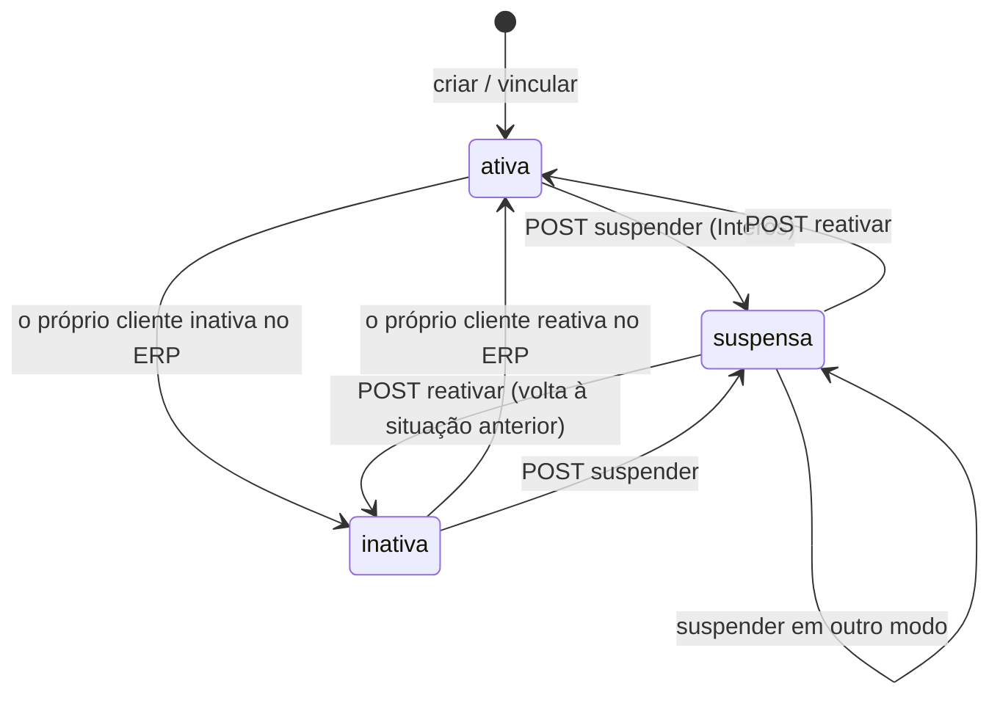
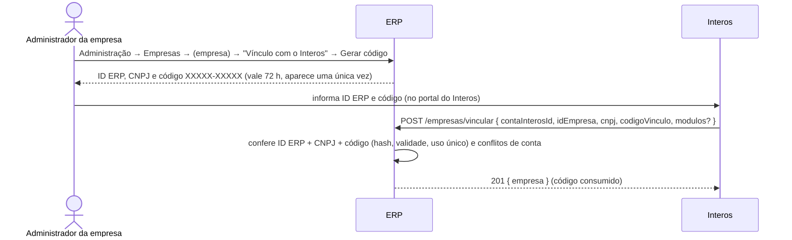

# Contrato de integração Interos ↔ Intercert ERP — v1

| | |
|---|---|
| Versão do contrato | **1.0.0** (API `v1`) |
| Situação | Homologação (produção ainda sem credenciais: responde `servico_nao_configurado`) |
| Data | 26/11/2026 |
| Base no código | `src/app/api/interos/v1/**`, `src/lib/service/**`, `src/domain/tenancy/**`, `src/domain/tower/**` |
| Exemplos | `docs/interos/exemplos/*.json`: respostas reais, conferidas pelo teste `tests/interos-contrato.test.ts` |
| Catálogo de indicadores | §12 deste documento (resumo) e `docs/interos/torre-indicadores.md` (definição campo a campo) |

> **Regra de ouro.** O ERP é a fonte dos dados operacionais e da situação de cada empresa. O Interos contrata,
> provisiona e acompanha, **sempre por esta interface**: nunca acessa o banco do ERP. Cada empresa contratante
> administra os próprios usuários dentro do ERP; o Interos só cria o administrador inicial e, quando preciso,
> convida outro administrador.

---

## Sumário

1. [Leitura rápida](#1-leitura-rápida)
2. [Ambientes](#2-ambientes)
3. [Autenticação, escopos e credenciais](#3-autenticação-escopos-e-credenciais)
4. [Convenções](#4-convenções)
5. [Erros](#5-erros)
6. [Idempotência e repetição segura](#6-idempotência-e-repetição-segura)
7. [Estados e ciclos de vida](#7-estados-e-ciclos-de-vida)
8. [Operações de provisionamento](#8-operações-de-provisionamento)
9. [Catálogo de módulos contratáveis](#9-catálogo-de-módulos-contratáveis)
10. [Vinculação de empresa que já usa o ERP](#10-vinculação-de-empresa-que-já-usa-o-erp)
11. [Suspensão e reativação](#11-suspensão-e-reativação)
12. [Torre de Controle: consultas analíticas](#12-torre-de-controle-consultas-analíticas)
13. [Regras de sincronização](#13-regras-de-sincronização)
14. [Limites operacionais](#14-limites-operacionais)
15. [Auditoria e rastreabilidade](#15-auditoria-e-rastreabilidade)
16. [Segurança e privacidade](#16-segurança-e-privacidade)
17. [Versionamento e compatibilidade](#17-versionamento-e-compatibilidade)
18. [Exemplos](#18-exemplos)
19. [Roteiro de homologação para a equipe do Interos](#19-roteiro-de-homologação-para-a-equipe-do-interos)
20. [Decisões em aberto](#20-decisões-em-aberto)

---

## 1. Leitura rápida

```
URL base     https://<host do ambiente>/api/interos/v1
Autenticação Authorization: Bearer <id-da-credencial>.<segredo>
Rastreio     X-Request-Id: <seu identificador>   (opcional; o ERP devolve sempre)
Alterações   Idempotency-Key: <chave única>      (obrigatória em todo POST/PUT)
Corpo        JSON UTF-8 (Content-Type: application/json), até 256 KB
Erros        { "erro": { "codigo": "...", "mensagem": "...", ... }, "requestId": "..." }
```

- **Duas credenciais, sem mistura:** uma de **provisionamento** (criar, vincular, ajustar, suspender, reativar e
  consultar empresas) e outra da **Torre de Controle** (só leitura analítica). Quem lê indicadores não altera nada.
- **Repetir é seguro:** se a resposta de uma alteração não chegar (tempo esgotado, rede), repita **a mesma
  solicitação com a mesma `Idempotency-Key`**. O ERP devolve a resposta original ou retoma de onde parou. Nada é
  duplicado.
- **Decida pelo `codigo`**, nunca pela `mensagem`: as mensagens são texto para pessoas e podem mudar.
- **Toda resposta de provisionamento traz o estado completo da empresa** (`empresa`): use-o como a nova fotografia.

## 2. Ambientes

| Ambiente | URL base | Credenciais | Situação |
|---|---|---|---|
| Homologação | `https://intercerterp-git-claude-eager-tesla-oark2w-martinsphilippes.vercel.app/api/interos/v1` | `interos-prov-homolog` (provisionamento) e `interos-torre-homolog` (Torre) | Ativa. Dados fictícios. Pode ser recriada. |
| Produção | `https://intercerterp.vercel.app/api/interos/v1` | nenhuma | Responde `503 servico_nao_configurado` até a liberação (§20) |

- Os segredos da homologação são entregues à equipe do Interos **fora deste documento**, por canal seguro. O ERP
  guarda apenas o hash.
- Os dados de homologação são fictícios e podem ser apagados a qualquer momento. Use nomes, CNPJs e e-mails de teste
  (domínios `.example`).

## 3. Autenticação, escopos e credenciais

**Formato.** `Authorization: Bearer <id>.<segredo>`, em que:
- `id` tem 3 a 64 caracteres (`A–Z a–z 0–9 . _ -`);
- `segredo` tem 43 caracteres base64url (256 bits).

**Escopos.**

| Escopo | Permite |
|---|---|
| `provisionamento:leitura` | `GET /empresas`, `GET /empresas/{idEmpresa}` |
| `provisionamento:escrita` | Todas as alterações de §8 (`POST`/`PUT`) |
| `torre:resumo` | Resumo e séries agregadas da Torre (§12) |
| `torre:detalhe` | Abertura por unidade, produto e SKU (§12) |
| `torre:transacoes` | Lista de transações (vendas, devoluções) com paginação (§12) |
| qualquer um | `GET /status` (testa a credencial) |

**Regras.**
- A credencial de provisionamento tem só os escopos `provisionamento:*`. A da Torre, só `torre:*`. O gerador do ERP
  recusa misturar os dois grupos numa credencial.
- O ERP guarda **somente o hash SHA-256** do segredo (variável `INTEROS_CREDENCIAIS`). Um vazamento do ERP não
  expõe o segredo.
- A comparação é feita em tempo constante. Credencial ausente, malformada, desconhecida ou com segredo errado recebe
  a **mesma** resposta `401 nao_autenticado`: o ERP não revela se o `id` existe.
- **Rotação sem parada:**
  1. O ERP cadastra uma credencial nova, com outro `id`.
  2. O Interos passa a usá-la.
  3. O ERP remove a antiga.
- **Revogação:** retirar a credencial da configuração derruba o acesso em seguida (`401`).
- O Interos deve guardar o segredo num cofre (secret manager), nunca em código, log ou planilha.

## 4. Convenções

### 4.1 Formato
- JSON UTF-8. Campos em português, `camelCase`, sem acento (`razaoSocial`, `codigoMunicipioIbge`).
- Valores enumerados em minúsculas, `snake_case`, sem acento (`somente_leitura`, `escritorio_contabil`).
- Campo opcional ausente, `null` e texto vazio têm o mesmo efeito: "não informado".
- Nas respostas, campos sem valor vêm como `null`. O consumidor deve **ignorar campos desconhecidos** (§17).

### 4.2 Datas e horas
- **Instantes**: ISO 8601 em UTC, com milissegundos e `Z` (`2026-11-20T12:02:00.000Z`).
- **Datas de referência** da Torre (dia do movimento): `AAAA-MM-DD`, no fuso da empresa (§12.2).

### 4.3 Documentos e números
- **CNPJ**: aceito com ou sem máscara (`24.681.357/0001-40` ou `24681357000140`) e validado pelos dígitos
  verificadores. Nas respostas vem **só com dígitos**.
- **CEP** (8 dígitos), **código IBGE do município** (7 dígitos), **CNAE** (7 dígitos) e **telefone**: aceitos com
  máscara e devolvidos só com dígitos.
- **Valores monetários** (Torre): ver §12.2.

### 4.4 Identificadores

| Identificador | Quem gera | Formato | Uso |
|---|---|---|---|
| `contaInterosId` | Interos | 3–100 caracteres `A–Z a–z 0–9 . _ : -` | Identifica a empresa contratante no Interos. **Uma conta corresponde a uma única empresa no ERP.** |
| `idEmpresa` | ERP | Texto opaco de 8 a 64 caracteres (hoje, 32 hexadecimais) | O "ID ERP" da empresa, estável. Vai no caminho das operações. |
| `idUnidade` | ERP | Texto opaco | Unidade (filial/loja) da empresa. |
| `idUsuario` | ERP | Texto opaco | Pessoa com acesso à empresa. |
| `X-Request-Id` | Interos (ou ERP) | 8–100 caracteres `A–Z a–z 0–9 . _ : -` | Rastreia a chamada nos registros dos dois lados. Inválido ou ausente: o ERP gera `req_<24 hex>`. |
| `Idempotency-Key` | Interos | 8–128 caracteres `A–Z a–z 0–9 . _ : -` | Uma chave por operação de negócio (§6). Sugestão: UUID v4, ou `<conta>-<operação>-<data>-<sequência>`. |

Trate os identificadores do ERP como **opacos**: não deduza nada do formato nem tente gerá-los.

### 4.5 Cabeçalhos

| Cabeçalho | Direção | Quando |
|---|---|---|
| `Authorization` | requisição | sempre |
| `X-Request-Id` | requisição e resposta | opcional na requisição; sempre na resposta |
| `Idempotency-Key` | requisição | obrigatório em `POST` e `PUT` |
| `Content-Type: application/json` | requisição e resposta | requisições com corpo; todas as respostas |
| `API-Version: v1` | resposta | sempre |
| `Cache-Control: no-store` | resposta | sempre (nenhuma resposta deve ser guardada em cache intermediário) |
| `Idempotent-Replayed: true` | resposta | quando a resposta é a repetição de uma solicitação já concluída (§6) |
| `Retry-After: <segundos>` | resposta | `429 limite_excedido` e `409 solicitacao_em_andamento` |
| `WWW-Authenticate` | resposta | `401` |

### 4.6 Paginação
Listas usam **cursor**:
- Parâmetros: `limite` (1 a 100; padrão 50) e `cursor`.
- Resposta: `{ "itens": [...], "proximoCursor": "<texto>" | null }`. Para continuar, envie o `proximoCursor` no
  parâmetro `cursor`. `null` indica o fim da lista.
- A ordem é estável. Cursores são opacos: não os construa nem os altere.
- A Torre usa a mesma convenção; os limites dela estão em §12.

## 5. Erros

Toda resposta de erro tem o formato:

```json
{ "erro": { "codigo": "validacao", "mensagem": "Há campos inválidos na solicitação.", "campos": [ { "campo": "empresa.cnpj", "mensagem": "CNPJ inválido." } ] }, "requestId": "req-exemplo-e422" }
```

`codigo` é estável e faz parte do contrato. `mensagem` é para pessoas e pode mudar. Alguns erros trazem detalhes
extras dentro de `erro`, como `campos` (validação) e `idEmpresa` (conflito de conta).

| HTTP | `codigo` | Quando | O que o Interos faz |
|---|---|---|---|
| 400 | `json_invalido` | Corpo que não é um objeto JSON | Corrigir e enviar com **chave nova** |
| 400 | `idempotencia_obrigatoria` | Alteração sem `Idempotency-Key` válida | Enviar com a chave |
| 401 | `nao_autenticado` | Credencial ausente ou inválida | Conferir a credencial; não repetir em laço |
| 403 | `sem_permissao` | Credencial sem o escopo da operação | Usar a credencial certa (§3) |
| 404 | `nao_encontrado` | Empresa inexistente **ou não vinculada ao Interos**; usuário fora da empresa | Conferir o `idEmpresa`. Empresas não vinculadas não existem para o Interos. |
| 409 | `solicitacao_em_andamento` | A mesma chave ainda está sendo processada | Esperar `Retry-After` e repetir **com a mesma chave** |
| 409 | `cnpj_em_uso` | O CNPJ já pertence a uma empresa do ERP sem vínculo com esta conta | Usar a vinculação por código (§10) |
| 409 | `conta_ja_vinculada` | A conta do Interos já tem outra empresa no ERP (traz `idEmpresa`) | Consultar essa empresa; não criar outra |
| 409 | `empresa_ja_vinculada` | A empresa já está vinculada a outra conta do Interos | Tratar a duplicidade de conta no Interos |
| 409 | `identidade_nao_confere` | Vinculação com `idEmpresa`, CNPJ ou código que não conferem, ou código vencido ou já usado | Pedir ao administrador da empresa um código novo |
| 409 | `email_reservado` | E-mail que não pode administrar a empresa (equipe da plataforma, demonstração, acesso desativado) | Informar outro e-mail |
| 409 | `usuario_bloqueado` | E-mail de um acesso suspenso ou inativo no ERP | Informar outro e-mail ou pedir a reativação à empresa |
| 409 | `convite_ja_aceito` | Reenvio de convite para quem já ativou o acesso | Nada a fazer; a pessoa recupera a senha pela tela de login |
| 409 | `nada_a_retomar` | Retomada de empresa sem implantação de criação | Nada a fazer |
| 409 | `conflito` | Conflito com registro existente (ex.: código de unidade repetido) | Consultar o estado e corrigir |
| 413 | `conteudo_grande_demais` | Corpo acima de 256 KB | Reduzir |
| 422 | `validacao` | Campos inválidos: **todos** os problemas, por campo, em `campos[]` | Corrigir e enviar com **chave nova** |
| 422 | `idempotencia_conflito` | A chave já foi usada com outro conteúdo | Usar chave nova para operação nova |
| 422 | `regra_de_negocio` | Regra de negócio do ERP recusou a operação | Ler a mensagem e corrigir |
| 423 | `empresa_suspensa` | Operação que exige a empresa ativa | Reativar antes, se o contrato permitir |
| 423 | `empresa_inativa` | A própria empresa se inativou no ERP | Tratar com o cliente |
| 429 | `limite_excedido` | Limite por minuto da credencial atingido | Esperar `Retry-After` |
| 500 | `erro_interno` | Erro inesperado no ERP | Repetir **com a mesma chave**, com espera crescente (§13.3) |
| 503 | `servico_nao_configurado` | Ambiente sem credenciais de serviço | Aguardar a liberação do ambiente |

A Torre acrescenta os erros de consulta listados em §12.

## 6. Idempotência e repetição segura

Toda alteração (`POST`, `PUT`) exige `Idempotency-Key`. O ERP registra cada chave **por credencial** junto com a
"impressão digital" da solicitação: método + caminho + corpo em JSON canônico. A ordem das chaves do JSON não
importa.

| Situação ao receber a chave | Resultado |
|---|---|
| Chave nova | Executa e guarda a resposta |
| Mesma chave e mesmo conteúdo, já concluída | Devolve **a resposta original**, com o mesmo status e `Idempotent-Replayed: true`, sem refazer nada. Vale também para respostas de erro definitivas (4xx). |
| Mesma chave e conteúdo diferente | `422 idempotencia_conflito`. Um reenvio nunca vira outra operação. |
| Mesma chave ainda em processamento | `409 solicitacao_em_andamento` com `Retry-After: 5`. A trava dura até 120 s. |
| Mesma chave depois de `5xx` | Executa de novo. As operações são **retomáveis**: cada etapa tem identificador fixo e só faz o que falta. |

Consequências práticas:
- **Depois de um 4xx, corrija e use uma chave nova.** A resposta 4xx fica guardada como definitiva para aquela chave.
- **Depois de tempo esgotado, rede ou `5xx`, repita com a mesma chave.** É a forma segura de saber o que aconteceu.
- **O link de convite é uma credencial de uso único.** Ele aparece **só na primeira resposta** e nunca é gravado. Na
  repetição pela mesma chave, `convite.link` vem `null`, com `linkRedigido: true` e um `aviso`. Para um link novo,
  use `convites/reenviar` (§8.9).
- **Proteção além da chave:** a conta do Interos identifica a empresa. Reenviar a criação **com outra chave** não
  duplica empresa, unidade nem convite. O ERP confere cada etapa e devolve `200` com o estado atual (exemplo 04).
  Suspender no mesmo modo, reativar empresa ativa e vincular de novo à mesma conta também não mudam nada.
- Nesta versão as chaves não expiram. Não reutilize chave para outra operação.

## 7. Estados e ciclos de vida

### 7.1 Situação da empresa (`empresa.situacao`)



| `situacao` | Significado |
|---|---|
| `ativa` | Opera normalmente |
| `suspensa` | Suspensa pelo Interos conforme o contrato; `suspensao.modo` diz como (§11) |
| `inativa` | O próprio cliente inativou a empresa em Administração → Empresas. **O Interos não altera isto.** |

`suspensao` traz `{ modo, motivo, referenciaContrato, desde }` quando a empresa está suspensa (`null` nos demais
casos). `historicoSituacao[]` traz as últimas 20 suspensões e reativações:
`{ evento: suspensao|reativacao, modo, motivo, referenciaContrato, em, requestId }`.

### 7.2 Implantação (`empresa.implantacao`)

| Campo | Valores |
|---|---|
| `operacao` | `criar`, `vincular`, `null` (empresa sem implantação pelo Interos) |
| `estado` | `nao_iniciada`, `em_andamento`, `concluida`, `falhou` |
| `etapas[]` | `{ etapa, estado, concluidaEm, erro, tentativas }`. Etapas da criação: `empresa`, `unidade_inicial`, `modulos`, `administrador`. Da vinculação: `vinculo`, mais `modulos` quando houver. |
| `etapas[].estado` | `pendente`, `concluida`, `falhou` |
| `tentativas` | Quantas vezes a implantação foi executada. Reexecutar uma etapa já concluída é só conferência e mantém o `concluidaEm` original. |
| `ultimoErro` | Texto de diagnóstico da última falha (`<etapa>: <motivo>`). Serve para pessoas, não para decisão automática. |

`falhou` é sempre recuperável: repita a criação com a mesma chave ou chame `implantacao/retomar` (§8.12).

### 7.3 Convite de administrador
- O link (`/convite/<token>`) é de **uso único** e tem **validade**: 7 dias por padrão, configurável pela empresa de
  1 a 30 dias.
- Abrindo o link, a pessoa define a própria senha. O Interos nunca conhece a senha.
- **Reenviar gera um link novo e invalida o anterior.**
- `administradores[].convite.estado`: `pendente`, `expirado` ou `aceito`.
- `enviadoEm: null` indica convite que ainda não saiu (entrega interrompida). A retomada gera e entrega o convite.

### 7.4 Pessoas (`administradores[].situacao`)
`ativo`, `convidado`, `suspenso`, `inativo`.

`usuarios` traz as contagens por situação das pessoas da empresa. Ficam fora a equipe da plataforma e os acessos
técnicos desativados.

## 8. Operações de provisionamento

| # | Operação | Método e caminho | Escopo | Sucesso | Exemplo |
|---|---|---|---|---|---|
| 8.1 | Conferir credencial | `GET /status` | qualquer | 200 | 01 |
| 8.2 | Criar empresa | `POST /empresas` | escrita | 201 criada · 200 já existia | 02, 03, 04, 13 |
| 8.3 | Listar empresas | `GET /empresas` | leitura | 200 | 16 |
| 8.4 | Consultar empresa | `GET /empresas/{idEmpresa}` | leitura | 200 | 05, 14 |
| 8.5 | Vincular empresa existente | `POST /empresas/vincular` | escrita | 201 vinculada · 200 já era desta conta | 12 |
| 8.6 | Ajustar unidade inicial | `PUT /empresas/{idEmpresa}/unidade-inicial` | escrita | 200 | 06 |
| 8.7 | Definir módulos | `PUT /empresas/{idEmpresa}/modulos` | escrita | 200 | 07 |
| 8.8 | Convidar administrador | `POST /empresas/{idEmpresa}/administradores` | escrita | 201 | 08 |
| 8.9 | Reenviar convite | `POST /empresas/{idEmpresa}/convites/reenviar` | escrita | 200 | 09 |
| 8.10 | Suspender | `POST /empresas/{idEmpresa}/suspender` | escrita | 200 | 10 |
| 8.11 | Reativar | `POST /empresas/{idEmpresa}/reativar` | escrita | 200 | 11 |
| 8.12 | Retomar implantação | `POST /empresas/{idEmpresa}/implantacao/retomar` | escrita | 200 | 15 |

Todas as alterações exigem `Idempotency-Key`. Os caminhos são relativos à URL base (`/api/interos/v1`).

### 8.0 O objeto `empresa`
Toda operação de §8 (menos `/status`) devolve a empresa no mesmo formato:

| Campo | Tipo | Descrição |
|---|---|---|
| `idEmpresa` | texto | ID ERP |
| `contaInterosId` | texto | Conta do Interos vinculada |
| `tipo` | `varejo` · `escritorio_contabil` · `parceiro_rede` | Tipo da empresa no ERP |
| `razaoSocial`, `nomeFantasia` | texto | |
| `cnpj` | texto (14 dígitos) | |
| `situacao` | `ativa` · `inativa` · `suspensa` | §7.1 |
| `suspensao` | objeto ou `null` | `{ modo, motivo, referenciaContrato, desde }` |
| `historicoSituacao` | lista | Últimos 20 eventos de suspensão e reativação |
| `modulos` | lista (ordem alfabética) ou `null` | Módulos contratados (§9). `null`: empresa anterior ao multiempresa, sem restrição por contrato. |
| `contrato` | objeto ou `null` | `{ referencia, plano }` |
| `implantacao` | objeto | §7.2 |
| `unidades[]` | lista | `{ idUnidade, codigo, nome, cnpj, situacao: ativa\|inativa }`, por código |
| `administradores[]` | lista | `{ idUsuario, nome, email, situacao, convite: { estado, expiraEm, enviadoEm, detalheEntrega } \| null, primeiroAcessoEm, ultimoAcessoEm }` |
| `usuarios` | objeto | Contagens: `{ ativos, convidados, suspensos, inativos }` |
| `ultimaAtividadeEm` | instante ou `null` | Último acesso de alguém da empresa (sinal de adoção) |
| `vinculadaEm` | instante | Quando a empresa foi vinculada ao Interos |
| `atualizadaEm` | instante | Última alteração do **cadastro** da empresa. Mudanças em pessoas e unidades não alteram este campo. |

### 8.1 `GET /status`
Confere a credencial e a saúde da interface. Use-o no monitoramento e para medir a diferença de relógio.

Resposta `200`: `{ situacao: "ok", versao: "v1", cliente: { id, nome, escopos[] }, horarioServidor, requestId }`.

### 8.2 `POST /empresas`: criar empresa contratante
Cria, em quatro etapas retomáveis, a empresa, a unidade inicial (matriz), os módulos contratados e o administrador
inicial com convite. Junto vem a parametrização padrão do ERP: perfis de acesso, depósitos, contas e categorias
financeiras, centros de custo e formas e condições de pagamento. Todos esses parâmetros ficam editáveis pelo cliente.

| Campo | Obrigatório | Regra |
|---|---|---|
| `contaInterosId` | sim | §4.4. Uma conta corresponde a uma empresa. |
| `empresa.tipo` | não | `varejo` (padrão) ou `escritorio_contabil` |
| `empresa.razaoSocial` | sim | até 200 caracteres |
| `empresa.nomeFantasia` | não | padrão: a razão social |
| `empresa.cnpj` | sim | CNPJ válido, **sem outra empresa no ERP com o mesmo CNPJ** |
| `empresa.inscricaoEstadual`, `empresa.inscricaoMunicipal` | não | até 30 caracteres |
| `empresa.regimeTributario` | não | `simples` (padrão), `simples_excesso`, `presumido`, `real`, `mei` |
| `empresa.cnae` | não | 7 dígitos |
| `empresa.email`, `empresa.telefone` | não | e-mail válido |
| `empresa.endereco` | não | `{ cep, logradouro, numero, complemento, bairro, municipio, codigoMunicipioIbge, uf }`. UF entre as 27; CEP com 8 dígitos; IBGE com 7. |
| `unidadeInicial` | não | `{ nome (padrão "Matriz"), codigo (até 20 letras/números), cnpj, inscricaoEstadual, endereco (padrão: o da empresa), telefone, email, fusoHorario }` |
| `unidadeInicial.fusoHorario` | não | `America/Sao_Paulo` (padrão), `America/Bahia`, `America/Fortaleza`, `America/Recife`, `America/Belem`, `America/Manaus`, `America/Cuiaba`, `America/Campo_Grande`, `America/Porto_Velho`, `America/Boa_Vista`, `America/Rio_Branco`, `America/Noronha` |
| `modulos` | sim | Lista com ao menos um módulo válido para o tipo (§9) |
| `administrador` | sim | `{ nome, email, telefone? }` |
| `entregaConvite` | não | `interos` (padrão): o link volta na resposta e o Interos entrega. `erp`: o ERP envia o e-mail. |
| `contrato` | não | `{ referencia (até 100), plano (até 60) }` |

**Regras.**
- **`201`:** empresa criada nesta chamada.
- **`200`:** a conta já tinha esta empresa (reenvio com outra chave ou retomada). Só o que faltava é feito.
- **CNPJ já existente no ERP**, de empresa sem vínculo com esta conta → `409 cnpj_em_uso`. A saída é a vinculação
  por código (§10). O ERP não informa qual empresa é.
- **Conta com outra empresa** → `409 conta_ja_vinculada`, com o `idEmpresa` dela.
- **Administrador cujo e-mail já tem acesso ao ERP** (de outra empresa): a pessoa é vinculada a esta empresa com o
  perfil de administrador e entra com a senha que já tem. Nesse caso não há convite, e `convite` vem `null`.
  E-mails reservados → `409 email_reservado`. Acessos suspensos ou inativos → `409 usuario_bloqueado`. Nos dois
  casos nada é gravado.
- **`convite`** na resposta: `{ idUsuario, entrega, entregue, canal, detalhe, expiraEm, link, linkRedigido }`.
  - Com `entrega: interos`, `link` traz o endereço e `entregue` vem `null`.
  - Com `entrega: erp` e e-mail entregue ao provedor, `link` vem `null` e `entregue` vem `true`.
  - Se o ERP não conseguir enviar o e-mail (canal de e-mail não configurado), o `link` volta na resposta e
    `entregue` vem `false`. Ninguém fica sem o convite.
- **Falha no meio** → `500 erro_interno`, com a etapa marcada como `falhou` (exemplos 13 e 14). Repita com a mesma
  chave ou use `implantacao/retomar`.

### 8.3 `GET /empresas`: listar empresas vinculadas
Filtros: `contaInterosId` (exato), `limite`, `cursor` (§4.6). Devolve `{ itens: [empresa...], proximoCursor }`. Só
aparecem empresas vinculadas a uma conta do Interos. Use para a reconciliação periódica (§13.2).

### 8.4 `GET /empresas/{idEmpresa}`: consultar empresa
Devolve `{ empresa }`. Empresa inexistente ou não vinculada → `404 nao_encontrado`.

### 8.5 `POST /empresas/vincular`: vincular empresa que já usa o ERP
Corpo: `{ contaInterosId, idEmpresa, cnpj, codigoVinculo, modulos?, contrato? }`. Fluxo e regras em §10.
- `201`: vinculada agora.
- `200`: já estava vinculada a esta mesma conta (nada muda).
- `modulos` é opcional. Sem ele a empresa mantém o acesso que tem hoje, ou seja, sem restrição por contrato.

### 8.6 `PUT /empresas/{idEmpresa}/unidade-inicial`: ajustar a unidade inicial
Corpo parcial com os campos de `unidadeInicial` de §8.2; só os campos enviados mudam. Código repetido em outra
unidade → `409 conflito`. As demais unidades são cadastradas pelo próprio cliente no ERP.

### 8.7 `PUT /empresas/{idEmpresa}/modulos`: definir módulos contratados
Corpo: `{ modulos: [...], contrato?: { referencia, plano } }`. A lista **substitui** a anterior inteira. Efeito
imediato e central:
- os módulos não contratados perdem todas as operações em todos os perfis da empresa (menu, telas, ações e APIs);
- recursos de contrato (loja virtual, rede de certificação) são ligados ou desligados.

Nenhum dado é apagado. Recontratar devolve o acesso aos perfis como eram.

### 8.8 `POST /empresas/{idEmpresa}/administradores`: convidar administrador
Corpo: `{ administrador: { nome, email, telefone? }, entregaConvite? }`. Mesmas regras de e-mail de §8.2. Útil quando
o administrador inicial sai. A administração do dia a dia (outros usuários, perfis, unidades) é do próprio cliente,
dentro do ERP. Empresa suspensa → `423`.

Resposta `201`: `{ empresa, idUsuario, convite }`.

### 8.9 `POST /empresas/{idEmpresa}/convites/reenviar`: reenviar convite
Corpo: `{ idUsuario }` ou `{ email }`, mais `entregaConvite?`.
- Gera **link novo**; o anterior deixa de valer.
- Só vale para quem ainda não ativou o acesso. Para os demais → `409 convite_ja_aceito`; a pessoa usa "Esqueci minha
  senha".

### 8.10 `POST /empresas/{idEmpresa}/suspender`
Corpo: `{ modo: "bloqueio" | "somente_leitura", motivo, referenciaContrato? }`. `motivo` é obrigatório e fica no
histórico. Efeitos em §11. Repetir no mesmo modo não muda nada; mudar de modo aplica o novo e registra no histórico.

### 8.11 `POST /empresas/{idEmpresa}/reativar`
Corpo: `{ motivo?, referenciaContrato? }`.
- Devolve a empresa à situação anterior à suspensão (`ativa`, ou `inativa` se o cliente a tinha inativado).
- Libera as tarefas retidas.
- Empresa que não está suspensa: nada muda.

### 8.12 `POST /empresas/{idEmpresa}/implantacao/retomar`
Corpo: `{}`. Reexecuta a criação com a **entrada guardada** no ERP, sem precisar reenviar os dados. Só o que faltou é
feito; um convite que não chegou a sair é gerado e entregue agora (exemplo 15). Implantação já concluída → `200` sem
mudanças. Empresa sem criação pelo Interos → `409 nada_a_retomar`.

## 9. Catálogo de módulos contratáveis

| Módulo (`modulos[]`) | Libera no ERP | Tipos de empresa |
|---|---|---|
| `pdv` | PDV e caixa | varejo |
| `vendas` | Vendas, orçamentos, pedidos e comissões | varejo |
| `estoque` | Estoque, depósitos e inventário | varejo |
| `compras` | Compras e recebimento de mercadorias | varejo |
| `financeiro` | Contas a pagar e a receber, conciliação | varejo, escritorio_contabil, parceiro_rede |
| `fiscal` | NF-e, NFC-e, NFS-e e arquivos fiscais | varejo, escritorio_contabil, parceiro_rede |
| `relatorios` | Relatórios gerenciais | varejo |
| `comercio_digital` | Loja virtual própria (recurso `comercioDigital`) | varejo |
| `gestao_contabil` | Carteira de clientes do escritório | escritorio_contabil |
| `rede_certificacao` | Rede de certificação digital (recurso `redeCertificacao`) | parceiro_rede, escritorio_contabil |

**Sempre disponíveis**, independentemente do contrato: painel, produtos, clientes, fornecedores, administração da
própria empresa e suporte.

**Empresas sem contrato registrado** (anteriores ao multiempresa) continuam com tudo o que têm hoje: o contrato só
restringe quem o tem.

A restrição é aplicada **num único ponto**: o perfil efetivo da pessoa e a leitura dos recursos. Por isso menu,
telas, ações e APIs obedecem juntos.

## 10. Vinculação de empresa que já usa o ERP

O Interos só vincula uma empresa existente com o **consentimento de quem a administra**:



**Regras.**
- O código vale **72 horas** e **uma única vez**. Gerar outro invalida o anterior. O ERP guarda só o hash.
- Gerar o código exige permissão de administração de usuários. Empresas de demonstração e empresas já vinculadas não
  geram código.
- **Mesma resposta** (`409 identidade_nao_confere`) para empresa inexistente, CNPJ diferente, código errado, vencido
  ou já usado. Assim o Interos, ou quem tiver a credencial, não descobre empresas por tentativa.
- Empresa vinculada a outra conta → `409 empresa_ja_vinculada`. Conta com outra empresa → `409 conta_ja_vinculada`.
  Uma conta corresponde a uma empresa, e vice-versa: o banco garante isso por índice único.
- Antes do vínculo, a empresa **não existe** para o Interos (`404`).

## 11. Suspensão e reativação

| Efeito | `bloqueio` | `somente_leitura` |
|---|---|---|
| Entrar no ERP e escolher a empresa | não | sim |
| Sessões abertas | **encerradas** para quem só tem esta empresa (quem tem outras continua, mas não escolhe esta) | mantidas |
| Gravar (vender, emitir, lançar, cadastrar) | não | **não**: toda gravação é recusada |
| Consultar e exportar | não | sim |
| Tarefas em segundo plano pendentes | **retidas** (`held`) | retidas |
| Rotinas agendadas (cobranças, avisos, sincronizações) | não rodam | não rodam |
| Loja virtual | fora do ar | fora do ar |
| Dados e histórico | preservados | preservados |

- A **reativação** devolve a situação anterior e libera as tarefas retidas, na fila em que estavam. Sessões
  encerradas não voltam; as pessoas entram de novo.
- Cada suspensão e reativação fica registrada em três lugares:
  - `historicoSituacao`, na resposta;
  - a auditoria da empresa, com o cliente de serviço como autor;
  - a trilha da solicitação (§15).
- **Nada é apagado** por suspensão. A política de encerramento definitivo (exportar e apagar dados) é contratual e
  ainda não faz parte da v1 (§20).

## 12. Torre de Controle: consultas analíticas

A Torre lê os indicadores de uma empresa vinculada para acompanhamento, sem alterar nada. As definições completas,
campo a campo, estão em `docs/interos/torre-indicadores.md` (versão dos indicadores **`2026-11-v1`**, devolvida em
`meta.versaoIndicadores`). Este capítulo é o resumo contratual.

**Princípio: a Torre não tem fórmulas próprias.** Cada número sai da mesma função que alimenta a tela do ERP: painel
do gestor, relatórios gerenciais, curva ABC, estoque, caixa, financeiro, fiscal, compras e comércio digital. A Torre
só escolhe o recorte (empresa, período, unidades) e traduz para o contrato. Assim, o que o Interos vê é o que o
cliente vê.

### 12.1 Rotas e escopos
Base: `GET /api/interos/v1/empresas/{idEmpresa}/torre/<rota>`. Todas são `GET`, sem `Idempotency-Key`. Os escopos são
exatos, sem hierarquia entre eles: cada rota exige o escopo do nível de detalhe que entrega.

| Rota | Escopo | Período | Paginada | Parâmetros próprios | Exemplo |
|---|---|---|---|---|---|
| `resumo` | `torre:resumo` | obrigatório | não | | torre-01 |
| `vendas/serie` | `torre:resumo` | obrigatório | não | `granularidade` = `dia` (padrão) \| `mes` | torre-02 |
| `vendas/por-unidade` | `torre:resumo` | obrigatório | não | | torre-03 |
| `produtos` | `torre:detalhe` | obrigatório | sim | `incluirSemMovimento` = `0` (padrão) \| `1` | torre-04 |
| `skus` | `torre:detalhe` | obrigatório | sim | `incluirSemMovimento` = `0` (padrão) \| `1` | torre-05 |
| `transacoes/vendas` | `torre:transacoes` | obrigatório | sim | `situacao` = `concluida` (padrão) \| `cancelada` \| `todas` | torre-06 |
| `transacoes/devolucoes` | `torre:transacoes` | obrigatório | sim | | torre-07 |
| `estoque` | `torre:detalhe` | não (posição atual) | sim | | torre-08 |
| `financeiro` | `torre:resumo` | obrigatório | não | | torre-09 |
| `fiscal` | `torre:resumo` | obrigatório | não | | torre-10 |
| `compras` | `torre:resumo` | obrigatório | não | | torre-11 |
| `comercio-digital` | `torre:resumo` | obrigatório | não | | torre-12 |
| `adocao` | `torre:resumo` | não | não | | torre-13 |

Só empresas **vinculadas** ao Interos existem para a Torre. Qualquer outra, inclusive inexistente, responde
`404 nao_encontrado` antes de qualquer validação. A empresa suspensa continua consultável: o acompanhamento não para.

### 12.2 Convenções das consultas
| Convenção | Regra |
|---|---|
| Dinheiro | **centavos de real, inteiros**, com sufixo `Centavos`. Pode ser negativo: devolução maior que a venda do dia, diferença de caixa, saldo negativo de estoque. |
| Quantidades | **milésimos inteiros**, sufixo `Milesimos` (1 unidade = 1000). Somas misturam unidades de medida diferentes. |
| Percentuais | **pontos-base inteiros**, sufixo `Bps` (1% = 100). `...PontosBps` é a diferença em pontos (atual − anterior). |
| Datas de referência | `AAAA-MM-DD`, no **fuso da instalação do ERP** (`America/Sao_Paulo`, devolvido em `meta.fuso`). Não há fuso por empresa nem por unidade nesta versão. |
| Instantes | ISO 8601 UTC |
| Situações | Português, minúsculas, `snake_case` (`concluida`, `em_processamento`, `aguardando_pagamento`) |
| Ausente | `null` quando o indicador não se aplica (ticket sem vendas, margem sem receita) ou quando **não há fonte confiável** (declarado campo a campo) |
| `meta` | Em toda resposta: `{ idEmpresa, periodo: { de, ate } \| null, unidades: [...] \| null, fuso, geradoEm, versaoIndicadores }` |
| Blocos operacionais | `noPeriodo` segue `de`/`ate`. `posicaoAtual` é a situação no momento da consulta (`geradoEm`), como nos cartões do painel. |

### 12.3 Parâmetros comuns
| Parâmetro | Regra |
|---|---|
| `de`, `ate` | Obrigatórios nas rotas com período. `AAAA-MM-DD`, inclusivos, `de ≤ ate`, no máximo **400 dias** (o limite das telas de análise). O recorte é [00:00 local de `de`, 00:00 local do dia seguinte a `ate`), com horário de verão. A Torre não adota período padrão: data ausente ou inválida é erro. |
| `idUnidade` | Opcional: ids de unidade separados por vírgula, ou o parâmetro repetido. Sem ele, vale o consolidado da empresa, incluindo os registros sem unidade (parcelas, baixas, contas compartilhadas, documentos fiscais). Unidade de outra empresa ou inexistente → `422 validacao`. |
| `limite` | Rotas paginadas: 1 a **500**, padrão 100 |
| `cursor` | O `proximoCursor` recebido. Só vale para a mesma rota, empresa, período, unidades e filtros; fora disso → `422 validacao` (`campo: "cursor"`). |

A paginação é **por chave**: cada lista tem ordem total, e o cursor guarda o último item entregue. Nenhum item se
repete nem é pulado. Os totais da consulta inteira (`totais` ou `curva`) vêm iguais em todas as páginas. Parâmetros
desconhecidos são ignorados. Erros: os de §5 (`401`, `403`, `404`, `422 validacao`, `429`, `500`, `503`). O `422`
lista todos os problemas de uma vez, nos campos `de`, `ate`, `idUnidade`, `limite`, `cursor`, `granularidade`,
`situacao` e `incluirSemMovimento`.

### 12.4 Catálogo de indicadores (resumo)

**Base comercial (vendas e devoluções).** É a mesma do painel do gestor, dos relatórios gerenciais, da curva ABC,
das metas e do CMV do DRE (`loadFacts`/`totalsOf` em `src/domain/reports.ts`).

| Indicador (campo) | Origem no ERP | Fórmula | Situações e data de referência | Cancelamentos, devoluções, descontos e ausentes |
|---|---|---|---|---|
| Receita bruta (`receitaBrutaCentavos`) | Itens das vendas (`sale_items.grossTotal`) | Σ preço × quantidade | Vendas `completed`. Data: dia local de `completedAt`. | Venda cancelada não entra e é informada à parte em `canceladas`, pela data de conclusão. Frete e impostos não são receita de produto. |
| Descontos (`descontosCentavos`) | Itens | Σ desconto do item (inclui promoção) + rateio do desconto global | idem | Vale-crédito e pontos são meio de pagamento, **não** desconto |
| Acréscimos (`acrescimosCentavos`) | Itens | Σ acréscimo do item + rateio do acréscimo global | idem | |
| Devoluções (`devolucoesCentavos`) | Itens de devolução | Σ valor devolvido | Devoluções `completed` ou `processing`. Data e unidade do **movimento da devolução**, mesmo que a venda seja de antes do período (um dia pode ter receita negativa). | Devolução cancelada não entra |
| **Receita líquida** (`receitaLiquidaCentavos`) | `totalsOf` | bruta − descontos + acréscimos − devoluções | idem | É o "Vendas líquidas (faturamento)" do painel. Pedido on-line e NF-e de pedido **não** entram (§12.5). |
| CMV (`custoMercadoriaVendidaCentavos`) | Custo histórico gravado no item | custo das vendas − custo revertido nas devoluções | idem | Custo ausente vira 0. Por isso produtos e SKUs sem custo registrado devolvem margem `null`. |
| Lucro bruto e margem bruta (`lucroBrutoCentavos`, `margemBrutaBps`) | `totalsOf` | receita líquida − CMV; margem = lucro × 10000 ÷ receita líquida | idem | Margem `null` com receita ≤ 0. Totais sempre pelas somas, nunca média de margens. |
| Ticket médio (`ticketMedioCentavos`) | `totalsOf` | receita líquida ÷ vendas distintas | idem | `null` sem vendas. Devolução não reduz a contagem de vendas. |
| Variação (`variacao.*Bps`) | Período anterior com o mesmo número de dias | (atual − anterior) × 10000 ÷ \|anterior\| | | `null` com anterior 0 ou nulo |
| Curva ABC (`classeAbc`, `participacaoBps`, `acumuladoBps`) | `abcReport`/`classifyAbc`, limites da empresa (padrão 80%/95%) | Classe pelo acumulado anterior ao item | Mesma curva da tela para o mesmo recorte | Receita ≤ 0: sem classe (`null`) |

**Demais blocos.**

| Bloco | Origem no ERP (tela) | Indicadores principais | Data de referência e regras |
|---|---|---|---|
| PDV (`pdv`) | Caixa e o topo do painel | Caixas abertos, fechados e com diferença no período; sobras e faltas; caixas em aberto agora (inclusive de dias anteriores); terminais ativos | Dia local da abertura. Diferença = contado − previsto, só de sessões fechadas. |
| Estoque (`estoque`) | Saldos de estoque e alertas do painel | Valor em estoque (físico × custo médio), físico, reservado, disponível, em trânsito, abaixo do mínimo, rupturas, zerados, negativos | **Posição atual**, sem período. Saldo negativo gera valor negativo. |
| Compras (`compras`) | Pedidos de compra e Recebimentos | Pedidos criados (exceto cancelados), recebidos (com no prazo), recebimentos confirmados; aguardando aprovação, a receber, atrasados, em conferência, com divergência, aguardando nota | `createdAt` e `confirmedAt` no fuso do ERP. O valor do pedido inclui frete, despesas, IPI e seguro. Fornecedores não são expostos. |
| Financeiro (`financeiro`) | Contas a receber e a pagar, painel e Relatórios financeiros | Recebido e pago no período (baixas com encargos); a receber e a pagar em aberto, vencido, vence hoje e nos próximos 7 dias; a autorizar; saldo das contas; aging; DRE gerencial | Baixa pela data da baixa. Vendas à vista em dinheiro ou Pix entram direto em conta e não aparecem como "recebido". O DRE é por competência e **difere da receita comercial** por definição. |
| Fiscal (`fiscal`) | Resumo fiscal do painel e Relatórios fiscais | Autorizadas (sem simulação) e simuladas; emitidos; faturamento fiscal bruto, devoluções e líquido; pendentes; rejeições; cancelamentos; por modelo (NFC-e, NF-e, NFS-e) | Autorizadas por `authorizedAt`; cancelamentos por `cancelledAt`. Autorizada e cancelada depois sai. O faturamento fiscal inclui frete, seguro e ICMS-ST e **não é** a receita comercial. |
| Comércio digital (`comercioDigital`) | Central e Pedidos da loja virtual, Banco da loja, Monitor | Pedidos criados, pagos (receita do canal, com frete e bruta das taxas), cancelados, por situação; aguardando pagamento, a faturar, a expedir ou retirar, devoluções solicitadas; banco e monitor | Pedidos pagos por `paidAt`. Fora da receita líquida comercial (`porCanal.comercioDigital.incluidoNaReceitaLiquida: false`). Dados do comprador nunca são expostos. |
| Adoção (`adocao`) | Auditoria, usuários, operação | Última atividade (auditoria), último acesso (login), usuários por situação, ativos em 7 e 30 dias, última venda, caixa, estoque, fiscal e pedido on-line, terminais, pendências de integração (fiscal, comércio digital, tarefas retidas ou com falha) | Sem período. Cada sinal declara a `fonte`. Sinal sem fonte confiável vem `null` (atividade de terminal, falha de rotina diária). |

### 12.5 Receita comercial, faturamento fiscal e DRE
São três números diferentes **por definição**. Nenhum deles é "o certo" para todos os usos.
- **Receita comercial**: `vendas.receitaLiquidaCentavos`. Só PDV e trocas, sem frete.
- **Faturamento fiscal**: `fiscal.noPeriodo.faturamentoFiscal`. Notas autorizadas por emissão, com frete e ICMS-ST,
  incluindo pedidos on-line e NF-e de pedido.
- **DRE**: `financeiro.noPeriodo.dre.receitaLiquidaCentavos`. Competência financeira; vale-crédito e pontos não são
  receita.

Não há receita omnicanal oficial na v1: `porCanal.pedidoDeVenda` vem `null`, e o comércio digital é informado à parte.

### 12.6 Sincronização da Torre
- **Não há fechamento comercial.** Cancelar uma venda ou uma NF-e depois a retira do período original. Itens de venda
  gravados depois por uma tarefa em segundo plano aumentam receita e custo de um período já consultado.
- Recomendação de consulta:
  - todo dia, os **últimos 35 dias**;
  - no dia 5 de cada mês, o mês anterior inteiro (fotografia mensal);
  - sempre guardar `meta.geradoEm` junto do número.
- A Torre corta todos os períodos no fuso do ERP. Telas que cortam pelo dia UTC ("Pedidos hoje", "Recebidos no mês")
  podem divergir para eventos entre 21h e 24h, horário de Brasília.
- As consultas leem o recorte em memória, como as telas, até 100 mil registros por consulta. `resumo` calcula o
  período atual e o anterior em todos os blocos e é a consulta mais pesada. Para séries longas, prefira `vendas/serie`
  e os blocos específicos.
- Mudança de fórmula, critério ou campo gera uma nova `versaoIndicadores`. Campos novos podem ser acrescentados sem
  mudar a versão.

### 12.7 Dados pessoais na Torre
Nenhuma rota devolve nome, CPF/CNPJ, e-mail, telefone ou endereço de cliente, nem o nome de operadores e vendedores.
Pessoas aparecem só por id (`idCliente`, `idOperador`, `idVendedor`). Nomes de unidades, depósitos, produtos,
categorias e contas financeiras são dados cadastrais da própria empresa. Os testes da Torre conferem a ausência de
CPF, CNPJ e nomes de clientes nas respostas.

## 13. Regras de sincronização

### 13.1 Provisionamento
- **O Interos é a fonte do contrato; o ERP é a fonte da operação.** Módulos, plano e suspensões partem do Interos.
  Situação de uso, pessoas, unidades e movimento partem do ERP.
- Depois de cada alteração, guarde a `empresa` devolvida como a fotografia atual.
- Mudanças feitas pelo cliente no ERP não são "corrigidas" pelo Interos. Exemplos: inativar a própria empresa,
  convidar pessoas, criar unidades. O Interos apenas as reflete.

### 13.2 Reconciliação periódica
- Uma vez por dia, e depois de qualquer incidente, percorra `GET /empresas` com paginação. Compare `situacao`,
  `modulos`, `contrato`, `implantacao.estado` e `administradores`.
- Divergência de contrato (por exemplo, módulos diferentes do contratado): reenvie `PUT /modulos` com chave nova.
- Implantação em `falhou`: `POST /implantacao/retomar`.

### 13.3 Repetição e espera
- Para `429`, `409 solicitacao_em_andamento`, `500` e falhas de rede: repita **com a mesma chave**, respeitando
  `Retry-After` quando houver. Sem ele, espere 1 s, 2 s, 4 s, 8 s e 16 s, com variação aleatória de até 20%.
- Depois de 5 tentativas, registre o incidente com o `requestId` e consulte o estado com `GET /empresas/{idEmpresa}`.
- `4xx` (exceto `409 solicitacao_em_andamento` e `429`) **não melhora com repetição**: corrija e use chave nova.

### 13.4 Relógio
Compare o seu relógio com `horarioServidor` de `GET /status`. Instantes são sempre UTC.

## 14. Limites operacionais

| Limite | Valor |
|---|---|
| Alterações por minuto, por credencial | 60 |
| Consultas por minuto, por credencial | 240 |
| Corpo da requisição | 256 KB |
| Tempo máximo de uma operação | 60 s |
| Itens por página | 1–100 (padrão 50); a Torre tem limites próprios (§12) |

Os limites por minuto são contados por instância do ERP. Trate-os como o ritmo máximo que o Interos deve manter, não
como garantia de que mais chamadas serão recusadas.

## 15. Auditoria e rastreabilidade

Cada chamada deixa três rastros, todos ligados pelo `requestId`:
1. **Registro estruturado** da chamada: operação, credencial, status, duração, empresa e `requestId`.
2. **Trilha da solicitação** (`service_requests`).
   - Alterações: quem pediu, operação, chave, impressão digital do conteúdo, tentativas, resultado e empresa afetada.
   - Consultas: contador diário por credencial, operação e empresa, ou seja, quem leu dados de qual empresa e quanto.
3. **Auditoria da empresa**: cada alteração aparece no histórico da própria empresa, com o autor
   `servico:<id-da-credencial>`. O administrador do cliente vê o que o Interos fez na conta dele.

Para investigar um caso, informe o `requestId` (e o `idEmpresa`).

## 16. Segurança e privacidade

- **Só HTTPS.** Use sempre `https://`. Uma chamada em `http://` é redirecionada, mas o cabeçalho de autenticação já
  terá trafegado sem criptografia. Trate isso como vazamento e troque a credencial.
- **Segredos nunca gravados em claro:** credenciais de serviço, links de convite e códigos de vínculo ficam só como
  hash. O link do convite aparece uma vez e nunca entra em registro.
- **Menor privilégio:** duas credenciais com escopos separados; empresas não vinculadas são invisíveis; a Torre só
  lê.
- **Sem acesso ao banco:** o Interos não recebe usuário de banco, réplica nem exportação direta. Toda informação
  passa por esta interface, com escopo, limite e trilha.
- **Isolamento:** cada consulta e alteração é feita na empresa do caminho, conferida no servidor. Os testes de
  isolamento estão em `docs/multiempresa/homologacao.md`.
- **LGPD:**
  - O provisionamento trata dados pessoais mínimos dos administradores (nome, e-mail, telefone), necessários ao
    contrato.
  - A Torre devolve dados de negócio agregados. O nível de transação não identifica consumidores pessoas físicas
    (§12).
  - Cada lado responde pelo tratamento que faz. O ERP registra quem consultou o quê (§15).

## 17. Versionamento e compatibilidade

- A versão está no caminho (`/api/interos/v1`) e no cabeçalho `API-Version`.
- **Dentro da v1, só mudanças compatíveis:**
  - campos novos nas respostas;
  - valores novos em enumerações;
  - operações e filtros novos;
  - campos opcionais novos nas requisições.
- O consumidor deve ignorar campos desconhecidos e tratar valor de enumeração desconhecido como "outro".
- **Mudança incompatível** (remover ou renomear campo, mudar tipo ou significado) só numa v2. A v2 convive com a v1
  por um prazo combinado; a proposta é de pelo menos 90 dias (§20).
- Este documento acompanha o código. O teste `tests/interos-contrato.test.ts` falha se uma resposta real divergir dos
  exemplos publicados.

## 18. Exemplos

Todos os arquivos estão em `docs/interos/exemplos/`. Cada um traz `titulo`, `requisicao` (método, URL, cabeçalhos,
corpo) e `resposta` (status, cabeçalhos, corpo).
- **Como são gerados:** executando a interface de verdade sobre dados fictícios, com o relógio fixo em 20/11/2026.
  Segredos, tokens de convite e códigos de vínculo aparecem mascarados.
- **Como são conferidos:** a cada execução da suíte. Para regenerar depois de uma mudança intencional:
  `GERAR_EXEMPLOS=1 npx vitest run tests/interos-contrato.test.ts tests/interos-contrato-torre.test.ts`.

| Arquivo | Status | Cenário |
|---|---|---|
| `01-status.json` | 200 | Conferir a credencial e a saúde da interface |
| `02-empresas-criar.json` | 201 | Criar empresa contratante (empresa, unidade inicial, módulos e administrador) |
| `03-empresas-criar-reenvio-mesma-chave.json` | 201 | Reenvio com a mesma chave: resposta original, link redigido |
| `04-empresas-criar-reenvio-outra-chave.json` | 200 | Mesma empresa com outra chave: nada duplicado |
| `05-empresas-consultar.json` | 200 | Consultar empresa e implantação |
| `06-unidade-inicial-ajustar.json` | 200 | Ajustar a unidade inicial |
| `07-modulos-definir.json` | 200 | Definir módulos contratados |
| `08-administradores-convidar.json` | 201 | Convidar mais um administrador |
| `09-convites-reenviar.json` | 200 | Reenviar convite (link anterior invalidado) |
| `10-suspender.json` | 200 | Suspender em somente leitura |
| `11-reativar.json` | 200 | Reativar (histórico registrado) |
| `12-empresas-vincular.json` | 201 | Vincular empresa existente com código |
| `13-empresas-criar-falha-no-meio.json` | 500 | Implantação que cai no meio |
| `14-empresas-consultar-implantacao-falhou.json` | 200 | Estado da implantação que falhou |
| `15-implantacao-retomar.json` | 200 | Retomar a implantação |
| `16-empresas-listar.json` | 200 | Listar empresas vinculadas (cursor) |
| `erro-400-idempotencia-obrigatoria.json` | 400 | Alteração sem `Idempotency-Key` |
| `erro-401-nao-autenticado.json` | 401 | Credencial ausente ou inválida |
| `erro-403-sem-permissao.json` | 403 | Credencial da Torre tentando provisionar |
| `erro-404-nao-encontrado.json` | 404 | Empresa inexistente ou não vinculada |
| `erro-409-cnpj-em-uso.json` | 409 | CNPJ de empresa que já usa o ERP |
| `erro-409-conta-ja-vinculada.json` | 409 | Conta que já tem outra empresa |
| `erro-409-convite-ja-aceito.json` | 409 | Reenvio para quem já ativou o acesso |
| `erro-409-empresa-ja-vinculada.json` | 409 | Empresa já vinculada a outra conta |
| `erro-409-identidade-nao-confere.json` | 409 | Vinculação sem identidade confirmada |
| `erro-422-idempotencia-conflito.json` | 422 | Mesma chave com outro conteúdo |
| `erro-422-validacao.json` | 422 | Campos inválidos, todos de uma vez |
| `erro-423-empresa-suspensa.json` | 423 | Operação em empresa suspensa |
| `erro-429-limite-excedido.json` | 429 | Limite por minuto |
| `erro-503-servico-nao-configurado.json` | 503 | Ambiente sem credenciais |

**Torre de Controle** (respostas reais sobre a demonstração de varejo vinculada, relógio fixo em 20/11/2026; a
conferência é pela estrutura, `tests/interos-contrato-torre.test.ts`):

| Arquivo | Status | Cenário |
|---|---|---|
| `torre-01-resumo.json` | 200 | Resumo de todos os blocos no período |
| `torre-02-vendas-serie.json` | 200 | Série diária |
| `torre-03-vendas-por-unidade.json` | 200 | Por unidade, com o período anterior |
| `torre-04-produtos.json` | 200 | Ranking de produtos (curva ABC), com cursor |
| `torre-05-skus.json` | 200 | Ranking de SKUs |
| `torre-06-transacoes-vendas.json` | 200 | Transações de venda (sem dados pessoais) |
| `torre-07-transacoes-devolucoes.json` | 200 | Transações de devolução |
| `torre-08-estoque.json` | 200 | Posição de estoque por SKU e depósito |
| `torre-09-financeiro.json` | 200 | Financeiro, aging, contas e DRE |
| `torre-10-fiscal.json` | 200 | Fiscal |
| `torre-11-compras.json` | 200 | Compras |
| `torre-12-comercio-digital.json` | 200 | Comércio digital |
| `torre-13-adocao.json` | 200 | Sinais de adoção |
| `torre-erro-422-validacao.json` | 422 | Parâmetros inválidos, todos de uma vez |
| `torre-erro-403-sem-permissao.json` | 403 | Credencial de provisionamento na Torre |
| `torre-erro-404-nao-encontrado.json` | 404 | Empresa não vinculada |

## 19. Roteiro de homologação para a equipe do Interos

1. `GET /status` com cada credencial: confira `cliente.escopos`.
2. Com a credencial da Torre, tente `POST /empresas`: deve vir `403 sem_permissao`.
3. Crie a **Empresa A** (fictícia) com `entregaConvite: interos`. Guarde o `idEmpresa`, abra o `convite.link`,
   defina a senha e entre no ERP.
4. Repita o passo 3 com a mesma chave (resposta original, link redigido) e com outra chave (`200`, nada duplicado).
5. `PUT /modulos` retirando `compras`: confira no ERP que o menu e as telas de compras somem. Devolva o módulo.
6. Suspenda em `somente_leitura`: no ERP, consultar funciona e gravar é recusado. Depois em `bloqueio`: não entra.
   Por fim, reative.
7. Crie a **Empresa B**. Confirme que o administrador de A não vê nada de B e que `GET /empresas/{B}` traz só os
   dados de B.
8. Peça ao administrador de uma empresa já existente um código de vínculo e chame `POST /empresas/vincular`. Repita
   com o código já usado: deve vir `409 identidade_nao_confere`.
9. Faça vendas na Empresa A pelo PDV e consulte a Torre (§12): resumo, abertura por unidade e transações.
10. Simule falhas: mesma chave com outro corpo (`422`), corpo inválido (`422 validacao`), CNPJ repetido (`409`).

## 20. Decisões em aberto

| Tema | Situação |
|---|---|
| Credenciais de produção e data de liberação | Pendente: depende do aceite da homologação |
| Notificações do ERP para o Interos (webhooks de eventos: implantação concluída, convite aceito, suspensão) | Fora da v1. Nesta versão o Interos consulta. Proposta para a v1.1. |
| Desvincular conta ou trocar a conta de uma empresa | Fora da v1. Hoje é um procedimento assistido pelo suporte. |
| Encerramento definitivo (exportação e exclusão dos dados ao fim do contrato) | Fora da v1. Depende da política contratual e da LGPD. |
| Prazo de retenção das chaves de idempotência | Hoje sem expiração. Proposta: 30 dias. |
| Prazo de convivência entre versões | Proposta: 90 dias |
| Limites por empresa, além dos limites por credencial | Proposta para quando houver volume real |
